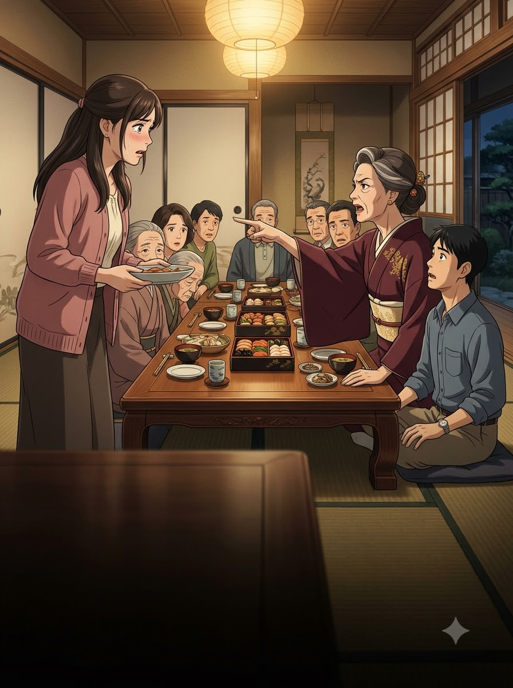
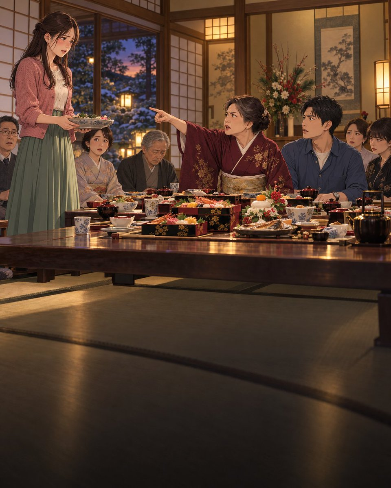

# 日式动画电影风：新年家宴上的婆媳冲突

- 原帖链接：https://x.com/ViralOps_/status/2114709909178810799
- 作者：ViralOps（@ViralOps_）
- 时间：2026-10-26 21:25 (UTC+8 / Asia/Shanghai)
- 互动摘要：点赞 27 · 转发 2 · 回复 2 · 引用 1 · 书签 11 · 浏览 5583（采集快照：2026-10-28 20:10 UTC+8）
- 模型/工具：Nano Banana 2.1 vs GPT Image 2.5（左 / 右）
- 标签：二次元
- 媒体路径：
  - `media/images/2114709909178810799_1.jpg`（）
  - `media/images/2114709909178810799_2.jpg`（）
- 入库日期：2026-10-28
- 备注：prompt 位于作者自回复：https://x.com/ViralOps_/status/2114709914316947837

## prompt 原文

```text
**STYLE AND VISUAL QUALITY**

Premium modern Japanese anime film style, cinematic 2D animation quality, beautifully detailed Japanese character designs, expressive faces, soft cel shading, delicate linework, painterly backgrounds, realistic fabric folds, natural skin tones, rich atmospheric lighting, and emotional visual storytelling.

The image should resemble a beautifully animated Japanese drama film, with warm cinematic lighting, rich colors, subtle depth of field, and emotionally powerful facial expressions. Avoid generic cartoon aesthetics, 3D rendering, or photorealism.

**CHARACTER DESCRIPTIONS — MAINTAIN THESE EXACT APPEARANCES**

**WIFE (Late 20s):**

A beautiful young Japanese woman, approximately 27 years old, with fair warm-toned skin, a delicate oval face, large expressive dark-brown eyes, straight dark eyebrows, a small natural nose, and soft feminine facial features.

She has long, silky, dark-brown hair reaching the middle of her back, styled with soft face-framing strands and a simple half-up hairstyle.

She wears an elegant, modest, dusty-rose pink knitted cardigan over a cream-colored blouse, paired with a flowing sage-green midi skirt.

Her appearance is graceful, gentle, and slightly delicate. Her large expressive eyes should communicate intense emotional pain, vulnerability, and quiet dignity.

**HUSBAND (Early 30s):**

A handsome Japanese man, approximately 32 years old, with fair-to-medium warm skin, short neatly styled black hair, dark-brown eyes, straight eyebrows, a clean-shaven face, and a defined but natural jawline.

He wears a slate-blue button-up shirt with a cream-colored undershirt, dark tailored trousers, and a simple silver wristwatch on his left wrist.

Average-to-tall height, lean-to-medium build, attractive but realistic anime facial proportions.

His personality should be reflected through subtle, emotionally expressive reactions.

**MOTHER-IN-LAW (Late 50s):**

A Japanese woman, approximately 58 years old, with fair-to-medium warm skin, a slightly rounded face, visible fine wrinkles around her eyes and mouth, sharp eyebrows, narrow expressive dark-brown eyes, and a stern, authoritative appearance.

Her dark hair, lightly streaked with gray, is neatly arranged in an elegant low bun.

She wears a sophisticated deep-maroon Japanese kimono with subtle gold floral embroidery, a cream-colored obi belt, and a traditional decorative hairpin.

Her posture and facial expressions communicate pride, authority, harsh judgment, and a controlling personality.

**SETTING — JAPANESE NEW YEAR FAMILY DINNER**

Inside a beautiful, cozy, traditional-modern Japanese family home during an Oshōgatsu (Japanese New Year) celebration in the evening.

A long, low polished wooden dining table dominates the tatami-mat room.

The table is covered with a generous Japanese New Year feast, including:

- Beautifully arranged osechi ryōri in traditional lacquered jubako boxes.
- Grilled fish served on ceramic plates.
- Ozōni soup in traditional bowls.
- Sushi and neatly arranged sashimi.
- Decorative mochi and traditional Japanese sweets.
- Elegant ceramic teacups and wooden chopsticks.

The room features authentic Japanese interior design: warm wooden beams, shoji paper sliding doors, tatami flooring, a decorative tokonoma alcove, a traditional flower arrangement, and soft hanging lanterns.

Through a partially open shoji door, a peaceful Japanese garden is faintly visible beneath the evening sky.

Warm golden interior lighting creates a beautiful festive atmosphere.

The peaceful New Year celebration contrasts sharply with the painful family confrontation unfolding around the table.

**MAIN SCENE — PUBLIC HUMILIATION AT THE FAMILY DINNER**

Capture a deeply emotional and dramatic moment at the exact instant a family celebration turns into a humiliating confrontation.

The mother-in-law sits at the head of the low Japanese dining table, leaning forward aggressively.

She points her index finger directly toward her daughter-in-law.

Her expression is harsh, mocking, and judgmental. Her mouth is slightly open as if she has just delivered a cruel, insulting remark in front of everyone.

The young wife stands beside the dining table, holding a beautiful ceramic serving platter with both hands.

She looks completely shocked and humiliated.

Her shoulders are tense, her lips slightly parted, and her large brown eyes are filled with tears she is desperately trying to hold back.

Her cheeks are faintly flushed with embarrassment.

Her expression communicates heartbreak, helplessness, and the unbearable pain of being publicly disrespected in front of her husband's entire family.

The husband sits on a floor cushion beside his mother.

He suddenly looks up with a frozen, stunned expression.

His body is tense, his eyes widened in disbelief, as though he cannot believe what his mother has just said to his wife.

Capture the precise moment before he decides whether to speak.

**SIX ADDITIONAL FAMILY MEMBERS**

Six adult Japanese relatives sit on floor cushions around the table.

The men wear a mixture of elegant casual shirts, sweaters, and traditional Japanese clothing.

The women wear tasteful modern outfits or subtle traditional kimono.

All six relatives have turned their attention toward the young wife.

Some look visibly shocked.

Others exchange uncomfortable glances.

One elderly relative lowers their eyes in embarrassment.

Another relative watches the confrontation with a judgmental expression.

Their reactions should amplify the wife's painful realization that everyone has witnessed her humiliation.

**EMOTIONAL VISUAL STORYTELLING**

The mother's aggressive pointing gesture, the wife's devastated expression, the husband's stunned reaction, and the relatives' uncomfortable stares must immediately communicate the entire conflict without any written dialogue.

The viewer should instantly understand:

A young Japanese wife has just been publicly insulted by her mother-in-law during an important family celebration, and everyone is waiting to see whether her husband will defend her.

**CAMERA AND COMPOSITION**

Portrait 4:5 aspect ratio.

Final resolution: 1080 × 1350 pixels.

Cinematic medium-wide shot at a natural eye-level camera angle, carefully framed to emphasize the emotional tension between the three main characters.

The composition should resemble a dramatic freeze-frame from a premium Japanese animated feature film.

**CRITICAL COMPOSITION RULE — TEXT OVERLAY SPACE**

The entire dramatic scene must occupy only the UPPER 55% of the image.

This includes:

- All important character faces.
- The mother-in-law's pointing gesture.
- The wife's shocked expression.
- The husband's frozen reaction.
- The relatives' uncomfortable stares.

The LOWER 45% of the image must remain a clean, darker, visually calm, uncluttered foreground.

Use the near section of the low wooden dining table, softly shadowed tatami flooring, and subtle atmospheric shadows to create this negative space.

Do not place important faces, hands, food plates, or distracting decorations in the lower 45%.

Create a natural transition from the detailed dramatic scene above into the quieter, darker foreground below.

The bottom area must be suitable for adding large, highly readable text overlays later.

**LIGHTING AND MOOD**

Warm golden Japanese lantern lighting.

Soft cinematic interior illumination.

Subtle shadows and atmospheric depth.

Beautiful highlights on expressive anime eyes.

Detailed painterly Japanese interiors.

Rich but natural color grading.

The emotional atmosphere should feel:

Heartbreaking, tense, humiliating, uncomfortable, dramatic, and deeply human.

The beautiful peaceful Japanese New Year setting should contrast strongly with the cruelty of the family confrontation.

**STRICT REQUIREMENTS**

- Generate ONE single cinematic anime illustration.
- Portrait 4:5 aspect ratio, 1080 × 1350 pixels.
- Premium Japanese animated film quality.
- Consistent character anatomy and natural body proportions.
- Beautiful expressive faces with accurate hands and fingers.
- All characters must have Japanese facial features and styling.
- The wife must wear her dusty-rose cardigan and sage-green skirt.
- The husband must wear his slate-blue shirt and silver wristwatch.
- The mother-in-law must wear her deep-maroon kimono with cream obi.
- Preserve the emotional intensity of the confrontation.
- Concentrate all important storytelling in the upper 55%.
- Reserve the lower 45% for future text overlays.
- No text.
- No letters.
- No speech bubbles.
- No subtitles.
- No captions.
- No logos.
- No borders.
- No watermarks.
- No 3D rendering.
- No CGI.
- No photorealism.
```

---

个人学习归档，非商业。prompt 与图片版权归原作者 @ViralOps_，引用请回到原帖。
