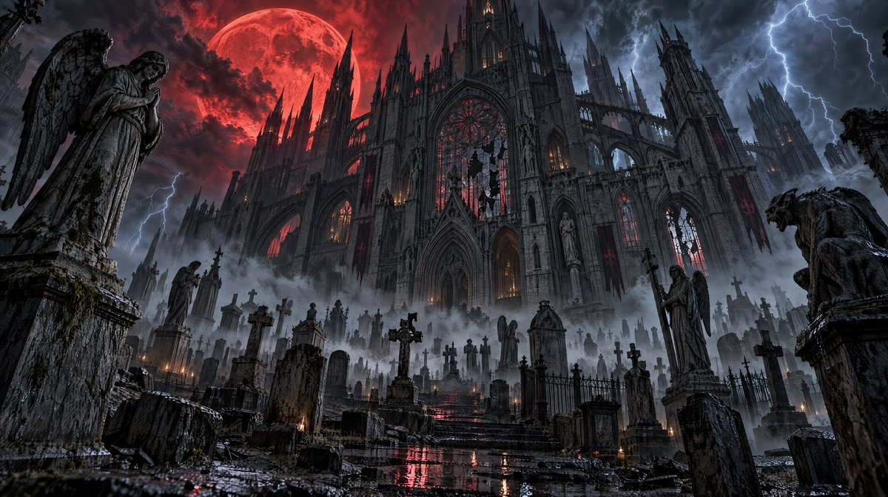

# 万圣节电影级场景 prompt 合集（7 条）

- 原帖链接：https://x.com/DJpowers69/status/2114913715355254786
- 作者：Jonathan DJ Powers（@DJpowers69）
- 时间：2026-10-27 10:54 (UTC+8 / Asia/Shanghai)
- 互动摘要：点赞 10 · 转发 1 · 回复 3 · 引用 0 · 书签 1 · 浏览 606（采集快照：2026-10-28 20:10 UTC+8）
- 模型/工具：Nano Banana 2.1、GPT Image 2.5 Sunburst；终章另有 Nano Banana Pro、Seedream 5.0 Pro
- 标签：其它
- 媒体路径：
  - `media/images/2114913715355254786_1.jpg`（）
- 入库日期：2026-10-28
- 备注：7 条 prompt 分别位于作者线程自回复中，按发布顺序原样拼接，以 --- 分隔。仅保存首帖配图（ALT：GPT Image 2.5 Sunburst, Max, 4K）。

## prompt 原文

```text
🏰 1. THE CATHEDRAL OF THE DAMNED

A blood-red moon, Gothic architecture and a graveyard swallowed by fog. Straight out of a $200 million horror movie.

Same prompt. Different engines. Which one nailed it?

🎨 FREE IMAGE PROMPT:

An impossibly colossal abandoned Gothic cathedral rises from a sprawling ancient cemetery beneath a gigantic blood-red moon. Razor-sharp spires pierce swirling black storm clouds. Hundreds of weathered gravestones and towering angel statues emerge from rolling cemetery fog. Lightning illuminates intricate stone gargoyles, shattered stained-glass windows, and centuries of architectural decay. Crimson moonlight bleeds through atmospheric mist while cold blue lightning creates dramatic color separation. Low-angle 20mm anamorphic cinematic composition, cathedral dominating the horizon. ARRI ALEXA 65 large-format optical realism, physically accurate global illumination, microscopic stone textures, wet reflective surfaces, volumetric lighting, deep dimensional shadows, extraordinary photorealism, Hollywood horror production design, 16:9.

---

🔥 2. THE HIGHWAY TO HELL

Ever wonder what the last exit before HELL looks like?

Molten lava, volcanic mountains and the road to nowhere.

Same prompt. Two completely different interpretations.

🎨 FREE IMAGE PROMPT:

An endless abandoned highway stretches straight into a terrifying apocalyptic landscape. Cracked black asphalt splits apart above rivers of glowing molten lava. Gigantic jagged obsidian mountains rise on either side, their silhouettes illuminated by a blazing crimson sky filled with volcanic ash, distant firestorms, and violent red lightning. Charred highway signs lean at impossible angles. Burning embers drift across the road. The highway disappears into a colossal circular opening in the storm clouds radiating ominous orange light. Ground-level cinematic road perspective, dramatic leading lines, immense atmospheric depth, realistic heat distortion, ultra-detailed asphalt, physically accurate fire illumination and volcanic smoke, large-format Hollywood cinematography, extreme micro-detail, 16:9.

---

🎃 3. THE CURSED PUMPKIN KINGDOM

Welcome to Halloween Town… if Halloween Town had an unlimited Hollywood budget.

Thousands of glowing jack-o’-lanterns, haunted mansions and a sinister castle.

🎨 FREE IMAGE PROMPT:

An enormous supernatural Halloween kingdom hidden inside a valley of twisted dead trees. Thousands of intricately carved jack-o’-lanterns illuminate winding cobblestone streets, crooked Victorian mansions, and a towering haunted castle in the distance. Giant pumpkins, some as large as houses, glow with sinister internal firelight. Purple ground fog drifts between ancient stone walls and rusted iron gates. A massive amber harvest moon hangs low behind black skeletal branches. Cinematic aerial three-quarter establishing perspective revealing extraordinary environmental scale. Rich burnt-orange, violet, midnight-blue, and black color palette. Realistic candlelight scattering, intricate pumpkin rind textures, authentic wet cobblestones, detailed architectural weathering, volumetric moonbeams, premium large-format photorealism, 16:9.

---

🎪 4. THE HAUNTED CARNIVAL

The carnival closed 90 years ago.

Somehow, the lights are still on.

Rusting Ferris wheels, abandoned rides, flickering bulbs and blood-red fog.

🎨 FREE IMAGE PROMPT:

A gigantic abandoned 1930s carnival stands in a deserted field under violent midnight storm clouds. A towering rust-covered Ferris wheel looms over broken carnival tents, a decaying carousel, abandoned ticket booths, and twisted amusement rides. Hundreds of antique incandescent carnival bulbs flicker erratically through dense ground-hugging crimson fog. Rain-soaked pavement reflects blood-red, sickly green, and electric purple illumination. Torn striped canvas flaps in the wind. A colossal dark circus tent dominates the background, its entrance glowing ominously from within. Cinematic ground-level ultra-wide establishing shot, symmetrical depth, realistic rain droplets, intricate rust and peeling paint textures, authentic aged machinery, dimensional volumetric lighting, extreme cinematic photorealism, 16:9.

---

🌲 5. THE FOREST OF THE FORGOTTEN

Some forests are better left unexplored.

Ancient twisted trees, forgotten statues and glowing eyes watching from the darkness. 👀

This one’s begging for a cinematic camera push through the fog.

🎨 FREE IMAGE PROMPT:

Deep inside an ancient supernatural forest, gigantic twisted black trees form a cathedral-like canopy hundreds of feet overhead. Their roots resemble massive skeletal fingers gripping the earth. A narrow muddy pathway vanishes into thick turquoise-blue fog. Countless faint glowing eyes peer from deep within the darkness between the trees. Abandoned stone statues are partially swallowed by moss and tangled roots. Pale silver moonbeams penetrate narrow openings in the canopy, revealing suspended mist, drifting spores, and fine particles. The environment feels impossibly ancient, threatening, and alive. Low eye-level cinematic composition with exceptional foreground-to-background depth, 24mm large-format lens, intricate bark and moss textures, realistic damp earth, atmospheric light scattering, deep organic shadows, absolute photorealism, 16:9.

---

💀 6. THE NECROPOLIS — CITY OF THE DEAD

An entire civilization built for the dead.

Millions of tombs beneath a crimson eclipse, ghostly green fog and a staircase leading somewhere nobody should go.

🎨 FREE IMAGE PROMPT:

An unimaginably vast ancient necropolis stretches across a dead valley beneath an enormous crimson eclipse. Millions of black stone tombs, towering mausoleums, skeletal Gothic monuments, and colossal funerary statues extend to the horizon. A monumental staircase carved into an obsidian mountainside leads to a gigantic sealed stone doorway surrounded by ancient skeletal carvings. Ghostly emerald-green mist pours through narrow streets between the tombs while crimson light illuminates the jagged skyline. Cinematic aerial establishing view emphasizing overwhelming architectural scale and eerie silence. Extraordinary stone craftsmanship, detailed erosion, realistic atmospheric perspective, layered volumetric fog, premium photorealistic dark-fantasy cinematography, 16:9.

---

🔥💀 7. THE GATES OF THE UNDERWORLD — GRAND FINALE!

FOUR AI IMAGE ENGINES. ONE EXACT PROMPT.

1️⃣ GPT Image 2.5 Sunburst
2️⃣ Nano Banana 2.1
3️⃣ Nano Banana Pro
4️⃣ Seedream 5.0 Pro

This is where things get REALLY interesting.

🎨 FREE IMAGE PROMPT:

Two impossibly gigantic ancient obsidian gates rise between towering volcanic cliffs at the edge of the underworld. The gates are intricately carved with colossal skulls, forgotten inscriptions, and weathered stone reliefs. Vast molten lava waterfalls pour down the surrounding cliffs into a glowing chasm. A narrow black stone bridge crosses the abyss toward the sealed gates. Violent orange firelight radiates through cracks between the enormous doors while atmospheric smoke rises into a dark crimson sky. Tiny distant ruins establish the overwhelming scale of the structure. Ultra-wide cinematic composition, physically accurate volcanic illumination, extreme surface micro-detail, dramatic atmospheric depth, massive volumetric smoke formations, extraordinary optical realism, Hollywood dark-fantasy epic, 16:9.

That’s the complete Halloween prompt drop! 🎃

All FREE to use. Steal a prompt, create something insane and show me what you make.

Now the big question:

WHICH ENGINE WON? 👇

#Halloween #AIArt #AIVideo #AICreators
```

---

个人学习归档，非商业。prompt 与图片版权归原作者 @DJpowers69，引用请回到原帖。
