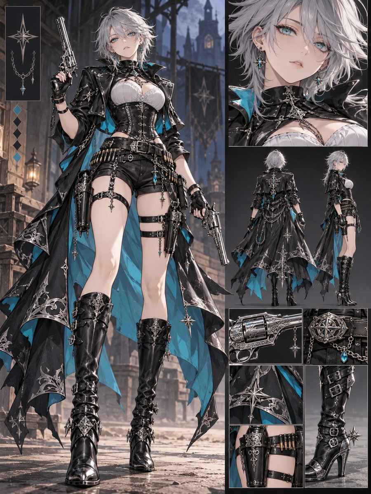
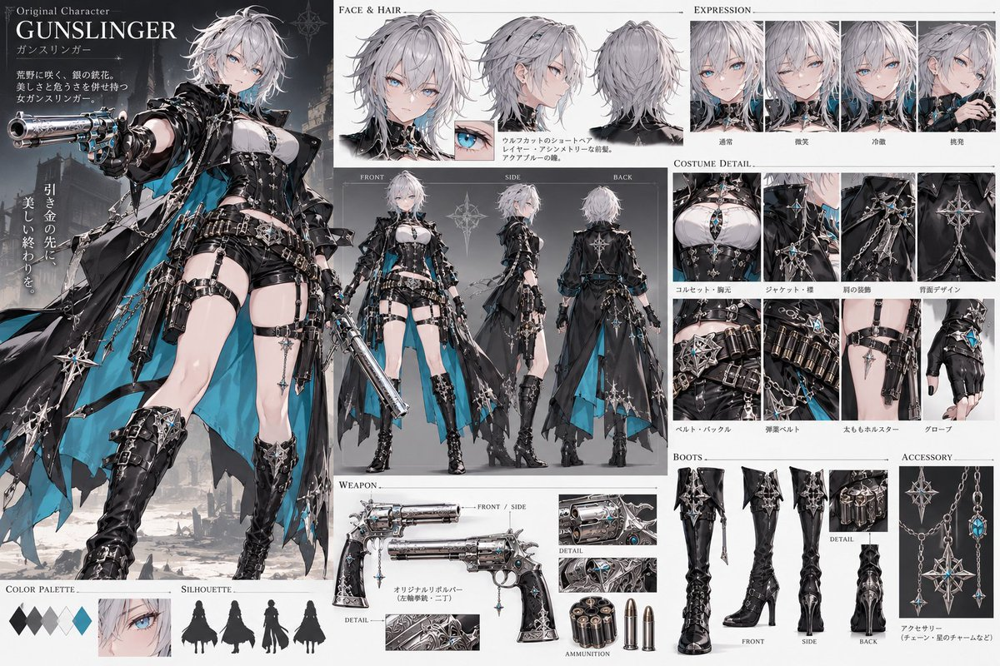
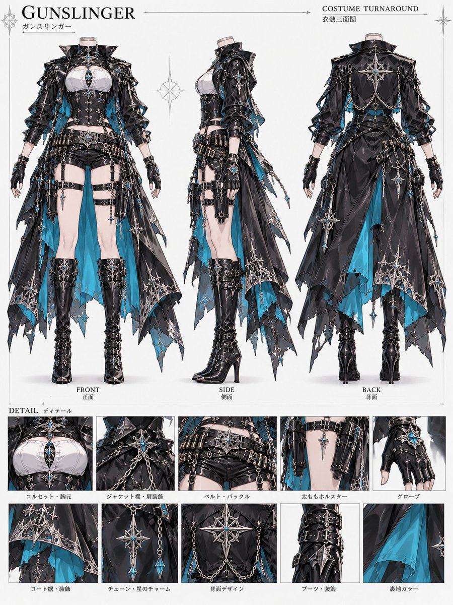

# 哥特西部枪手衣装（kk 衣装 prompt）

- 原帖链接：https://x.com/uRMS7Vm26qqEE5J/status/2115008729452253285
- 作者：k k（@uRMS7Vm26qqEE5J）
- 时间：2026-10-27 17:12 (UTC+8 / Asia/Shanghai)
- 互动摘要：点赞 162 · 转发 15 · 回复 1 · 引用 5 · 书签 66 · 浏览 3888（采集快照：2026-10-28 20:10 UTC+8）
- 模型/工具：未注明（日系 AI 插画）
- 标签：二次元
- 媒体路径：
  - `media/images/2115008729452253285_1.jpg`（）
  - `media/images/2115008729452253285_2.jpg`（）
  - `media/images/2115008729452253285_3.jpg`（）
- 入库日期：2026-10-28
- 备注：prompt 位于原帖正文末尾。

## prompt 原文

```text
original gothic western gunslinger outfit, black, charcoal gray, metallic silver and aqua blue color scheme, fitted black high-collar corset-style bodice with white chest panel, cropped black leather jacket, enormous flowing asymmetrical black long coat with aqua blue inner lining, silver star ornaments and decorative trim, multiple leather belts and ornate silver buckles, black fitted high-waisted leather shorts, double gun belts with ammunition cartridges, thigh holsters and garter straps, silver chains and dangling star charms, black fingerless gloves, tall black knee-high leather boots with silver armor details and buckles, dual ornate silver engraved revolvers, elegant dark fantasy western gunslinger aesthetic, clean Japanese anime lineart, crisp cel shading, dramatic rim lighting, fixed costume design, preserve exact silhouette, colors, coat, corset, belts, holsters, chains, boots and weapons
```

---

个人学习归档，非商业。prompt 与图片版权归原作者 @uRMS7Vm26qqEE5J，引用请回到原帖。
