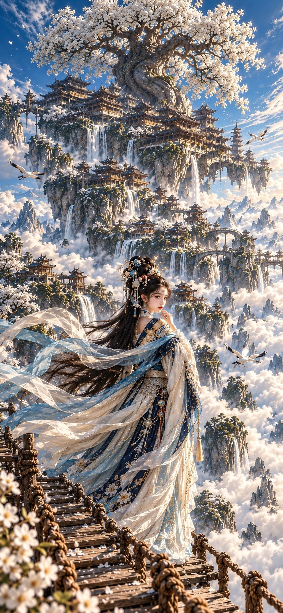
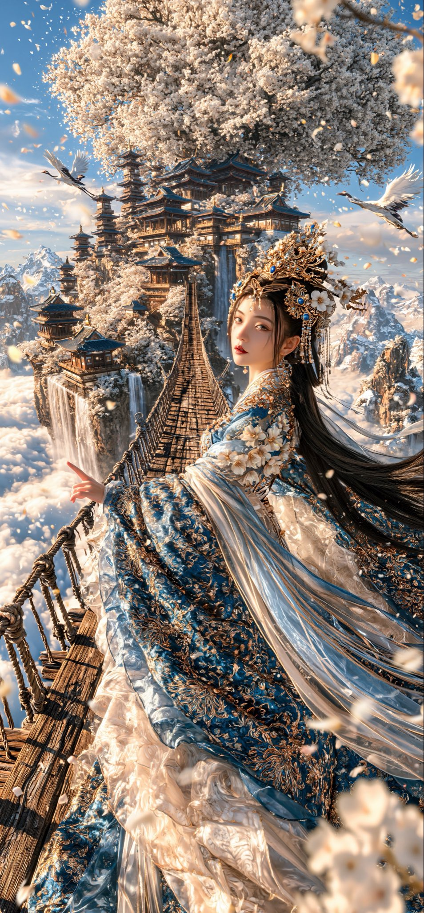

# 中式仙侠云海天宫：同一 prompt 对比 ChatGPT 与 Midjourney 8.2

- 原帖链接：https://x.com/liluocheng13/status/2114973154011709838
- 作者：Zidan 子丹（@liluocheng13）
- 时间：2026-10-27 14:51 (UTC+8 / Asia/Shanghai)
- 互动摘要：点赞 123 · 转发 20 · 回复 25 · 引用 1 · 书签 18 · 浏览 1968（采集快照：2026-10-29 09:12 UTC+8）
- 模型/工具：ChatGPT、Midjourney 8.2（同一 prompt 对比）
- 标签：真人
- 媒体路径：
  - `media/images/2114973154011709838_1.jpg`（）
  - `media/images/2114973154011709838_2.jpg`（）
- 入库日期：2026-10-29
- 备注：原帖未逐图注明哪张出自哪个模型，按文案顺序推测图 1 为 ChatGPT、图 2 为 Midjourney 8.2。标签按写实人像风格归为真人。

## prompt 原文

```text
Masterpiece of Chinese celestial fantasy fine art, monumental vertical composition. An exquisitely beautiful young Chinese celestial maiden standing on an ancient wooden suspension bridge above an endless ocean of clouds, elegant three-quarter pose, looking back with a delicate melancholic East Asian face, natural porcelain skin, dark eyes and crimson lips.

Elaborate imperial hairstyle adorned with golden ornaments, sapphire gemstones, pearls and ivory blossoms, extraordinarily long flowing black hair.

Magnificent sapphire-blue, ivory-white and champagne-gold hanfu, intricate gold embroidery, luxurious silk brocade, translucent flowing sleeves, gemstone accessories and dramatic cascading ribbons. Elegant anatomy, slender natural fingers.

Behind her, an immense heavenly palace complex suspended among colossal floating mountains, magnificent Tang Dynasty pavilions, intricate curved roofs, towering pagodas, ancient bridges and spectacular cascading waterfalls.

An enormous ancient flowering tree dominates the upper composition, gigantic twisted trunk, sprawling branches covered with thousands of ivory-white blossoms. Endless floating islands, distant temples, misty mountains and luminous clouds.

White cranes soaring through the sky, drifting flower petals, weathered wooden bridge with thick rope railings.

Epic architectural scale, extraordinary atmospheric depth, crystal-blue sky, warm golden sunlight, soft volumetric lighting. Sophisticated palette of sapphire blue, porcelain white, antique ivory and champagne gold.

Chinese classical landscape painting meets European Old Masters and cinematic fantasy photography. Photorealistic skin and silk, intricate architectural details, poetic oriental aesthetics, ultra-detailed, cinematic masterpiece.

No modern elements, no text, no watermark, no CGI appearance, no distorted anatomy.

Ratio 6:13
```

---

个人学习归档，非商业。prompt 与图片版权归原作者 @liluocheng13，引用请回到原帖。
