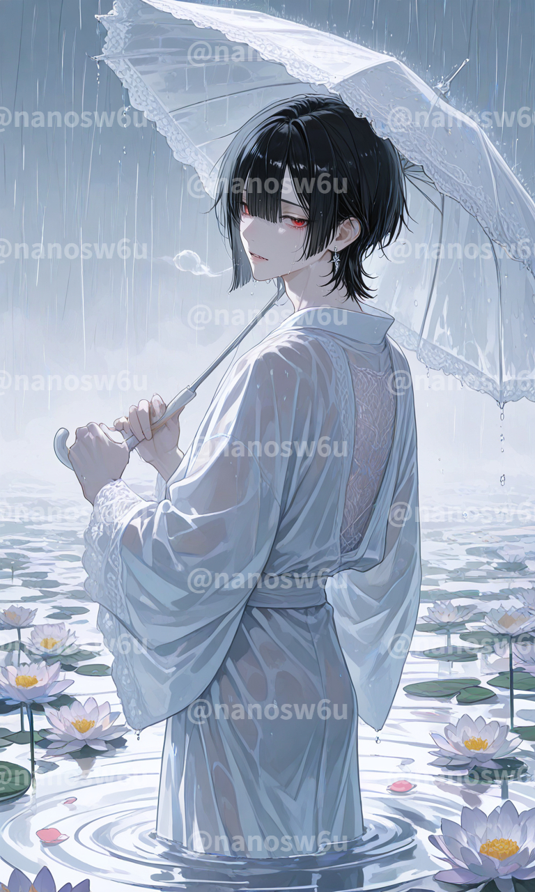
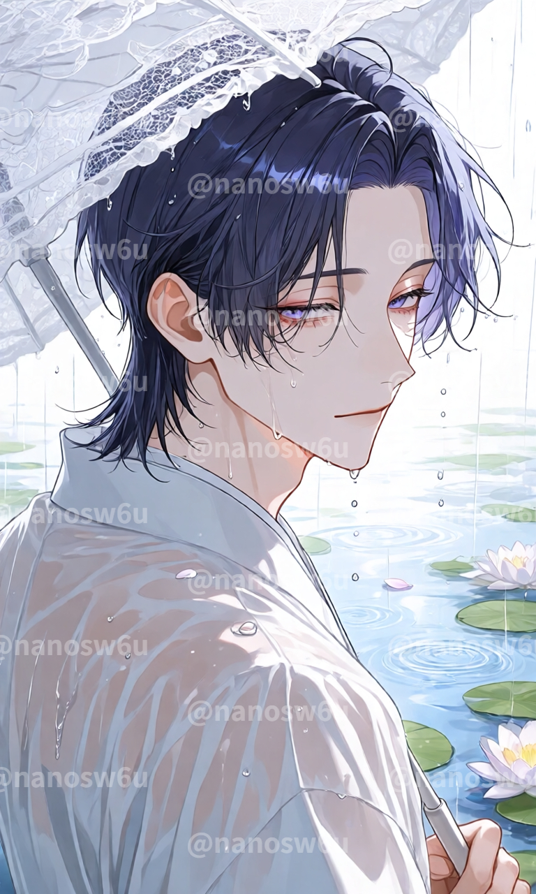
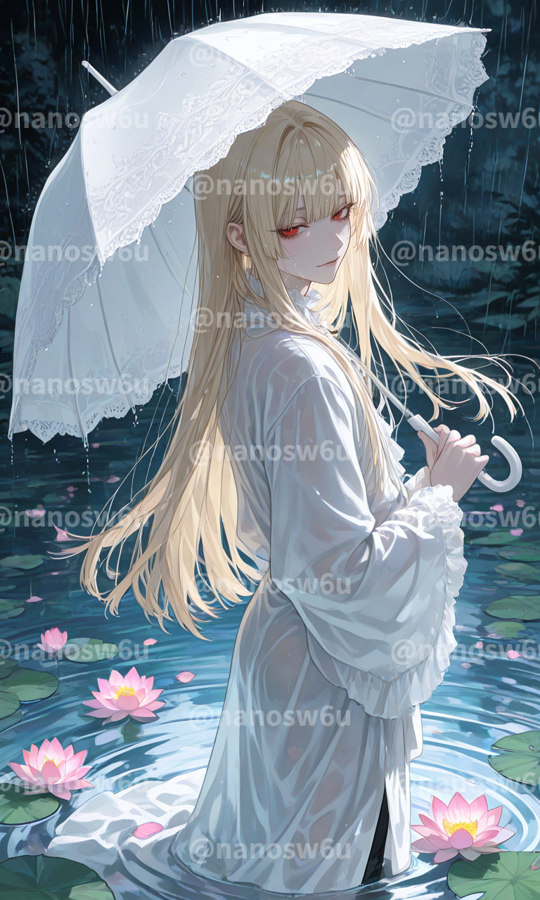
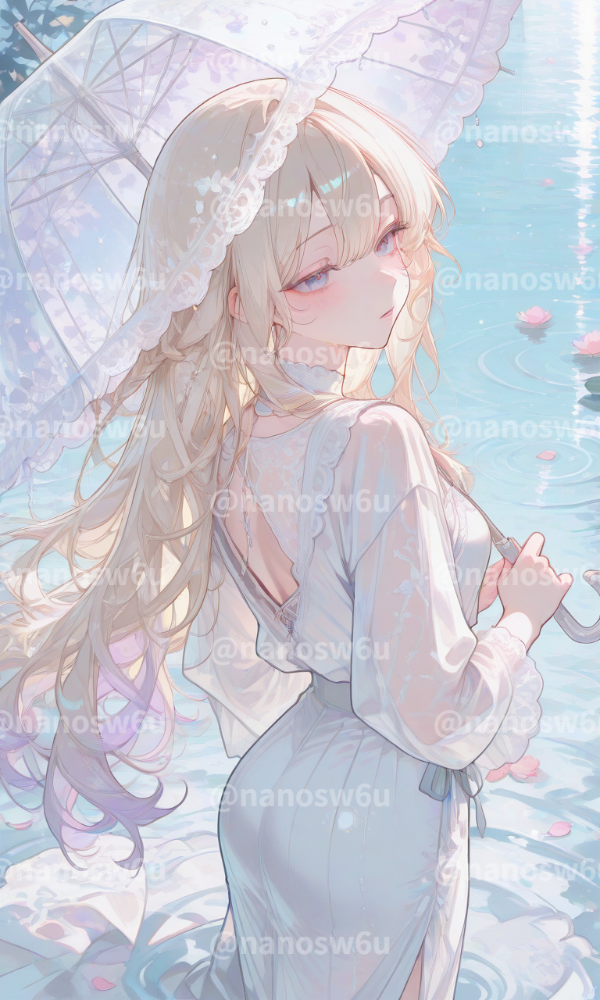

# 雨 × 睡蓮 × 傘：淡彩水彩风雨中回眸

- 原帖链接：https://x.com/nanosw6u/status/2114973299705040897
- 作者：nano（@nanosw6u）
- 时间：2026-10-27 14:51 (UTC+8 / Asia/Shanghai)
- 互动摘要：点赞 35 · 转发 2 · 回复 1 · 引用 3 · 书签 46 · 浏览 2435（采集快照：2026-10-29 09:12 UTC+8）
- 模型/工具：未注明
- 标签：二次元
- 媒体路径：
  - `media/images/2114973299705040897_1.jpg`（）
  - `media/images/2114973299705040897_2.jpg`（）
  - `media/images/2114973299705040897_3.jpg`（）
  - `media/images/2114973299705040897_4.jpg`（）
- 入库日期：2026-10-29
- 备注：prompt 位于作者自回复图片的 ALT：https://x.com/nanosw6u/status/2114973302888526220 ；作者说明服装可自由指定。

## prompt 原文

```text
雨が降る、濡れた髪、濡れた服
淡いイラストタッチ、透明感のある水彩風、柔らかなパステルカラー、低彩度、繊細な線画、柔らかな光、儚く幻想的な雰囲気。
静かな水辺に立つ人物、しとしとと降り続く雨、雨粒が空中を漂う、雨に濡れて束感のある髪、頬や首筋に張り付く濡れた毛束、雨水を含んでしっとりと濡れた衣服、生地に浮かぶ繊細な水滴。風に吹かれてなびく濡れた髪。繊細な白いレースの日傘、透け感のある精巧なレース模様、優雅なフリルの縁取り。片手で傘を持ち、身体は水辺の奥へ向け、顔だけをこちらへ振り返る、肩越しに振り返る自然なポーズ。
足もとの水面から幾重にも広がる同心円状の波紋、雨粒が水面に落ちて生まれる小さな波紋、雨に揺れる水面。水面に浮かぶ睡蓮の花と丸い葉、雨粒を受ける花びら。水面に揺らめく淡い反射、雨に霞む背景、白を基調とした淡い色彩、柔らかな陰影、空気感のある光、静謐で叙情的なワンシーン。
```

---

个人学习归档，非商业。prompt 与图片版权归原作者 @nanosw6u，引用请回到原帖。
