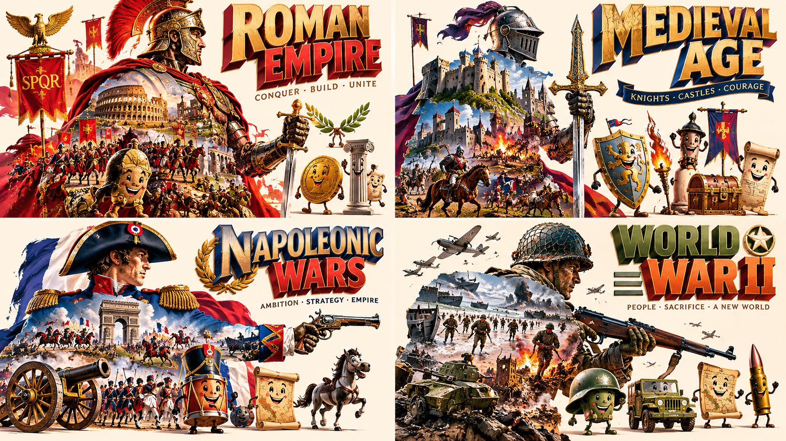

# SQL 式结构化 prompt：时代角色 + 实拍道具霓虹海报

- 原帖链接：https://x.com/Gdgtify/status/2115008601945497789
- 作者：Gadgetify（@Gdgtify）
- 时间：2026-10-27 17:12 (UTC+8 / Asia/Shanghai)
- 互动摘要：点赞 14 · 转发 1 · 回复 2 · 引用 0 · 书签 6 · 浏览 382（采集快照：2026-10-29 20:15 UTC+8）
- 模型/工具：GPT Image 2.5（原帖写作 “GPT 2.5”）
- 标签：其它
- 媒体路径：
  - `media/images/2115008601945497789_1.jpg`（）
- 入库日期：2026-10-29
- 备注：prompt 位于原帖正文 “GPT 2.5 Prompt:” 之后；作者认为适合儿童故事/绘本类画面。

## prompt 原文

```text
WITH input(era) AS (VALUES (:ERA)), spec AS (SELECT filled_character(era) ch, photoreal_artifact(era) ar, smiley_objects(era) ob,                 bold_3d_title(era) ty, neon_palette(era) pl FROM input) SELECT poster(character=>ch, artifact=>held(ar, count=>1), objects=>ob,               typography=>ty, palette=>pl, ground=>'cream', layout=>'dense') AS era_character_artifact FROM spec -- E₁: CHECK ( character filled with era scenes ) -- E₂: CHECK ( exactly one photoreal artifact, held by character ) -- E₃: CHECK ( 3-6 smiley anthropomorphized objects ) -- E₄: CHECK ( bold 3D title + taglines ) -- E₅: CHECK ( saturated neon on cream, dense )
```

---

个人学习归档，非商业。prompt 与图片版权归原作者 @Gdgtify，引用请回到原帖。
