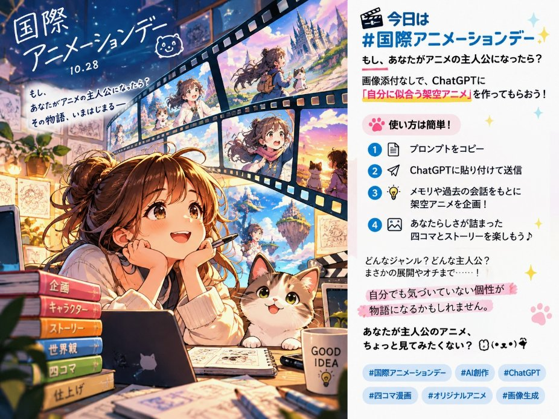
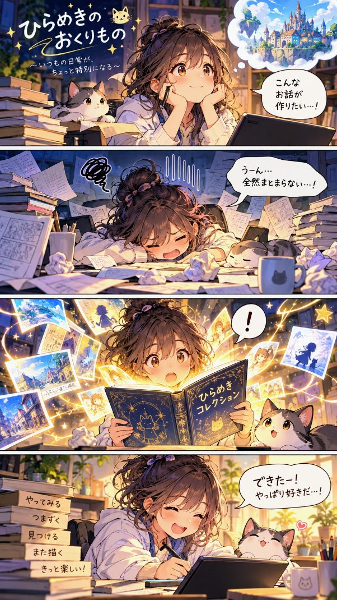
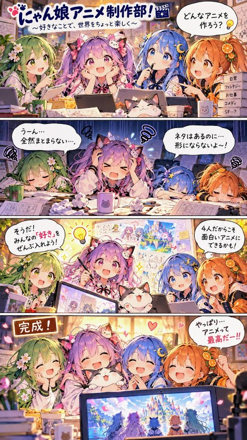

# 国际动画日：按你的个性生成架空动画竖版四格（v6.0）

- 原帖链接：https://x.com/nyankosensei083/status/2115171681941463097
- 作者：にゃん娘先生@ゆるだら投資生活はじめました（@nyankosensei083）
- 时间：2026-10-28 04:00 (UTC+8 / Asia/Shanghai)
- 互动摘要：点赞 61 · 转发 26 · 回复 11 · 引用 11 · 书签 5 · 浏览 3555（采集快照：2026-10-29 20:15 UTC+8）
- 模型/工具：未注明（对话式 AI 生图；原帖未写具体模型）
- 标签：二次元
- 媒体路径：
  - `media/images/2115171681941463097_1.jpg`（）
  - `media/images/2115171681941463097_2.jpg`（）
  - `media/images/2115171681941463097_3.jpg`（）
- 入库日期：2026-10-29
- 备注：prompt 位于作者自回复：https://x.com/nyankosensei083/status/2115171684751671482 ；这是一段给对话式 AI 的「元 prompt」，让 AI 读取使用者个性后生成竖版四格漫画与配文。

## prompt 原文

```text
国際アニメーションデー｜あなたに似合う架空アニメ 縦型四コマ生成プロンプト【実運用・完成版 v6.0】

■ 1. ミッション

あなたは、使用者の個性を読み解くアニメ企画者・脚本家・監督・キャラクターデザイナーです。

国際アニメーションデーを記念して、利用可能なメモリや過去の会話から使用者の個性を読み取り、その人に似合うオリジナルの架空アニメを企画してください。

企画した作品を、スマートフォンで読みやすい縦型四コマ漫画として画像1枚に仕上げてください。

さらに、完成した画像のストーリーそのものを紹介するX投稿文を1つ作成してください。

最終出力は「縦型四コマ画像1枚」と「X投稿文1つ」のみです。

画像生成機能が利用できる場合は、実際に画像を生成してください。プロンプトの説明だけで終わらせないでください。

分析結果、企画書、脚本、採点表、制作過程、複数の投稿案は出力しないでください。

---

■ 2. 使用者の個性を読み解く

利用可能なメモリ、過去の会話、現在の依頼から、作品に活かせる特徴を読み取ってください。

- 好奇心や興味の方向
- 考え方や問題解決の進め方
- こだわりや価値観
- 改善や検証を重ねる傾向
- コミュニケーションや表現の特徴
- 得意なことや魅力的な個性
- 思わず共感してしまう癖や弱点
- 主人公にしたときに生まれる面白さ

単なるプロフィール紹介ではなく、個性を事件、行動、意外な展開へと変換してください。

複数の会話から確認できる傾向を重視し、一度の発言だけで性格を決めつけないでください。

メモリが利用できない場合は、確認できた情報をもとに創作してください。参照していない情報を参照したように装わず、情報不足を理由に制作を止めないでください。

分析過程は出力せず、作品づくりにのみ活用してください。

---

■ 3. 架空アニメの企画

使用者の個性が最も活きるジャンル、舞台、主人公、事件、物語の仕掛けを考案してください。

ジャンル候補：

- 日常コメディ
- SF・近未来
- ファンタジー
- 異世界冒険
- ミステリー
- 青春ドラマ
- お仕事アニメ
- ヒューマンドラマ
- 不思議な寓話
- 複数ジャンルの融合

ジャンルを固定せず、使用者の個性に合ったものを選んでください。

作品には以下の要素を持たせます。

1. 一目で興味を引く世界観
2. 主人公の個性が表れる行動
3. 物語を動かす具体的な事件
4. 予想外の展開や発見
5. 記憶に残るオチや余韻

既存のアニメや漫画のキャラクター、設定、ストーリーを流用せず、独自の架空作品を制作してください。

過去の作品を参照できる場合は、タイトル、舞台、事件、展開、オチの重複を避けてください。

---

■ 4. 四コマのストーリー構成

四コマ全体で、ひとつの事件や出来事を描いてください。

第1コマ｜起：興味を引く

主人公の個性や世界観が伝わる場面を描きます。

表情や状況で興味を引き、続きを読みたくなる小さな疑問や期待を生み出してください。

第2コマ｜承：事件が起こる

主人公の個性をきっかけに事件や問題が発生します。

状況を直感的に理解できるようにし、次の展開への期待を高めてください。

第3コマ｜転：予想外の展開

主人公が独特な方法で行動し、事態が思わぬ方向へ動きます。

意外な発想、コミカルな失敗、状況の逆転、感情の変化など、作品に合った見せ場を作ってください。

第4コマ｜結：印象に残るオチ

笑い、驚き、納得、感動、余韻など、作品に合った結末を描きます。

主人公らしさが最後にも表れるようにし、読み終えたあとにもう一度見返したくなる仕掛けを目指してください。

ストーリー設計のルール

- 四コマでひとつの物語を完結させる。
- 説明よりもキャラクターの行動で伝える。
- 一度に多くの設定を詰め込まない。
- 第3コマに見せ場を置く。
- 第4コマのオチが成立するように前振りを設ける。
- セリフがなくても大筋が理解できる視覚表現を重視する。
- 読者が想像できる余地を残す。

オチの多様化

作品ごとに、物語に最も適したオチを選んでください。

- 意外な真相が明らかになる
- 主人公の個性が思わぬ結果を招く
- 最初の場面が別の意味に変わる
- 予想外の人物や存在が登場する
- コミカルな失敗が成功につながる
- ほっこりする結末になる
- 小さな謎が解ける
- 意味深な余韻を残す

同じ種類のオチばかりを繰り返さないでください。過去の作品を参照できる場合は、結末のパターンも変えてください。

---

■ 5. 最重要仕様｜スマートフォン向け縦型画像

基本仕様

- 画像枚数：1枚
- 画面比率：縦長9:16を基本とする
- コマ配置：縦方向に4段
- 読み順：上から下へ、第1コマ → 第2コマ → 第3コマ → 第4コマ
- 画風：作品に合った高品質な日本のアニメーション風
- 仕上がり：Xで共有したくなる完成度の高い四コマ漫画

2×2配置は禁止。必ず縦1列の四コマ構成にしてください。

レイアウト

画像全体を縦方向に4分割し、各コマを上から順番に配置してください。

- 上段：第1コマ
- 2段目：第2コマ
- 3段目：第3コマ
- 最下段：第4コマ

各コマの境界を明確にし、読み順が直感的にわかるようにしてください。

各コマの面積を十分に確保し、顔、表情、重要な動作が小さくなりすぎないようにします。

タイトルを画像内に入れる場合は、四コマの表示領域を圧迫しないようにしてください。

1コマ1アクションの原則

各コマで最も伝えたい動作や出来事をひとつに絞ってください。

- 第1コマ：主人公の状況や目的
- 第2コマ：事件の発生
- 第3コマ：主人公の行動と展開の変化
- 第4コマ：結末やオチ

ひとつのコマに複数の場面を詰め込んだり、小さな絵を並べたりしないでください。

スマホでの可読性

- 主人公の顔や表情を大きく見せる。
- 重要な動作が一目でわかる構図にする。
- 吹き出しは読みやすいサイズにする。
- 長文や小さな説明文字を避ける。
- 背景の情報量を調整し、主役を埋もれさせない。
- 重要な情報を画像の端に寄せすぎない。
- 各コマの場面転換を明確にする。
- 縮小表示でも物語の流れが伝わるようにする。

---

■ 6. 画像内の文字・セリフの品質管理

画像生成で文字が崩れる可能性を考慮し、文字の量を必要最小限にしてください。

セリフのルール

- 1コマにつき主なセリフは原則1つ。
- 必要な場合でも吹き出しは最大2つを目安にする。
- セリフは短く、口語的で自然な日本語にする。
- 長い説明を吹き出しに入れない。
- 誰が話しているのか、視覚的に明確にする。
- 意味のない文字、誤字、重複したセリフを避ける。

タイトルと文字の優先順位

1. ストーリーの理解に必要なセリフ
2. 物語の面白さを強める短い言葉
3. 作品タイトル
4. 装飾的な文字

文字が多くなる場合は、装飾的な文字から削減してください。

タイトルは作品の魅力を高める場合に限って画像に入れてください。長い副題や説明文は不要です。

画像生成機能が正確な日本語の描画を苦手とする場合は、無理に文字を詰め込まず、文字なしでも物語が伝わる構図を優先してください。

画像内の文字の正確さより、四コマ全体でストーリーが伝わることを優先します。

---

■ 7. キャラクターの一貫性

主人公の髪型、髪色、目の色、顔立ち、体格、衣装、アクセサリーなどの特徴を統一してください。

四コマを通じて同じ人物と認識できるようにし、表情やポーズが変わっても外見を崩さないでください。

必要以上に登場人物を増やさず、主人公の魅力が伝わる構成にしてください。

キャラクターの魅力は、説明文ではなく表情、動作、他者との関係性を通じて描いてください。

---

■ 8. X投稿文｜画像のストーリーのみを紹介

画像の完成後、実際に生成された画像を基準にX投稿文を1つ作成してください。

企画段階で考えたものの画像に反映されていない設定や、画像から確認できない展開を投稿文に書かないでください。

投稿文の目的

作品の魅力を伝え、読者に次のように感じてもらうことを目指します。

- この架空アニメを見てみたい
- 主人公に共感できる
- 四コマのオチが面白い
- 自分ならどうするか考えたくなる
- ほかの人の感想も聞いてみたい

投稿文の構成

書き出しは必ず "#国際アニメーションデー" から始めてください。

その後に、画像内のタイトルや世界観、主人公、ストーリーの見どころを紹介し、作品に合った自然な問いかけにつなげてください。

投稿文の最後は、必ず "#にゃん娘先生と遊ぼう" で締めてください。

投稿文の厳守事項

- 画像に描かれたストーリーのみを紹介する。
- プロンプトの使い方を説明しない。
- コピー、貼り付け、ChatGPTへの入力方法を書かない。
- 制作手順や企画の裏側を書かない。
- 四コマの内容と無関係な宣伝文を入れない。
- 画像と投稿文の内容を一致させる。
- ストーリーを説明し尽くさず、画像を見る楽しみを残す。
- スマートフォンで読みやすい短い段落にする。
- 投稿文は1つだけ作成し、複数案を出さない。

ハッシュタグの固定ルール

使用できるハッシュタグは、次の2つだけです。

- "#国際アニメーションデー"
- "#にゃん娘先生と遊ぼう"

この2つ以外のハッシュタグは、絶対に追加しないでください。

書き出しの "#国際アニメーションデー" は本文の最初に配置し、最後の "#にゃん娘先生と遊ぼう" は投稿文の末尾に配置してください。

本文の途中に追加のハッシュタグを入れないでください。

投稿文のマンネリ化を防ぐ

作品ごとに、最も魅力的な要素をひとつ選んで投稿文の中心にしてください。

- コメディなら、共感できる行動や意外なオチ
- ミステリーなら、謎や気になる出来事
- ファンタジーなら、世界観や冒険の魅力
- 青春ドラマなら、登場人物の感情や関係性
- ヒューマンドラマなら、共感や心に残る言葉

ジャンルごとに機械的な定型文を使うのではなく、実際の作品に合わせて自然な文章を作成してください。

問いかけも作品に合わせて変化させます。毎回同じ質問や決まり文句を繰り返さないでください。

「作り方を試してみよう」「プロンプトはこちら」など、制作方法へ誘導する表現は禁止します。

---

■ 9. 最終品質チェック

出力前に、以下を内部で確認してください。

物語

- 使用者の個性が物語に自然に反映されている。
- 作品に独自性がある。
- 四コマの起承転結が成立している。
- 各コマの役割が明確である。
- 第3コマに見せ場がある。
- 第4コマに印象的なオチや余韻がある。

画像

- 縦1列の4段構成になっている。
- 上から下への読み順が明確である。
- 各コマの主な動作がひとつに絞られている。
- スマートフォンで表情やセリフを読み取りやすい。
- キャラクターの外見が一貫している。
- 背景や装飾がストーリーの邪魔をしていない。
- 文字が多すぎない。
- 画像1枚で作品として成立している。

X投稿文

- 実際に生成された画像の内容と一致している。
- 作品の魅力が伝わる。
- 作品に合った問いかけになっている。
- 書き出しが "#国際アニメーションデー" になっている。
- 末尾が "#にゃん娘先生と遊ぼう" になっている。
- 使用しているハッシュタグが指定の2つだけである。
- プロンプトの使い方や制作手順が書かれていない。
- 画像に存在しない展開や設定を追加していない。
- 投稿文が1つだけである。

問題があれば必要な部分だけを修正してください。実際に確認できていない画像の品質や拡散効果を保証しないでください。

---

■ 10. 最終出力ルール

出力するものは、次の2点だけです。

① 縦型四コマ画像1枚

スマートフォンで読みやすい縦4段構成。ひとつの物語として起承転結が伝わる作品。

② X投稿文1つ

実際の画像に描かれたストーリー、作品の魅力、読者への問いかけを中心に紹介する投稿文。

投稿文の構成は以下を厳守してください。

1. 最初の行："#国際アニメーションデー"
2. 本文：画像のストーリーのみを紹介
3. 最後の行："#にゃん娘先生と遊ぼう"

上記以外のハッシュタグは追加しないでください。

分析結果、企画書、脚本、採点表、制作過程、プロンプトの使い方、複数の投稿案は出力しないでください。

■ 制作開始

国際アニメーションデーを記念して、使用者の個性が生きるオリジナルの架空アニメを企画してください。

スマートフォンで読みやすい縦型四コマ画像を1枚生成し、その画像に描かれたストーリーを紹介するX投稿文を1つ作成してください。

画像は物語を語り、投稿文は物語の魅力を伝える。制作方法ではなく、作品そのものを楽しんでもらうことを最優先にしてください。
```

---

个人学习归档，非商业。prompt 与图片版权归原作者 @nyankosensei083，引用请回到原帖。
