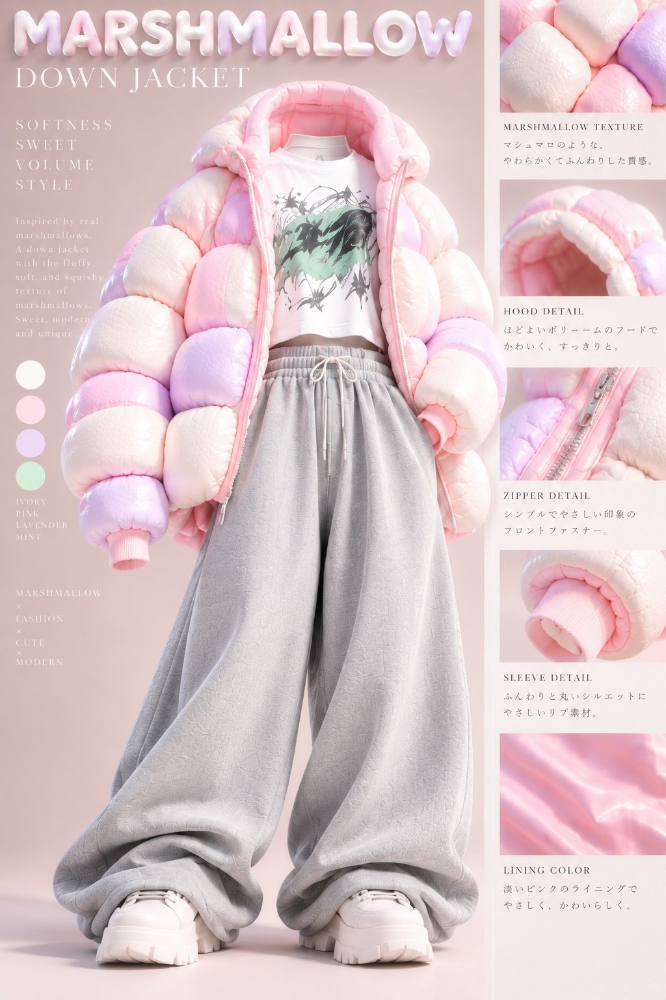
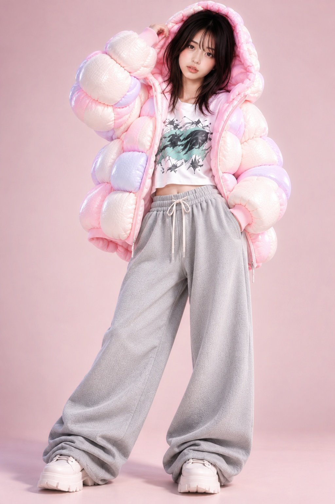
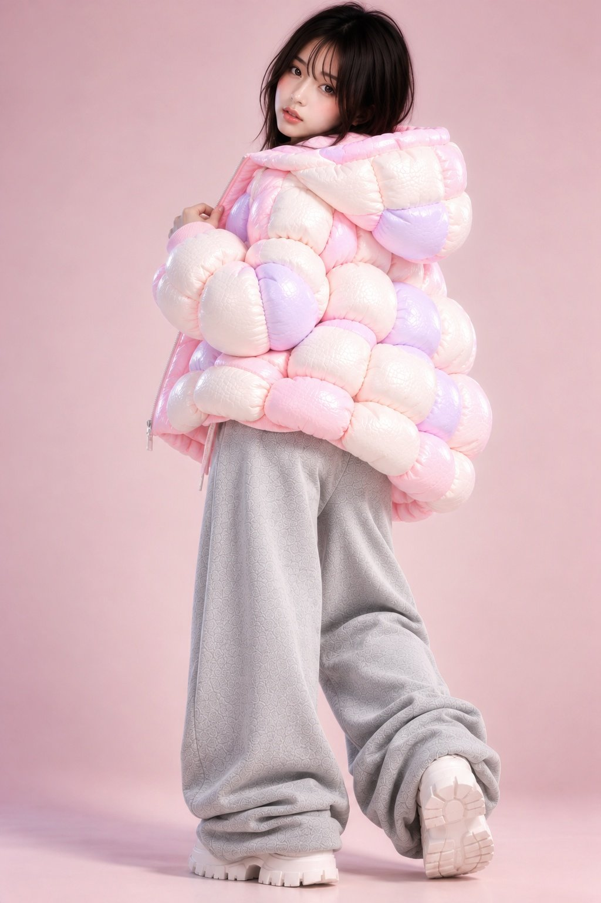
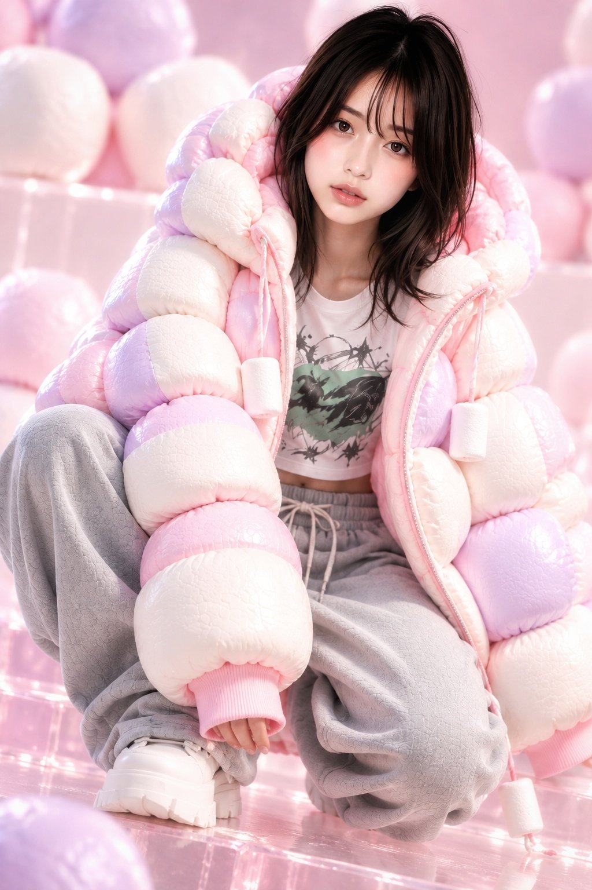

# Outfit Prompt Series FILE 21：棉花糖 × 羽绒服街头穿搭

- 原帖链接：https://x.com/haku_Degozaimas/status/2115299476470669338
- 作者：白桜 (Hakura)（@haku_Degozaimas）
- 时间：2026-10-28 12:27 (UTC+8 / Asia/Shanghai)
- 互动摘要：点赞 61 · 转发 5 · 回复 5 · 引用 1 · 书签 3 · 浏览 2529（采集快照：2026-10-29 09:12 UTC+8）
- 模型/工具：未注明
- 标签：真人
- 媒体路径：
  - `media/images/2115299476470669338_1.jpg`（）
  - `media/images/2115299476470669338_2.jpg`（）
  - `media/images/2115299476470669338_3.jpg`（）
  - `media/images/2115299476470669338_4.jpg`（）
- 入库日期：2026-10-29
- 备注：prompt 位于作者自回复：https://x.com/haku_Degozaimas/status/2115300010451448034 ；只描述服装，人物与场景未在 prompt 中指定。

## prompt 原文

```text
MARSHMALLOW × DOWN JACKET 
STREET STYLE

マシュマロの柔らかさとストリートファッションを融合させた、可愛らしく個性的な冬のファッションコーディネート。

【ダウンジャケット】

本物のマシュマロを積み重ねたような、立体的でボリュームのあるオーバーサイズのダウンジャケット。

アイボリーホワイトを基調に、淡いパステルピンクとラベンダーパープルを組み合わせた優しい配色。アイボリー約60％、ピンク約25％、ラベンダー約15％。

一つひとつの膨らみは、角が丸く、軽く押しつぶされたマシュマロのような形状。柔らかな弾力、繊細な表面のシワ、滑らかでマットな質感を持つ。

フードは丸みのある適度なボリュームで、内側は淡いピンク色。フロントはピンクの縁取りが施されたシルバーファスナー仕様で、前を開けて着用する。

袖はふっくらとした立体構造で、袖口には淡いピンクのリブニットを使用。裾は自然な丸みを持つオーバーサイズシルエット。

吊り下げ装飾、リボン、チャームなどは付けない。

【グラフィックTシャツ】

ホワイトをベースにした、やや短めのクロップド丈Tシャツ。

胸元にはブラック、ダークグレー、くすんだミントグリーンを組み合わせた、大胆な抽象アートグラフィック。

勢いのあるブラシストローク、流れるような曲線、不規則な線画、インクが飛び散ったような表現を重ねたアーティスティックなデザイン。

可愛らしいダウンジャケットと対照的な、クールで都会的なストリートアートの雰囲気。

大きな文字ロゴ、マシュマロのイラスト、ハート柄、キャラクター柄は使用しない。

【ワイドスウェットパンツ】

ライトグレーの極太オーバーサイズスウェットパンツ。

柔らかく厚みのあるスウェット生地を使用し、ゆったりとしたワイドシルエット。

ウエストはゴム仕様で、同色の長いドローストリング付き。

腰から裾までたっぷりとした布量があり、自然なドレープと柔らかなシワを形成する。

裾は足元にゆったりとたまり、スニーカーの上に重なるルーズなスタイル。

大きなカーゴポケットや過剰な装飾は付けない。

【スニーカー】

アイボリーホワイトのボリュームソールスニーカー。

厚みのある立体的なソール、丸みのあるつま先、ホワイトのシューレース。

シンプルでありながら存在感のある、現代的なストリートデザイン。

【全体のスタイル】

ふわふわで甘いパステルカラーのマシュマロダウンと、クールな抽象アートTシャツ、ルーズなグレースウェットパンツを組み合わせた、可愛らしさと格好良さが共存するストリートファッション。

柔らかな立体感、異素材のコントラスト、ゆったりしたシルエットを重視する。
```

---

个人学习归档，非商业。prompt 与图片版权归原作者 @haku_Degozaimas，引用请回到原帖。
