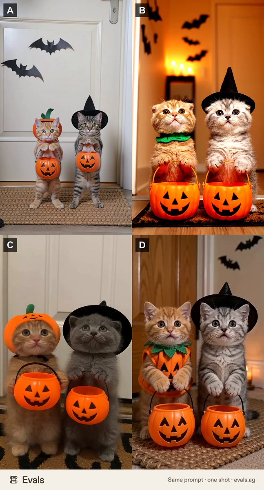

# 同一万圣节 prompt 跑 4 个视频模型：小猫讨糖“背叛”

- 原帖链接：https://x.com/maker_evan/status/2115347985991455217
- 作者：chacha（@maker_evan）
- 时间：2026-10-28 15:40 (UTC+8 / Asia/Shanghai)
- 互动摘要：点赞 8 · 转发 0 · 回复 8 · 引用 0 · 书签 2 · 浏览 244（采集快照：2026-10-29 20:15 UTC+8）
- 模型/工具：Kling 3.0 Pro、Veo 3.1、Seedance 2.5、Seedance 2.0 Fast（A–D 对照）
- 标签：其它
- 媒体路径：
  - `media/video-stills/2115347985991455217_1.jpg`（视频截图，视频文件不入库，仅保留原帖链接）（）
- 入库日期：2026-10-29
- 备注：视频帖；prompt 位于作者自回复：https://x.com/maker_evan/status/2115347987882987755 ；A–D 对应模型见 https://x.com/maker_evan/status/2115347989627916685

## prompt 原文

```text
"Make a 10-second vertical (9:16) video. Halloween night, a cozy candle-lit apartment hallway with paper bats on the walls. Two tiny kittens stand on their hind legs on a doormat: one in a little pumpkin costume, one wearing a tiny witch hat. Each holds a mini jack-o'-lantern candy bucket. The door opens and a hand drops a big pile of candy into the pumpkin kitten's bucket, but only one single candy into the witch kitten's bucket. The witch kitten looks down at it, stares into the camera in total betrayal, then slowly paws a candy out of its sibling's bucket. Photoreal, warm soft lighting, handheld phone feel, no text. It should feel adorable the moment it starts."
```

---

个人学习归档，非商业。prompt 与视频/截图版权归原作者 @maker_evan，引用请回到原帖。
