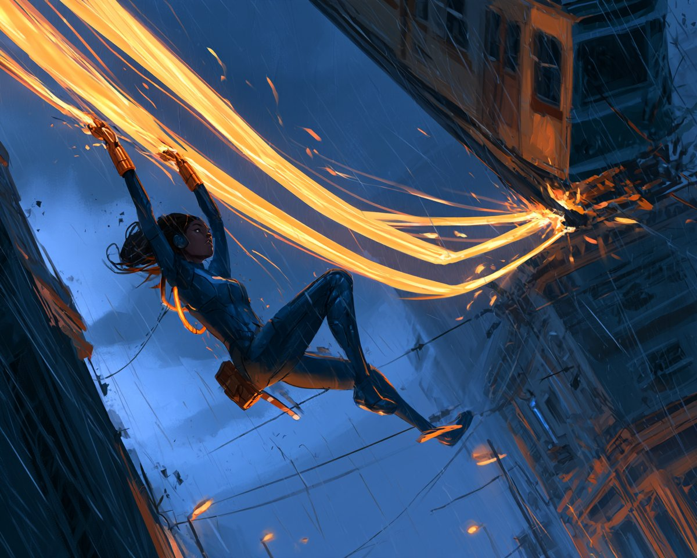

# 原创女超人凌空接住坠落电车（图像小说绘画风）

- 原帖链接：https://x.com/tisch_eins/status/2115549169376956883
- 作者：TischEins（@tisch_eins）
- 时间：2026-10-29 05:00 (UTC+8 / Asia/Shanghai)
- 互动摘要：点赞 14 · 转发 2 · 回复 1 · 引用 0 · 书签 2 · 浏览 372（采集快照：2026-10-29 20:15 UTC+8）
- 模型/工具：Midjourney v8.2
- 标签：其它
- 媒体路径：
  - `media/images/2115549169376956883_1.jpg`（）
- 入库日期：2026-10-29
- 备注：prompt 位于原帖正文 “Prompt:” 之后（原帖末尾话题标签未计入）。

## prompt 原文

```text
An original adult female superhero aged 30 in a fitted functional cobalt protective suit with copper gauntlets and no emblem, suspended diagonally between two rain-soaked city towers while catching a falling suspended tram with two broad luminous amber energy ribbons extending from her gauntlets, both arms straining upward, one bent knee and one extended leg forming a coherent dynamic rescue pose, tram tilted above and to the right with taut energy ribbons visibly connecting to its undercarriage, clear negative space behind her complete silhouette, tiny streetlights far below, storm-blue evening sky and restrained warm sparks at the connection points, low-angle wide action composition with convincing foreshortening and anatomy, cinematic graphic novel painting, no injury, no lettering or watermark --v 8.2 --ar 5:4
```

---

个人学习归档，非商业。prompt 与图片版权归原作者 @tisch_eins，引用请回到原帖。
