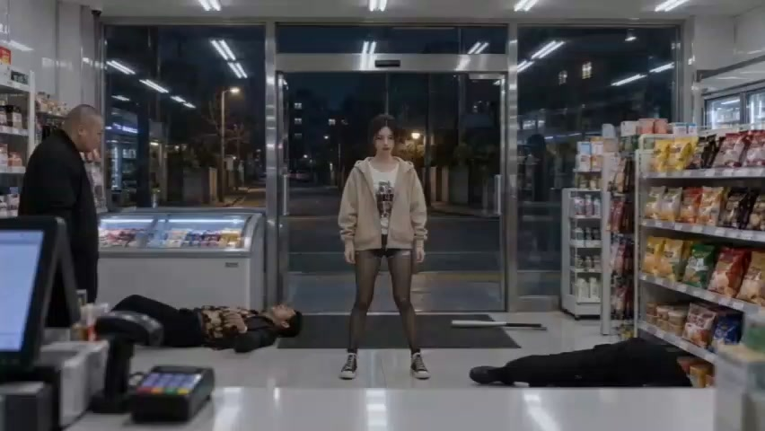
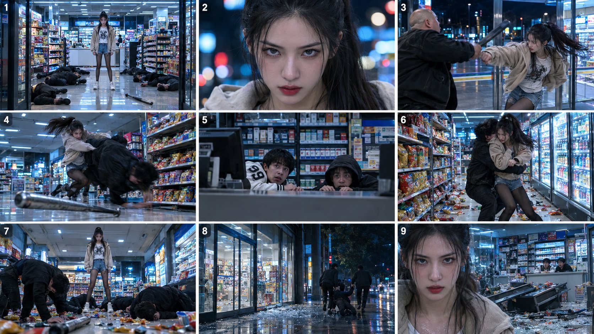

# Seedance 2.5 韩剧风便利店打斗分镜（7 个镜头）

- 原帖链接：https://x.com/ItsMaryamAi/status/2115620531949183253
- 作者：Maryam（@ItsMaryamAi）
- 时间：2026-10-29 09:43 (UTC+8 / Asia/Shanghai)
- 互动摘要：点赞 57 · 转发 7 · 回复 17 · 引用 0 · 书签 22 · 浏览 2880（采集快照：2026-10-29 20:15 UTC+8）
- 模型/工具：Seedance 2.5
- 标签：真人
- 媒体路径：
  - `media/video-stills/2115620531949183253_1.jpg`（视频截图，视频文件不入库，仅保留原帖链接）（）
  - `media/images/2115620531949183253_1.jpg`（）
- 入库日期：2026-10-29
- 备注：视频帖；prompt 位于作者自回复：https://x.com/ItsMaryamAi/status/2115620938981200202 （自回复附带一张分镜拼图，已存为图片）

## prompt 原文

```text
Cinematic live-action Korean-drama style fight sequence, shot at night inside a bright, fluorescent-lit 24-hour convenience store with glass front doors, snack aisles, glowing drink fridges and a checkout counter. A young woman with long dark hair tied in a ponytail, wearing a beige oversized hoodie over a graphic print white t-shirt, denim shorts and black tights, stands alone in the center of the store entrance, calm and confident, surrounded by several men in black clothes holding metal baseball bats.
Shot 1: Wide symmetrical shot of her standing still as thugs lie groaning on the floor around her, a bat rolling on the glossy tiles.
Shot 2: Extreme close-up of her face, cold intense stare, red lips, soft bokeh city lights behind her.
Shot 3: Fast handheld action. She dodges a bat swing, counters with punches, throws a bulky bald thug to the floor, and fights between the snack aisles. Chips and snacks scatter everywhere, shelves shake.
Shot 4: Low-angle shot of a bat clattering on the shiny floor. Two young male cashiers (one in a white varsity jacket with the number 99, one in a dark hoodie) peek terrified from behind the counter.
Shot 5: A thug grabs her from behind in front of the fridges. She breaks free and takes him down.
Shot 6: Final wide shot. All the thugs are knocked out or kneeling on the debris-covered floor while she stands tall in the doorway. Exterior shot of the remaining men dragging their friend away on the empty night street.
Shot 7: Close-up of her serious, slightly breathless face, then a final wide shot of the wrecked store with broken glass, fallen shelves and the two cashiers staring at her in shock.
Style: realistic, moody cool-blue and cyan night tones with warm shelf colors, high contrast, shallow depth of field, dynamic handheld camera with quick cuts, slow-motion on key hits, 24fps, film grain, 4K, no text, no watermark.
Audio: impact sounds, bat clatter, falling snacks, fluorescent hum, tense low drone music
```

---

个人学习归档，非商业。prompt 与视频/截图版权归原作者 @ItsMaryamAi，引用请回到原帖。
