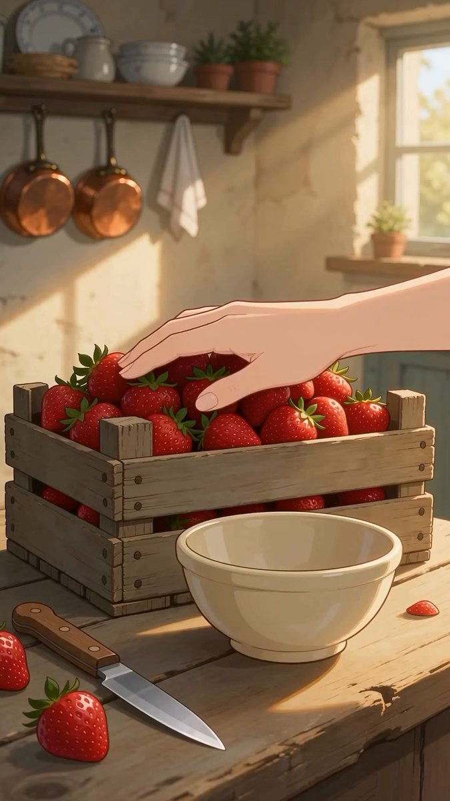

# Ghibli 风自制草莓酱动画

- 原帖链接：https://x.com/JohnSmith5912/status/2114886198745592113
- 作者：John Smith Ai（@JohnSmith5912）
- 时间：2026-10-27 09:05 (UTC+8 / Asia/Shanghai)
- 互动摘要：点赞 28 · 转发 10 · 回复 8 · 引用 0 · 书签 6 · 浏览 1648（采集快照：2026-10-30 09:15 UTC+8）
- 模型/工具：未注明（动漫风视频；Ghibli aesthetic）
- 标签：二次元
- 媒体路径：
  - `media/video-stills/2114886198745592113_1.jpg`（视频截图，视频文件不入库，仅保留原帖链接）（）
- 入库日期：2026-10-30
- 备注：视频帖；prompt 位于原帖正文。

## prompt 原文

```text
Prompt:
Cozy anime-style animation of making homemade strawberry jam in a rustic country kitchen. A person picks fresh strawberries from a wooden crate, slices them on a cutting board, and adds them to a copper pot with sugar and freshly squeezed lemon juice. The mixture simmers and bubbles on the stove before being poured into a glass jar and sealed with a cloth lid tied with string. Finally, a golden flaky croissant is broken open and generously filled with the rich, glossy homemade strawberry jam. Studio Ghibli aesthetic, warm sunlight, soft lighting, relaxing ASMR food preparation, 4k resolution.
```

---

个人学习归档，非商业。prompt 与视频/截图版权归原作者 @JohnSmith5912，引用请回到原帖。
