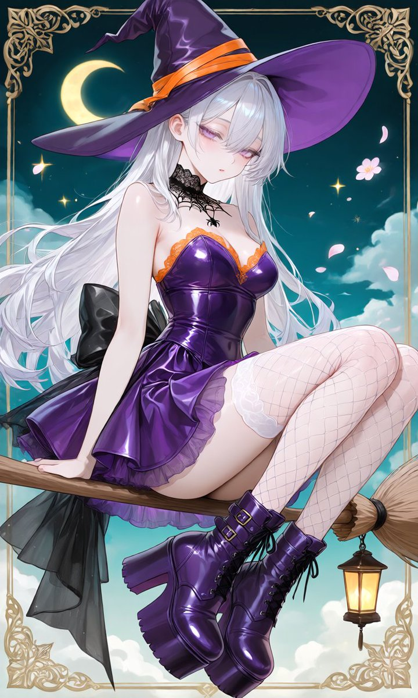
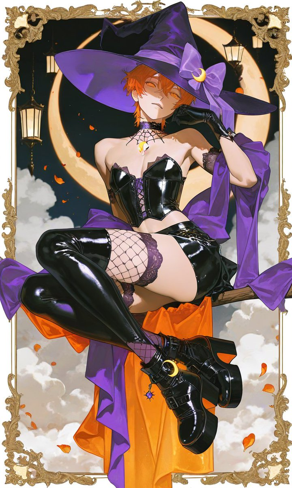
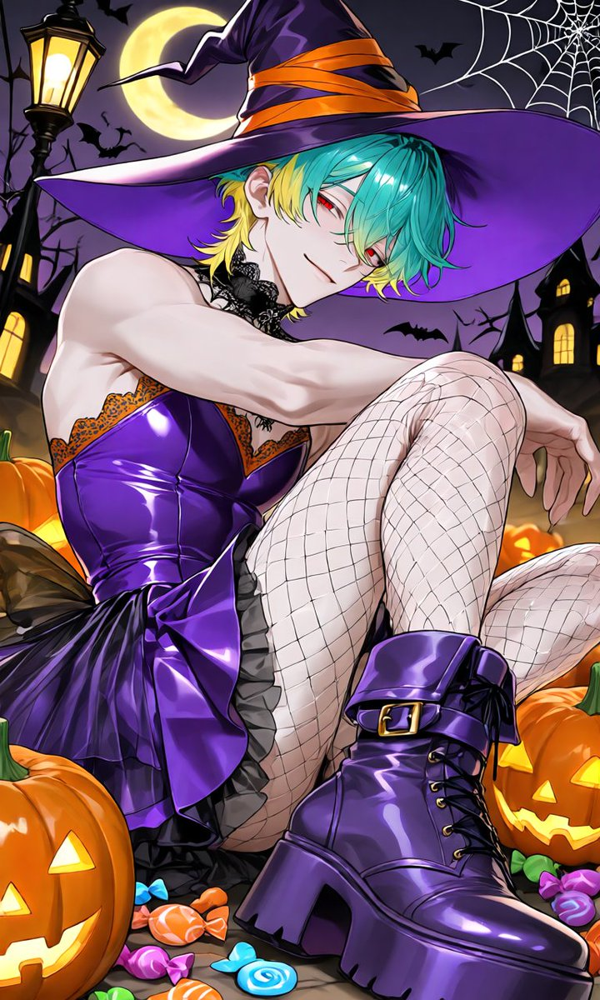
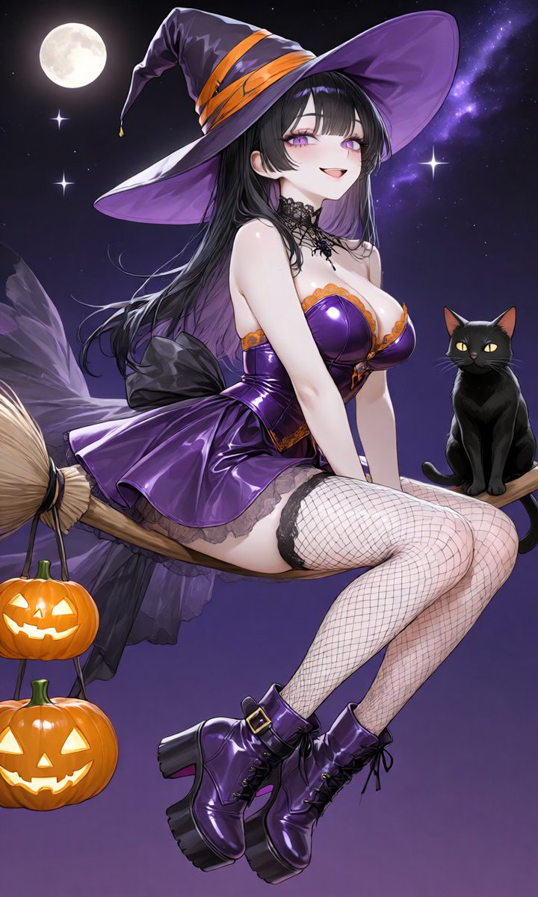

# 万圣节魔女衣装 3 模式

- 原帖链接：https://x.com/yumey4183/status/2115543547906785502
- 作者：腰痛(とりむね)（@yumey4183）
- 时间：2026-10-29 04:37 (UTC+8 / Asia/Shanghai)
- 互动摘要：点赞 14 · 转发 3 · 回复 2 · 引用 0 · 书签 9 · 浏览 656（采集快照：2026-10-30 09:15 UTC+8）
- 模型/工具：未注明（日系 AI 插画 / NovelAI 类）
- 标签：二次元
- 媒体路径：
  - `media/images/2115543547906785502_1.jpg`（）
  - `media/images/2115543547906785502_2.jpg`（）
  - `media/images/2115543547906785502_3.jpg`（）
  - `media/images/2115543547906785502_4.jpg`（）
- 入库日期：2026-10-30
- 备注：三模式 prompt 分别位于作者自回复：① https://x.com/yumey4183/status/2115543589816254560 ；② https://x.com/yumey4183/status/2115543629058228722 ；③ https://x.com/yumey4183/status/2115543669998801202

## prompt 原文

```text
### パターン①

〖パターン①〗
❤︎︎→性別(boy / girl 等)
❤→好みの色を指定してね
上から順に⬇の色です◎

・魔女帽子の本体（ハット生地）
・魔女帽子に巻きついているリボン
・蜘蛛の巣チョーカー
・ビスチェ（エナメル/レザー地）
・ビスチェのレース縁取り
・スカート（エナメル/レザー地）
・背中のオーガンジーリボン
・網タイツ
・超厚底プラットフォームブーツ
・ブーツのベルト・バックル金具

Anime style illustration, (1girl:1.2), focused strictly on the intricate outfit, full body portrait shot with legs fully visible. The character wears a cute sexy witch costume set. On the head is a tall wide-brimmed witch hat made of (❤ fabric:1.2), wrapped with a decorative (hat ribbon in ❤ color:1.2). Around the neck is a gothic lace (spider-web choker in ❤ color:1.2) with a small spider pendant. The upper body features a glossy (patent leather strapless bustier in ❤ color:1.2) trimmed with delicate (lace edges in ❤ color:1.2), with clear invisible shoulder straps. Around the waist is a flared (patent leather miniskirt in ❤ color:1.2) with a sheer tulle layer underneath. On the back of the waist is a oversized (sheer organza bow ribbon in ❤ color:1.2). The legs are covered in a full pair of (fishnet stockings in ❤ color:1.2). On the feet are heavy goth-style (ankle-length platform boots in ❤ leather:1.2) featuring folded boot covers, an extreme chunky sole, and (buckled ankle straps in ❤ color:1.2). Background is completely omitted, focusing purely on the intricate details and design of the clothing.

full body, floating pose, straddling a wooden broomstick in mid-air, side-sitting posture, legs bent and dangling, resting one hand on broomstick, turning upper body to face viewer, looking at viewer.
Background features a dark teal night sky with a yellow crescent moon, glowing stars, floating white clouds, falling flower petals, and glowing hanging lanterns. Decorative ornate square frame border, high quality, highly detailed.

### パターン②

〖パターン②〗
❤︎︎→性別(boy / girl 等)
❤→好みの色を指定してね
上から順に⬇の色です◎

・魔女帽子の本体（ハット生地）
・魔女帽子に巻きついているリボン
・蜘蛛の巣チョーカー
・ビスチェ（エナメル/レザー地）
・ビスチェのレース縁取り
・スカート（エナメル/レザー地）
・背中のオーガンジーリボン
・網タイツ
・超厚底プラットフォームブーツ
・ブーツのベルト・バックル金具

Anime style illustration, (1girl:1.2), focused strictly on the intricate outfit, full body portrait shot with legs fully visible. The character wears a cute sexy witch costume set. On the head is a tall wide-brimmed witch hat made of (❤ fabric:1.2), wrapped with a decorative (hat ribbon in ❤ color:1.2). Around the neck is a gothic lace (spider-web choker in ❤ color:1.2) with a small spider pendant. The upper body features a glossy (patent leather strapless bustier in ❤ color:1.2) trimmed with delicate (lace edges in ❤ color:1.2), with clear invisible shoulder straps. Around the waist is a flared (patent leather miniskirt in ❤ color:1.2) with a sheer tulle layer underneath. On the back of the waist is a oversized (sheer organza bow ribbon in ❤ color:1.2). The legs are covered in a full pair of (fishnet stockings in ❤ color:1.2). On the feet are heavy goth-style (ankle-length platform boots in ❤ leather:1.2) featuring folded boot covers, an extreme chunky sole, and (buckled ankle straps in ❤ color:1.2). Background is completely omitted, focusing purely on the intricate details and design of the clothing.

full body, pulled-back view, slightly distant shot, front view, sitting on floor, sitting pose with one knee pulled up to chest and other leg bent, leaning forward slightly, resting hands near knees, head tilted, looking directly at viewer, background of a spooky halloween night, vibrant jack-o-lantern pumpkins scattered around in foreground, colorful candies and sweets scattered on the floor, old gothic witch castle in background, glowing yellow crescent moon, dark purple night sky, flying bats in sky, spider webs stretched across background, glowing antique street lamps, halloween art style, vibrant contrast lighting, highly detailed

### パターン③

〖パターン③〗
❤︎︎→性別(boy / girl 等)
❤→好みの色を指定してね
上から順に⬇の色です◎

・魔女帽子の本体（ハット生地）
・魔女帽子に巻きついているリボン
・蜘蛛の巣チョーカー
・ビスチェ（エナメル/レザー地）
・ビスチェのレース縁取り
・スカート（エナメル/レザー地）
・背中のオーガンジーリボン
・網タイツ
・超厚底プラットフォームブーツ
・ブーツのベルト・バックル金具

・夜空、天の川、満月、星等の背景全体のカラーテーマ
例: deepBlue、deeppurple 等

Anime style illustration, (1girl:1.2), focused strictly on the intricate outfit, full body portrait shot with legs fully visible. The character wears a cute sexy witch costume set. On the head is a tall wide-brimmed witch hat made of (❤ fabric:1.2), wrapped with a decorative (hat ribbon in ❤ color:1.2). Around the neck is a gothic lace (spider-web choker in ❤ color:1.2) with a small spider pendant. The upper body features a glossy (patent leather strapless bustier in ❤ color:1.2) trimmed with delicate (lace edges in ❤ color:1.2), with clear invisible shoulder straps. Around the waist is a flared (patent leather miniskirt in ❤ color:1.2) with a sheer tulle layer underneath. On the back of the waist is a oversized (sheer organza bow ribbon in ❤ color:1.2). The legs are covered in a full pair of (fishnet stockings in ❤ color:1.2). On the feet are heavy goth-style (ankle-length platform boots in ❤ leather:1.2) featuring folded boot covers, an extreme chunky sole, and (buckled ankle straps in ❤ color:1.2). Background is completely omitted, focusing purely on the intricate details and design of the clothing.

full body, side view, floating in mid-air, straddling pose, side-sitting posture on a wooden broomstick, legs bent and dangling, resting one hand on broomstick, turning upper body to face viewer, cheerful smile, looking directly at viewer. A black cat is sitting near the tip of the broomstick. A small lit jack-o-lantern basket is hanging from the front tip of the broomstick. 

Background of a ❤ dark night sky featuring a glowing full moon, bright shining stars, and a beautiful Milky Way galaxy, highly detailed, high quality
```

---

个人学习归档，非商业。prompt 与图片版权归原作者 @yumey4183，引用请回到原帖。
