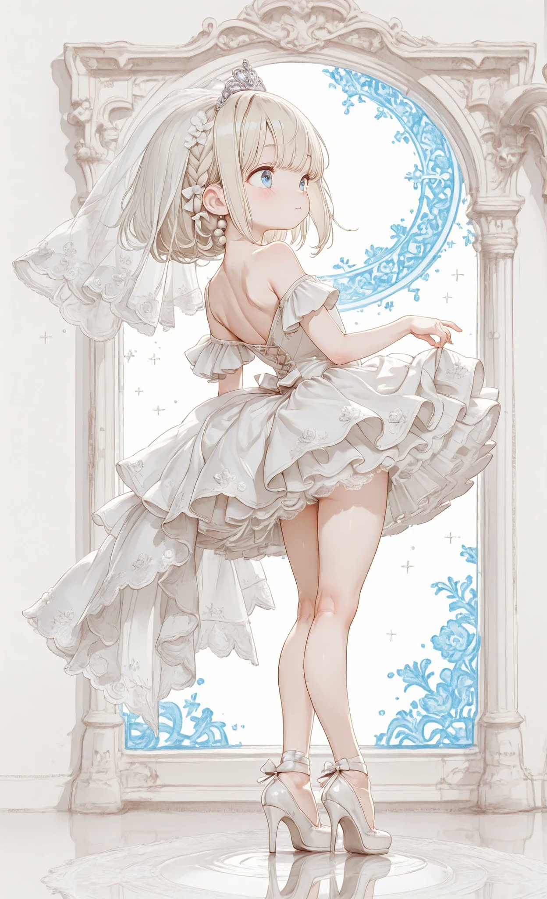
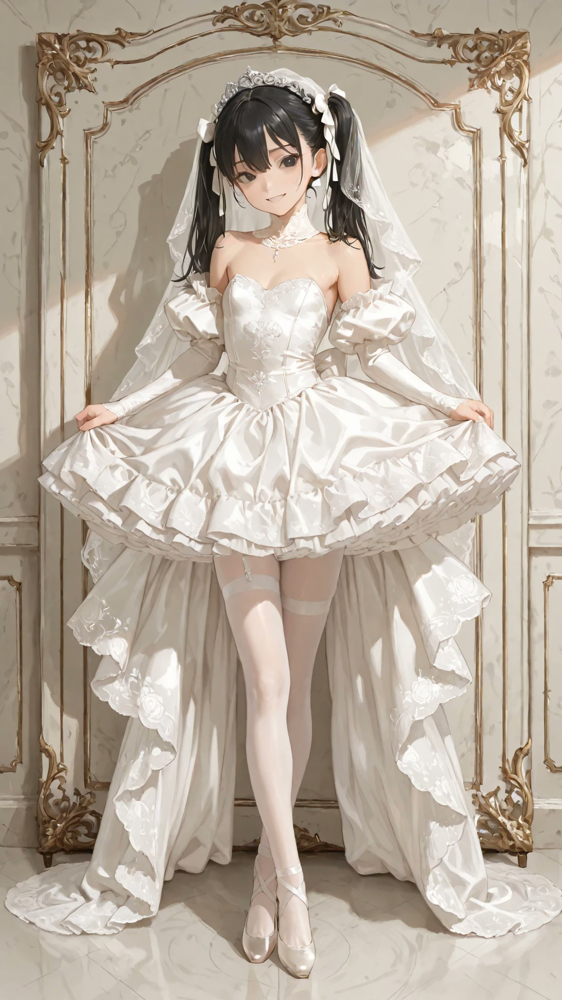
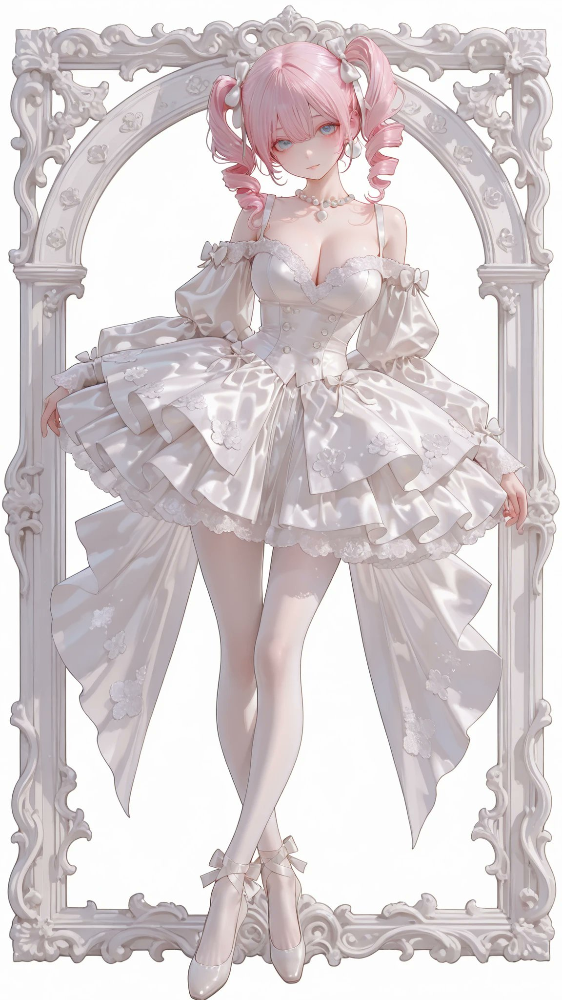

# 白缎芭蕾 tutu 婚纱与足尖鞋（衣装 prompt）

- 原帖链接：https://x.com/AliceLavli/status/2115639760471638177
- 作者：アリス服飾店（@AliceLavli）
- 时间：2026-10-29 11:00 (UTC+8 / Asia/Shanghai)
- 互动摘要：点赞 238 · 转发 37 · 回复 4 · 引用 18 · 书签 61 · 浏览 6489（采集快照：2026-10-30 20:15 UTC+8）
- 模型/工具：未注明（通用；作者写可用于 SD / SeaArt / PixAI / ChatGPT / Gemini / Grok / Midjourney / niji）
- 标签：二次元
- 媒体路径：
  - `media/images/2115639760471638177_1.jpg`（）
  - `media/images/2115639760471638177_2.jpg`（）
  - `media/images/2115639760471638177_3.jpg`（）
  - `media/images/2115639760471638177_4.jpg`（）
- 入库日期：2026-10-30
- 备注：prompt 位于原帖正文（note_tweet）。

## prompt 原文

```text
white tutu style wedding dress with white satin pointe shoes, fitted white satin bodice with sweetheart neckline and delicate white lace off shoulder straps, curved bodice panels with fine vertical seams and subtle floral embroidery, small pearl beads sewn along neckline, structured white satin waistband with small flat bow at back, short classical ballet tutu skirt projecting outward from waist, densely layered white tulle forming a broad circular silhouette, fine white floral lace appliques scattered around tutu edge, softly scalloped lace trimming upper tulle layer, narrow white satin underskirt beneath layered tutu, concealed back fastening with small covered white buttons, white satin pointe shoes with reinforced square toe boxes and flat platforms, fitted satin uppers with low rounded vamps and neatly stitched side seams, narrow white satin ribbons crossed around ankles and tied into small bows, slim white elastic straps across insteps, pale ivory suede soles beneath pointe shoes
```

---

个人学习归档，非商业。prompt 与媒体版权归原作者 @AliceLavli，引用请回到原帖。
