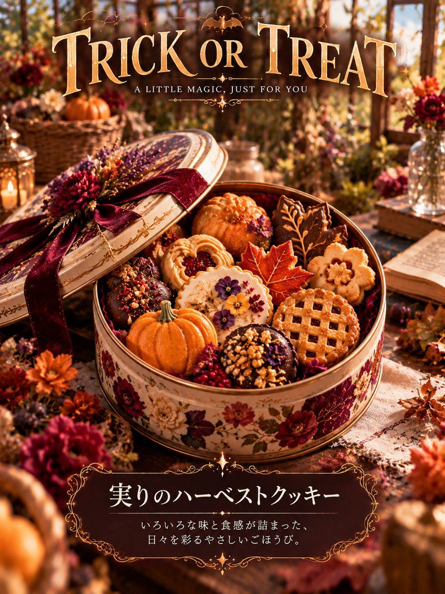
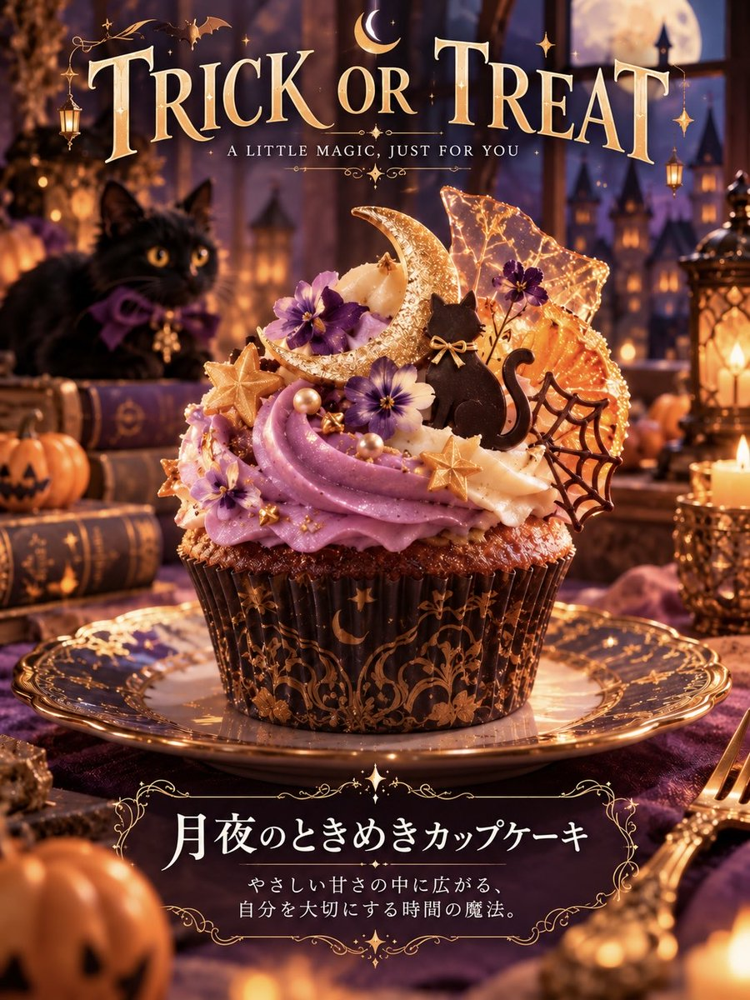
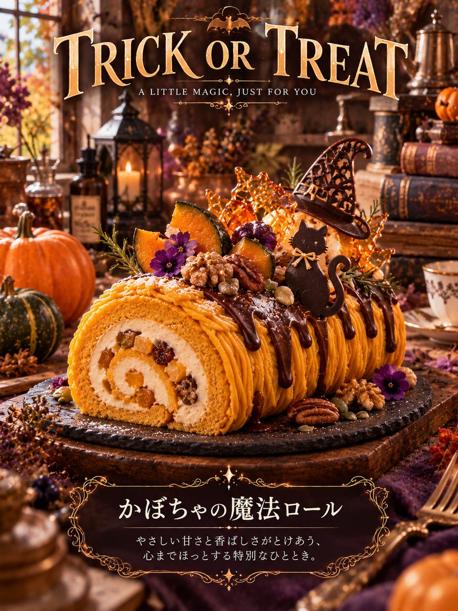
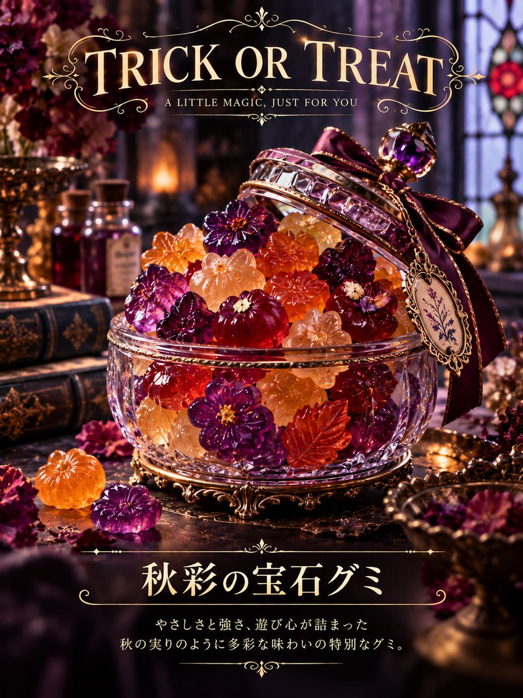

# ChatGPT 人物分析型万圣节糖果图

- 原帖链接：https://x.com/_a5_s_/status/2115745476737659338
- 作者：A5（@_a5_s_）
- 时间：2026-10-29 18:00 (UTC+8 / Asia/Shanghai)
- 互动摘要：点赞 86 · 转发 10 · 回复 3 · 引用 30 · 书签 55 · 浏览 7542（采集快照：2026-10-30 09:15 UTC+8）
- 模型/工具：ChatGPT（图像生成）
- 标签：其它
- 媒体路径：
  - `media/images/2115745476737659338_1.jpg`（）
  - `media/images/2115745476737659338_2.jpg`（）
  - `media/images/2115745476737659338_3.jpg`（）
  - `media/images/2115745476737659338_4.jpg`（）
- 入库日期：2026-10-30
- 备注：prompt 位于作者自回复：https://x.com/_a5_s_/status/2115781155639472130

## prompt 原文

```text
【人物分析型・オリジナル画像生成｜あなたをイメージしたハロウィンのお菓子】

このプロンプトを受信したら、追加確認や分析結果の提示をせず、直ちに「ユーザー理解→お菓子の選定→人物×ハロウィンの融合→デザイン設計→最終確認→画像生成」まで自動で実行し、完成した画像を1枚生成する。

【Concept】
ユーザー本人を深く理解し、その人をイメージしたハロウィンのお菓子を1種類だけ選び、本人らしさとハロウィンの世界観を融合させた、唯一無二の作品を創作する。

ChatGPTに現在まで蓄積されている利用可能な会話データを必ず参照する。

過去の発言、質問、好み、価値観、思考、創作傾向、美意識、こだわり、ユーモア、反応、繰り返し現れる関心などを総合的に読み取り、ユーザー固有の特徴を抽出する。会話データを最優先し、参照できる情報に限って判断する。根拠のない設定や過去を創作しない。

【お菓子の選定】
人物理解を完了してから、その人を象徴するハロウィンのお菓子を1種類だけ選ぶ。

お菓子の種類は固定せず、幅広い選択肢からユーザーの人物像に最も適したものを選定する。和菓子、焼き菓子、飴細工、チョコレート菓子なども含め、形状や表現の可能性を広く検討する。

色、形、味の印象、食感、質感、意外性などを人物の核と結びつけ、「なぜこの人にはこのお菓子なのか」がデザインから伝わる選択とする。定番のお菓子に安易に偏らず、ユーザーごとの個性を優先する。

【人物×ハロウィン】
選んだお菓子そのものに、ユーザーの人物像とハロウィンの要素を融合させる。

人物らしさは配色、造形、模様、トッピング、素材、装飾に反映する。

ハロウィンらしさは特定のモチーフに依存せず、色彩、素材、造形、装飾、光、物語性など、多様な表現方法から構築する。ユーザーの人物像に最も適した要素を選び、定番のモチーフはほどよく使用する。

かわいさ、妖しさ、上品さ、ダークさ、遊び心、幻想性などの方向性も人物像に合わせて決定する。一般的なハロウィンのお菓子の模倣ではなく、人物らしさが自然に伝わる独創的なデザインとする。

【多様性・独創性のルール】
お菓子の種類、形状、色彩、ハロウィンの表現方法、世界観の組み合わせを固定化しない。人物理解をもとに複数の異なるデザイン方向を内部で比較し、最も本人らしさが表れる案を選定する。

特定のお菓子やモチーフを、人物像との明確な結びつきがないまま採用しない。定番の組み合わせに安易に頼らず、お菓子とモチーフの両方で、そのユーザーならではの意外性と必然性を優先する。

多様性を出すこと自体を目的にせず、人物像との適合性を最優先する。珍しさだけを狙った不自然なデザインは避ける。

【ビジュアル設計】
・お菓子は1種類、主役は1個を基本とし、画面中央に大きく美しく配置する。
・形状、厚み、表面の質感、トッピングを精巧に描き、実在感と特別感を両立させる。
・背景はハロウィンらしい豊かな世界観を持たせる。大小のモチーフ、奥行き、光、影、繊細な模様を組み合わせ、装飾を詰め込みすぎず、主役を引き立てる密度に整える。
・お菓子、背景、光源の色彩と質感を統一し、上質な商品写真や精巧な3D表現に仕上げる。
・既存商品のロゴやパッケージを模倣せず、この作品だけのオリジナルデザインとする。

【文字・レイアウト】
画像比率は必ず3:4の縦長とする。SNS投稿にも適した、洗練されたポスターやコレクションカードのような仕上がりとする。

上部には固定タイトル「TRICK OR TREAT」を毎回必ず配置する。 上部中央を基本とし、作品の世界観に合う上品で読みやすい英字フォントを使用する。タイトルの文言は変更せず、背景に埋もれないよう十分なコントラストと余白を確保する。タイトルの下には小さく「A LITTLE MAGIC, JUST FOR YOU」を添える。

下部のお菓子名と説明は、必ず日本語で表記する。 お菓子の名前は、そのユーザーを象徴するオリジナルの名称とし、説明はお菓子の特徴とユーザーらしさが伝わる一文とする。お菓子名は説明より大きく、明確に読み分けられるようにする。英語表記への置き換えや、英語だけでの表記は禁止する。

お菓子の名称と説明は、選んだお菓子とユーザー固有の特徴に基づいて毎回新しく考案し、汎用的な定型文を避ける。

文字用の余白を上下に確保し、お菓子や装飾と文字を重ねない。説明文を長くせず、日本語の文字化けや誤字を避け、タイトル・主役・お菓子名・説明の視線誘導を整える。
```

---

个人学习归档，非商业。prompt 与图片版权归原作者 @_a5_s_，引用请回到原帖。
