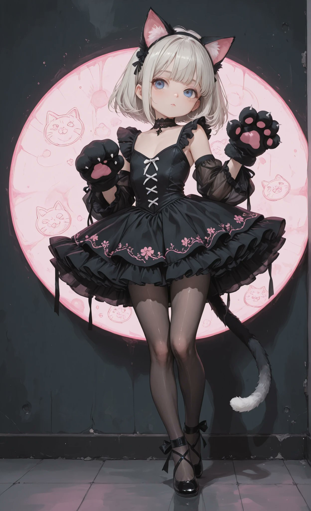
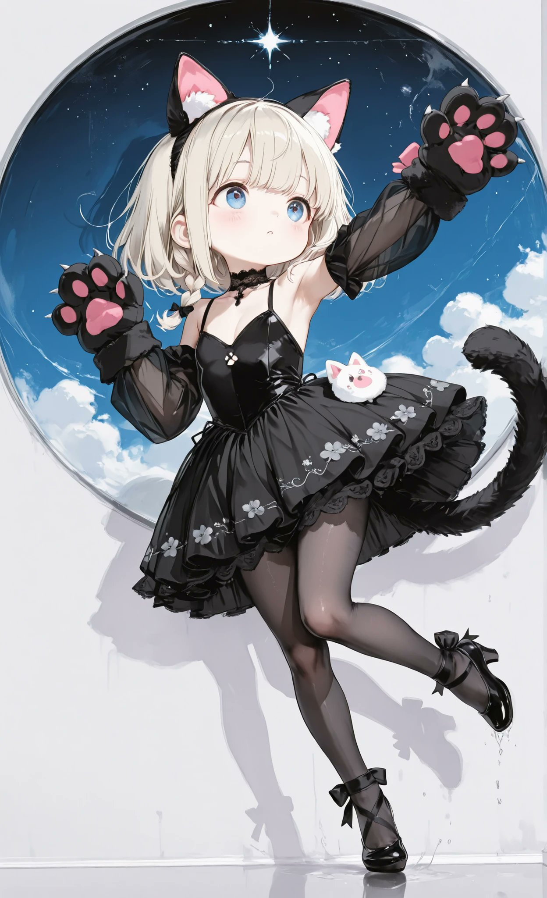
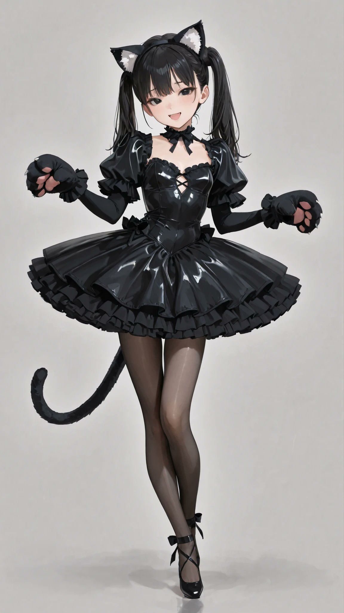
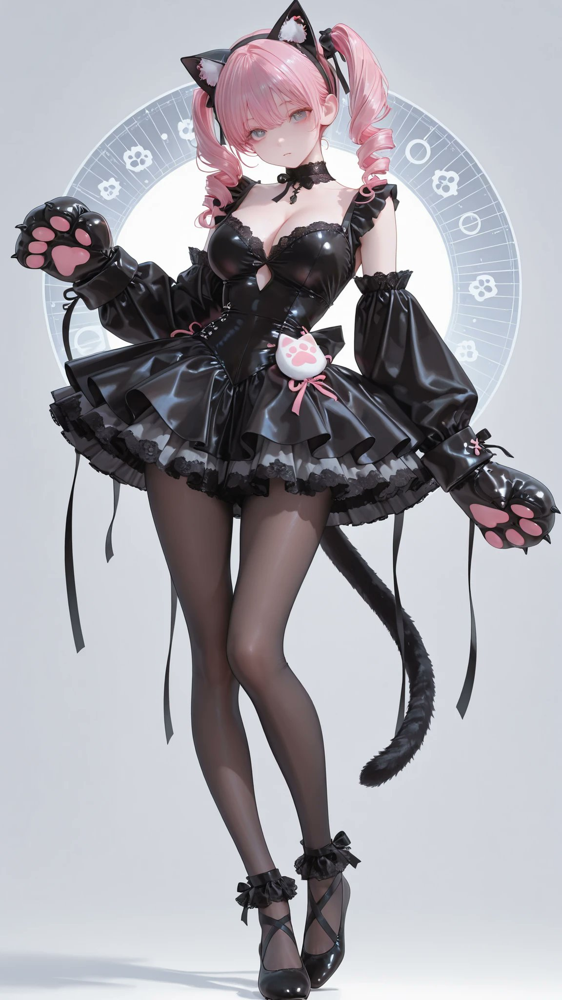

# 黑猫芭蕾 tutu 衣装（含爪套与猫耳）

- 原帖链接：https://x.com/AliceLavli/status/2115760567881499086
- 作者：アリス服飾店（@AliceLavli）
- 时间：2026-10-29 19:00 (UTC+8 / Asia/Shanghai)
- 互动摘要：点赞 233 · 转发 43 · 回复 6 · 引用 29 · 书签 67 · 浏览 9059（采集快照：2026-10-30 20:15 UTC+8）
- 模型/工具：未注明（通用；作者写可用于 SD / SeaArt / PixAI / ChatGPT / Gemini / Grok / Midjourney / niji）
- 标签：二次元
- 媒体路径：
  - `media/images/2115760567881499086_1.jpg`（）
  - `media/images/2115760567881499086_2.jpg`（）
  - `media/images/2115760567881499086_3.jpg`（）
  - `media/images/2115760567881499086_4.jpg`（）
- 入库日期：2026-10-30
- 备注：prompt 位于原帖正文（note_tweet）。

## prompt 原文

```text
black long sleeved ballet tutu dress with cat costume accessories, fitted black stretch bodice with shallow V neckline and small gathered center front seam, smooth shaped waist and full length close fitting black sleeves, short black classical tutu projecting outward in a broad circular silhouette, densely gathered black tulle skirt with narrow black ruffle around outer edge, layered medium gray and light gray ruffles beneath black tutu, softly scalloped stacked skirt edges, sheer black ankle length footless tights, black satin ballet slippers with rounded closed toes and low curved openings, narrow black satin ribbons crossed over insteps and wrapped around ankles, oversized black padded paw mittens with four small pink oval finger pads and large pink central paw pad, thick black plush mitten cuffs, black fabric headband with two pointed triangular costume ears, pink fabric ear insets and small white plush accents, narrow black floral lace choker, curved dark gray plush costume tail attached at back waist
```

---

个人学习归档，非商业。prompt 与媒体版权归原作者 @AliceLavli，引用请回到原帖。
