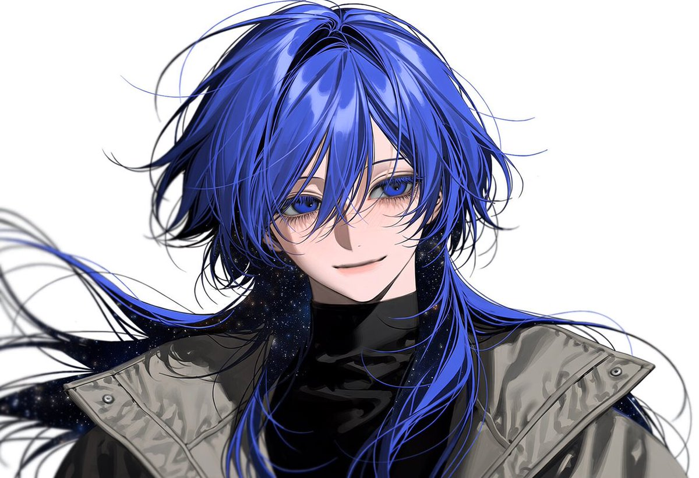

# 蓝发宇宙主题近景肖像（ALT prompt）

- 原帖链接：https://x.com/h4gure_b0sh1/status/2115820527319466463
- 作者：はぐれ星🚀🪐（@h4gure_b0sh1）
- 时间：2026-10-29 22:58 (UTC+8 / Asia/Shanghai)
- 互动摘要：点赞 16 · 转发 1 · 回复 0 · 引用 0 · 书签 3 · 浏览 201（采集快照：2026-10-30 09:15 UTC+8）
- 模型/工具：未注明（NAI/pixAI 可用，原帖自述）
- 标签：二次元
- 媒体路径：
  - `media/images/2115820527319466463_1.jpg`（）
- 入库日期：2026-10-30
- 备注：prompt 来自图片 ALT 文本，原样入库。

## prompt 原文

```text
1person, close-up portrait, handsome androgynous face, delicate features, long feathery eyelashes, deep blue eyes, vibrant blue hair, long layered hair with long mullet and face-framing strands, subtle black hole cosmic theme in hair with dark navy inner layers and glowing stellar rim light, high-neck black inner shirt, oversized stylish jacket, high detailed anime illustration, masterpiece, best quality
```

---

个人学习归档，非商业。prompt 与图片版权归原作者 @h4gure_b0sh1，引用请回到原帖。
