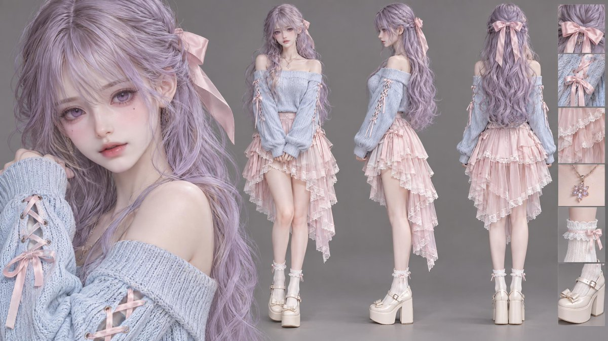

# Midjourney 角色三视图：淡紫发少女

- 原帖链接：https://x.com/jackchen1919/status/2115884120626602040
- 作者：怪侠一只驴（@jackchen1919）
- 时间：2026-10-30 03:11 (UTC+8 / Asia/Shanghai)
- 互动摘要：点赞 23 · 转发 1 · 回复 4 · 引用 0 · 书签 9 · 浏览 689（采集快照：2026-10-30 09:15 UTC+8）
- 模型/工具：Midjourney v6.1
- 标签：二次元
- 媒体路径：
  - `media/images/2115884120626602040_1.jpg`（）
- 入库日期：2026-10-30
- 备注：prompt 位于原帖正文。

## prompt 原文

```text
Prompt：
Character sheet, multi-angle view, 1girl, close-up portrait on the left, full body turn-around on the right showing front view, side view, and back view. 
A delicate and beautiful young woman, long wavy pastel lavender hair tied with a soft pink ribbon bow, soft bangs, gentle violet eyes, porcelain skin, subtle makeup. 
Wearing a light pastel blue off-shoulder knit sweater with laced ribbon sleeves, paired with an asymmetrical tiered pastel pink chiffon ruffle skirt with white lace trim. White ankle socks and platform cream Mary Jane shoes. 
Solid neutral gray studio background, soft diffused lighting, clean character design, hyper-detailed, semi-realistic 3D anime style, 8k resolution, Masterpiece --ar 16:9 --v 6.1
```

---

个人学习归档，非商业。prompt 与图片版权归原作者 @jackchen1919，引用请回到原帖。
