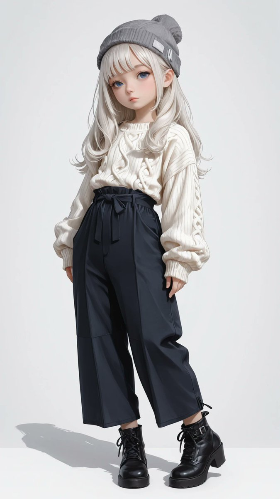
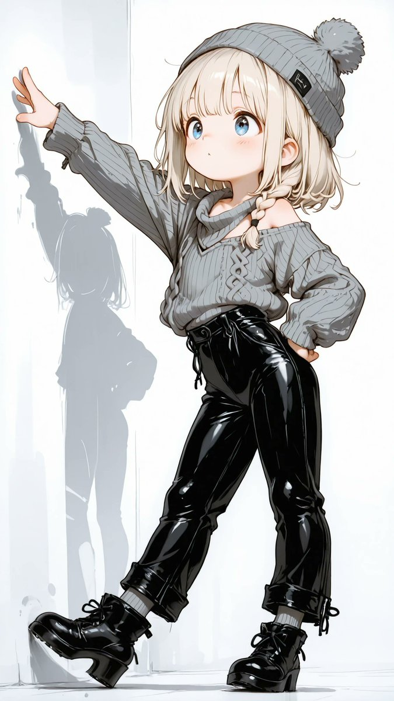
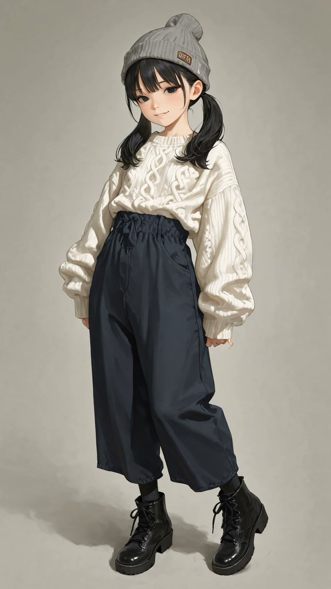
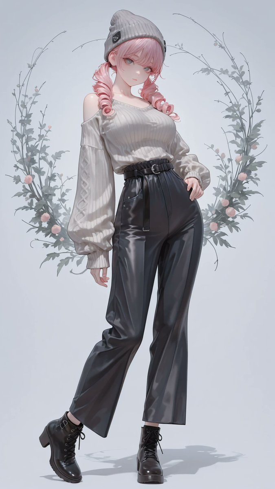

# 灰针织帽 + 毛衣宽裤靴装（衣装 prompt）

- 原帖链接：https://x.com/AliceLavli/status/2116002158080655473
- 作者：アリス服飾店（@AliceLavli）
- 时间：2026-10-30 11:00 (UTC+8 / Asia/Shanghai)
- 互动摘要：点赞 100 · 转发 18 · 回复 5 · 引用 10 · 书签 31 · 浏览 3019（采集快照：2026-10-30 20:15 UTC+8）
- 模型/工具：未注明（通用；作者写可用于 SD / SeaArt / PixAI / ChatGPT / Gemini / Grok / Midjourney / niji）
- 标签：二次元
- 媒体路径：
  - `media/images/2116002158080655473_1.jpg`（）
  - `media/images/2116002158080655473_2.jpg`（）
  - `media/images/2116002158080655473_3.jpg`（）
  - `media/images/2116002158080655473_4.jpg`（）
- 入库日期：2026-10-30
- 备注：prompt 位于原帖正文（note_tweet）。

## prompt 原文

```text
plain heather gray knitted beanie, soft rounded top, broad folded ribbed cuff, undecorated knit, matching heather gray chunky knit sweater, cool gray marled yarn, matte wool texture, relaxed boxy silhouette, hip length pullover, round ribbed crew neckline, dropped shoulders, full length loose sleeves, tapered sleeve ends, wide folded ribbed cuffs, neatly finished ribbed lower hem, sweater worn untucked over trouser waistband, deep midnight navy woven wide leg trousers, opaque matte fabric, fine textile weave, high waist, narrow flat waistband, concealed front fastening, softly fitted hips, separate full length trouser legs, generous width from thighs to hems, soft vertical fabric folds, broad straight stitched hems reaching boot insteps, clean tailored seams, dry fabric surfaces, black leather ankle boots, close fitting shafts, softly creased insteps, sharply pointed toes, slim high heels, thin black soles, tonal stitching, smooth leather uppers
```

---

个人学习归档，非商业。prompt 与媒体版权归原作者 @AliceLavli，引用请回到原帖。
