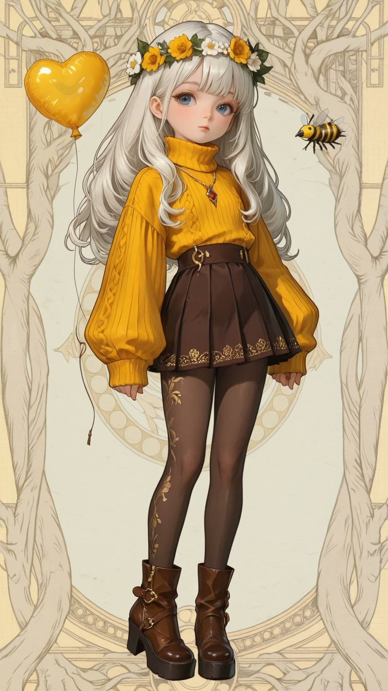
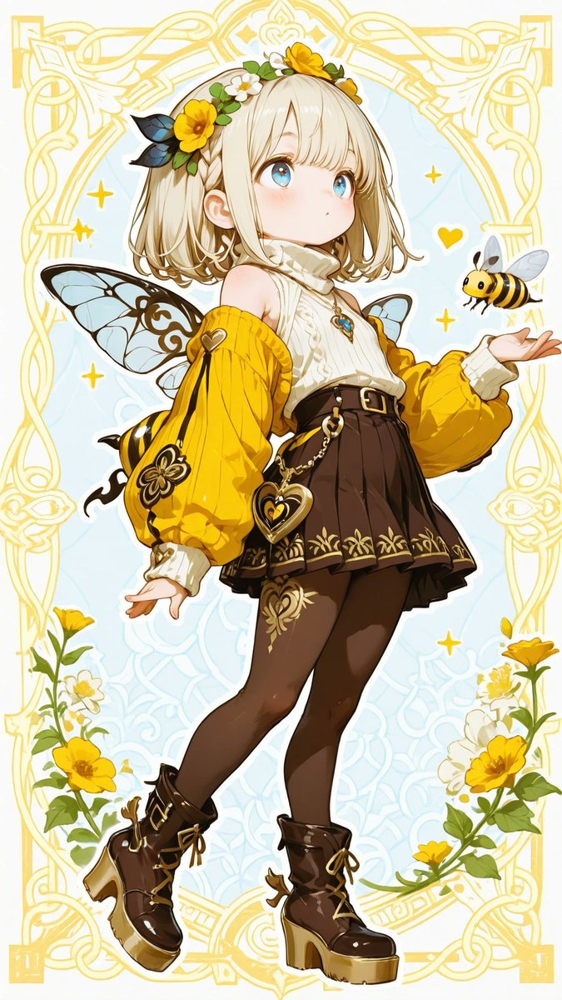
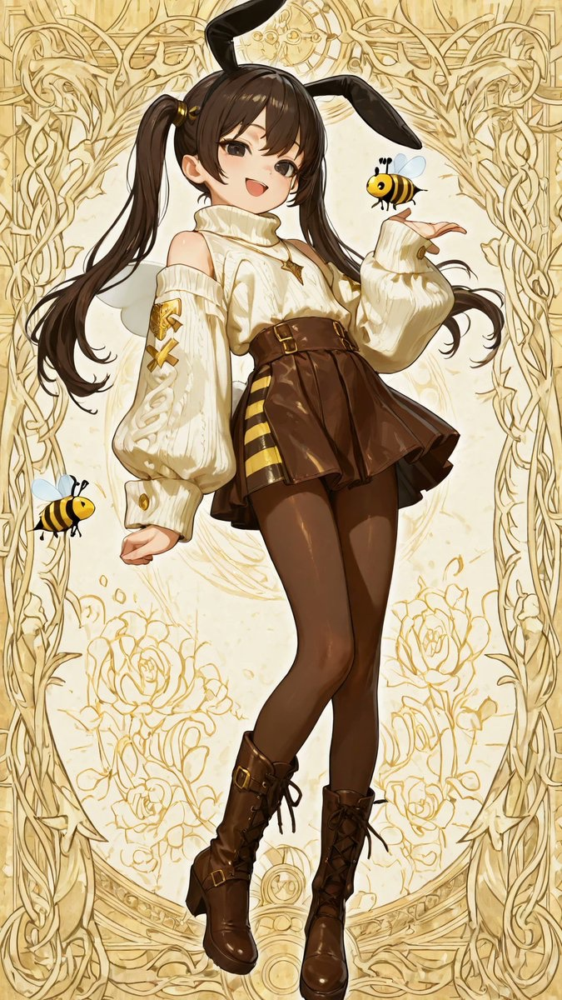
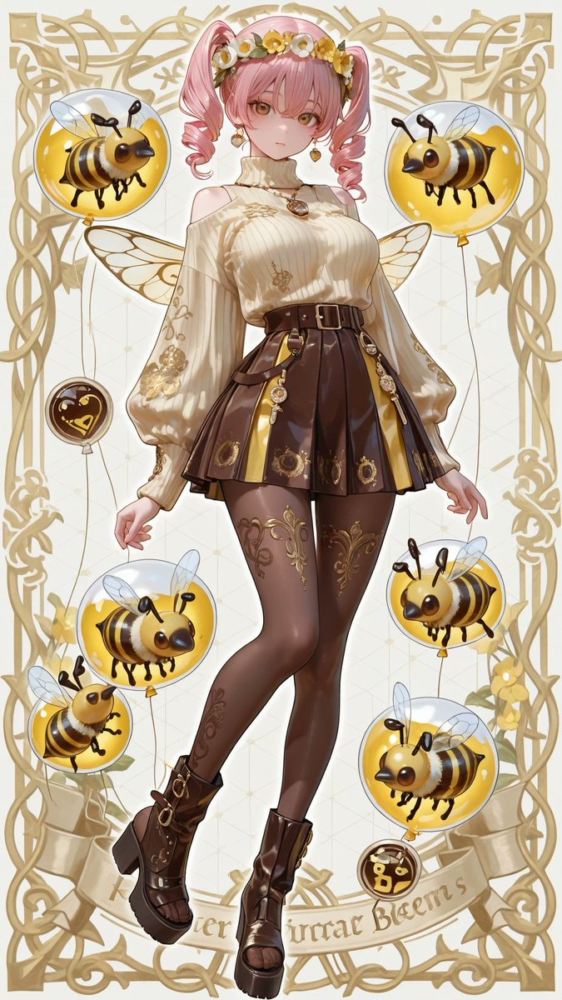

# 蜜蜂刺绣毛衣与蜂巢迷你裙靴装

- 原帖链接：https://x.com/AliceLavli/status/2116062546600071334
- 作者：アリス服飾店（@AliceLavli）
- 时间：2026-10-30 15:00 (UTC+8 / Asia/Shanghai)
- 互动摘要：点赞 95 · 转发 18 · 回复 1 · 引用 7 · 书签 23 · 浏览 2358（采集快照：2026-10-30 20:15 UTC+8）
- 模型/工具：未注明（通用；作者写可用于 SD / SeaArt / PixAI / ChatGPT / Gemini / Grok / Midjourney / niji）
- 标签：二次元
- 媒体路径：
  - `media/images/2116062546600071334_1.jpg`（）
  - `media/images/2116062546600071334_2.jpg`（）
  - `media/images/2116062546600071334_3.jpg`（）
  - `media/images/2116062546600071334_4.jpg`（）
- 入库日期：2026-10-30
- 备注：prompt 位于原帖正文（note_tweet）。

## prompt 原文

```text
mustard yellow oversized ribbed knit sweater, thick folded turtleneck, dropped shoulders, full length balloon sleeves, fitted ribbed cuffs, loose softly tucked hem, large embroidered bee centered on chest, black and golden yellow striped bee with ivory wings, circular wreath of small yellow flowers and green stems around bee, dark brown branching botanical embroidery near sleeve ends, chocolate brown high waisted pleated mini skirt, broad fitted waistband, two vertically arranged silver outline heart ornaments, layered brown leatherlike pleated panels, dark brown side panels with gold honeycomb pattern, fine gold edging, draped gold waist chains with ivory pearls and small bee charms, dark brown sheer tights with large hexagonal honeycomb mesh pattern, chocolate brown knee high boots, soft suede texture, wide folded cuffs with gold honeycomb trim, matching patterned buckle straps around calves and ankles, antique gold round buckles, rounded toes, thick platform soles, tall stacked block heels, gold necklace with amber honeycomb pendant and small bee ornament
```

---

个人学习归档，非商业。prompt 与媒体版权归原作者 @AliceLavli，引用请回到原帖。
