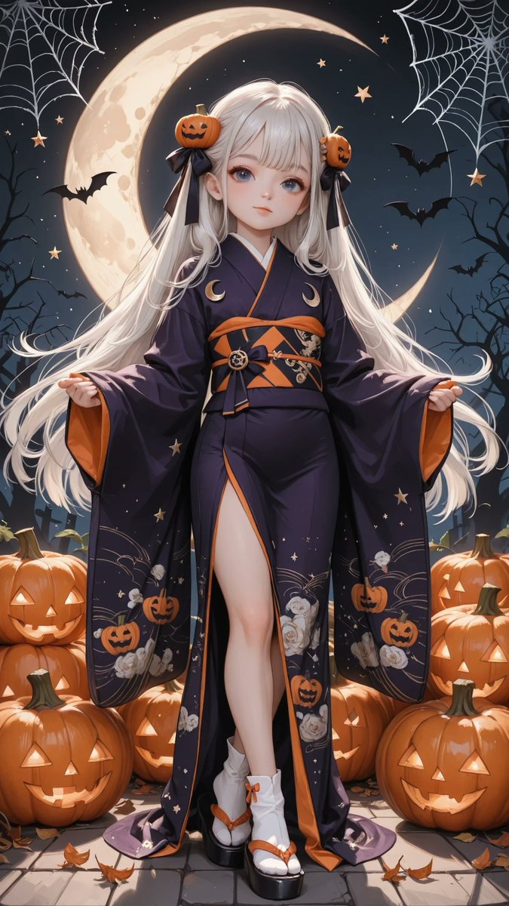

# 深紫万圣节图案和服（南瓜蝙蝠鬼月）

- 原帖链接：https://x.com/AliceLavli/status/2116122953951871387
- 作者：アリス服飾店（@AliceLavli）
- 时间：2026-10-30 19:00 (UTC+8 / Asia/Shanghai)
- 互动摘要：点赞 42 · 转发 7 · 回复 2 · 引用 5 · 书签 11 · 浏览 611（采集快照：2026-10-30 20:15 UTC+8）
- 模型/工具：未注明（通用；作者写可用于 SD / SeaArt / PixAI / ChatGPT / Gemini / Grok / Midjourney / niji）
- 标签：二次元
- 媒体路径：
  - `media/images/2116122953951871387_1.jpg`（）
  - `media/images/2116122953951871387_2.jpg`（）
  - `media/images/2116122953951871387_3.jpg`（）
  - `media/images/2116122953951871387_4.jpg`（）
- 入库日期：2026-10-30
- 备注：prompt 位于原帖正文（note_tweet）。

## prompt 原文

```text
deep violet kimono, traditional full length wrap silhouette, left front panel overlapping right front panel, neatly crossed neckline, narrow ivory inner collar, long rectangular hanging sleeves, straight sleeve openings, smooth woven silk fabric, Halloween motifs printed across kimono, small orange pumpkins with carved faces, black bats, ivory ghosts, golden crescent moons and tiny stars, scattered motifs across upper bodice and sleeves, larger pumpkin and curling vine pattern along lower hem, subtle dark purple spiderweb pattern between motifs, burnt orange wide obi, structured rectangular obi knot at back, black woven geometric pattern on obi, narrow plum obijime cord tied at center front, small gold pumpkin shaped obidome clasp, ivory lace trim along inner sleeve edges, straight ankle length kimono hem, neatly folded waist tuck beneath obi, ivory tabi socks with divided toes, black lacquered zori sandals, burnt orange velvet sandal straps, small dark violet fabric bow hair ornament with tiny gold star charms
```

---

个人学习归档，非商业。prompt 与媒体版权归原作者 @AliceLavli，引用请回到原帖。
