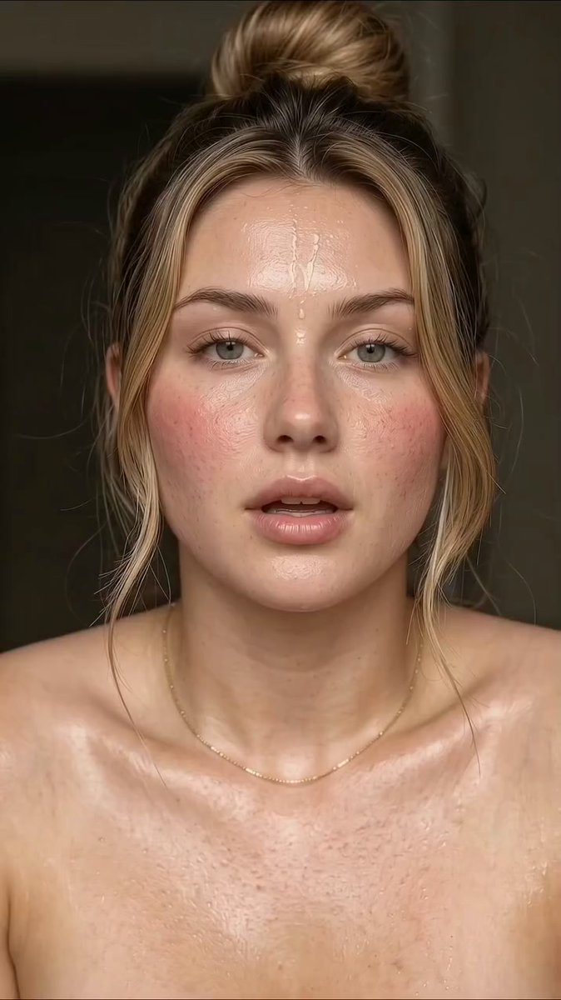

# 金发高丸子头水润肌特写（视频/生图双 prompt）

- 原帖链接：https://x.com/JohnSmith5912/status/2116101602746794188
- 作者：John Smith Ai（@JohnSmith5912）
- 时间：2026-10-30 17:35 (UTC+8 / Asia/Shanghai)
- 互动摘要：点赞 218 · 转发 7 · 回复 9 · 引用 0 · 书签 171 · 浏览 17578（采集快照：2026-11-02 20:10 UTC+8）
- 模型/工具：视频：Sora / Runway Gen-2 / Pika / Veo；静帧：Midjourney / Stable Diffusion（作者示例）
- 标签：真人
- 媒体路径：
  - `media/video-stills/2116101602746794188_1.jpg`（视频截图，视频文件不入库，仅保留原帖链接）（）
- 入库日期：2026-11-02
- 备注：视频帖；prompt 位于原帖 note_tweet。社交平台文案/标签未收入 prompt 区。

## prompt 原文

```text
1. AI Video Generation Prompt (e.g., Sora, Runway Gen-2, Pika, Veo)
> Prompt: A vertical, high-definition cinematic close-up video of a young woman with her blonde hair tied up in a high bun with loose framing strands, green eyes, and rosy pink cheeks. Her face and skin have a dewy, glowing texture with visible droplets of water, and she gently touches her lip with her finger while looking into the camera. Soft indoor lighting, hyper-realistic skin texture and smooth motion, 4k resolution.
> 
2. Midjourney / Stable Diffusion Image Prompt
> Prompt: A photorealistic, intimate close-up portrait of a young woman with blonde hair in a high bun, loose strands framing her face, green eyes, and rosy flushed cheeks. Her skin has a dewy, wet-look texture with subtle water droplets. Soft ambient indoor lighting, high skin detail, hyper-realistic, shallow depth of field, 8k resolution, shot on 85mm lens --ar 9:16 --v 6.0
>
```

---

个人学习归档，非商业。prompt 与媒体版权归原作者 @JohnSmith5912，引用请回到原帖。
