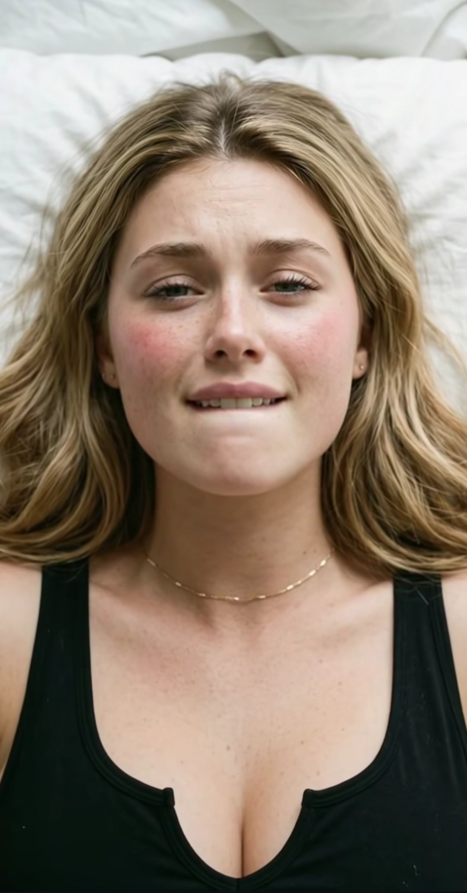

# 俯拍金发特写：白床黑背心与咬唇（生图双 prompt）

- 原帖链接：https://x.com/JohnSmith5912/status/2116156702777348480
- 作者：John Smith Ai（@JohnSmith5912）
- 时间：2026-10-30 21:14 (UTC+8 / Asia/Hong_Kong)
- 互动摘要：点赞 91 · 转发 6 · 回复 5 · 引用 0 · 书签 76 · 浏览 4884（采集快照：2026-11-02 09:08 UTC+8）
- 模型/工具：Midjourney / Stable Diffusion；DALL-E 3（作者示例）
- 标签：真人
- 媒体路径：
  - `media/images/2116156702777348480_1.jpg`（）
- 入库日期：2026-11-02
- 备注：prompt 位于原帖 note_tweet。社交平台文案/标签未收入 prompt 区。

## prompt 原文

```text
1. Midjourney / Stable Diffusion Prompt
> Prompt: Photorealistic top-down close-up portrait of a young woman with wavy blonde hair lying back on white bedding, wearing a black tank top. She has soft rosy cheeks, freckles, a subtle thin gold necklace, and is biting her lower lip while looking up. Bright, natural indoor lighting, hyper-realistic skin texture, shallow depth of field --ar 9:16 --v 6.0

2. DALL-E 3 Prompt
> Prompt: A vertical close-up photo from above showing a blonde woman lying on a white pillow, wearing a black tank top and a simple gold chain. She has flushed cheeks, freckles, and a playful expression as she bites her lip. Soft, natural light with realistic detail.
```

---

个人学习归档，非商业。prompt 与媒体版权归原作者 @JohnSmith5912，引用请回到原帖。
