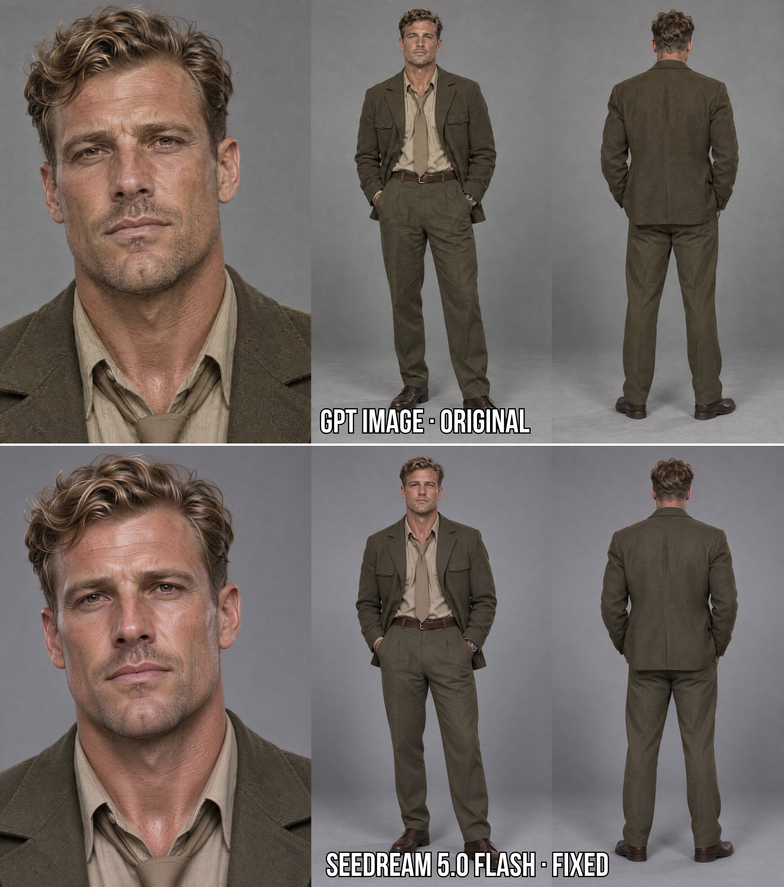
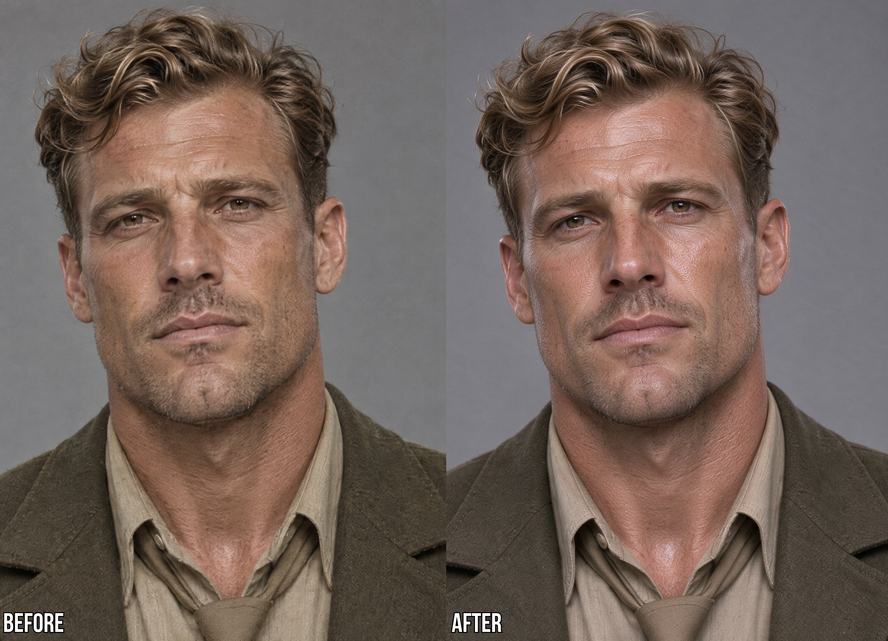
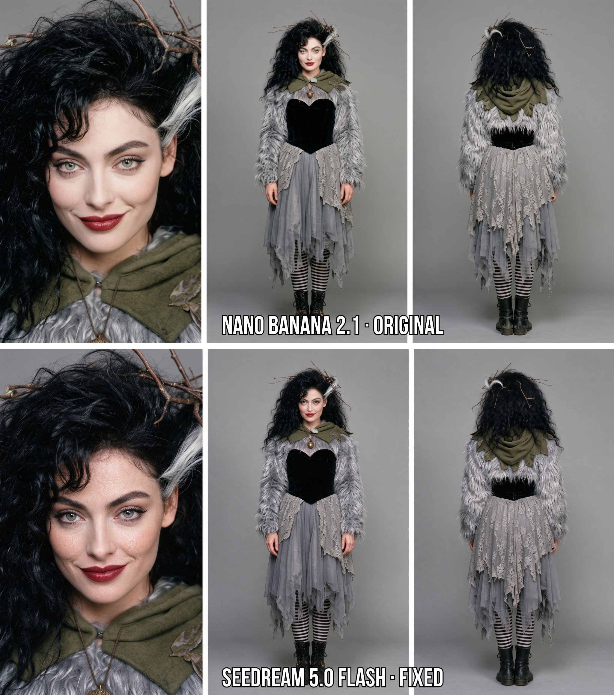
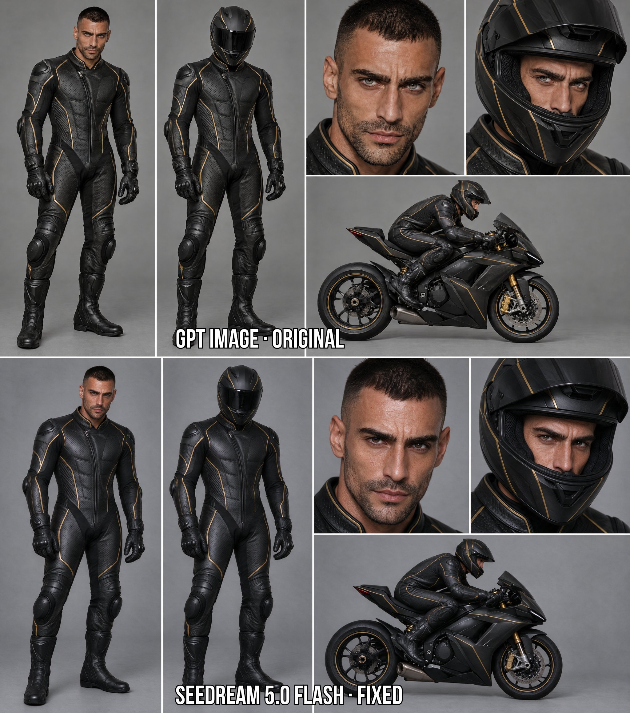
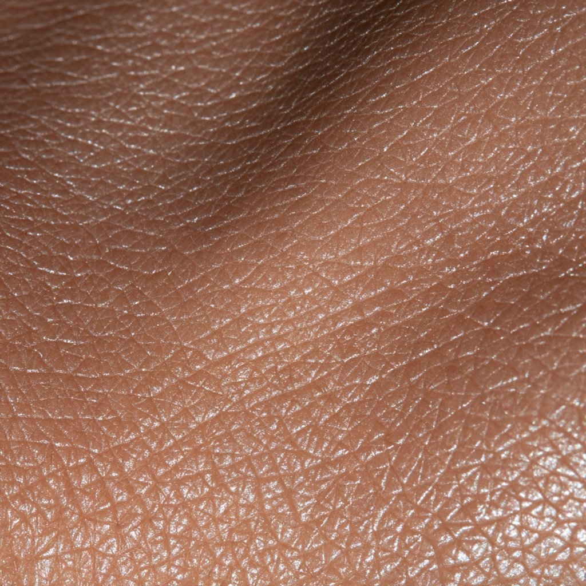
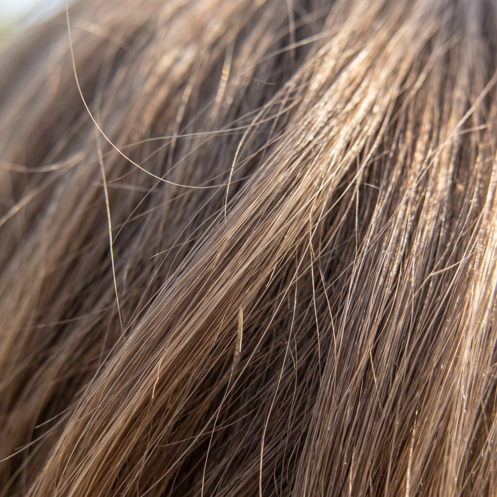
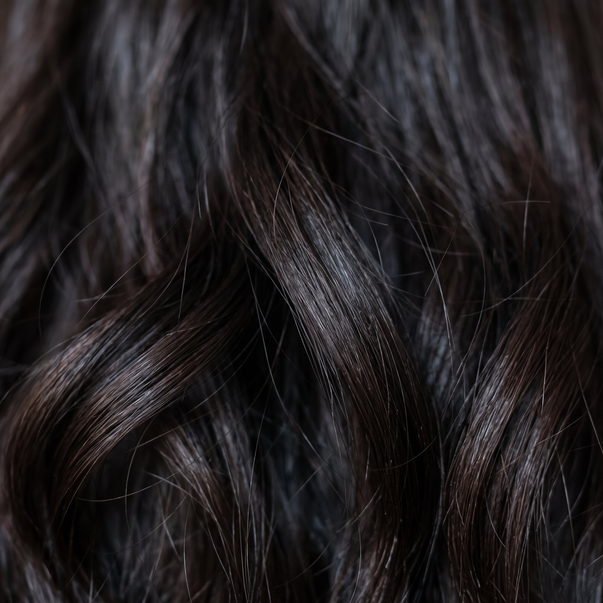

# 角色脸部去斑驳：皮肤/发丝质感参考图 + 通用 prompt

- 原帖链接：https://x.com/Kiber_Alla/status/2116291838852141297
- 作者：Kiber Alla（@Kiber_Alla）
- 时间：2026-10-31 06:11 (UTC+8 / Asia/Shanghai)
- 互动摘要：点赞 198 · 转发 16 · 回复 24 · 引用 1 · 书签 343 · 浏览 14105（采集快照：2026-11-02 20:10 UTC+8）
- 模型/工具：Seedream 5.0 Flash（作者称亦可对比 Nano Banana 2.1 / GPT Image 2.5）
- 标签：真人
- 媒体路径：
  - `media/images/2116291838852141297_1.jpg`（）
  - `media/images/2116291838852141297_2.jpg`（）
  - `media/images/2116291838852141297_3.jpg`（）
  - `media/images/2116291838852141297_4.jpg`（）
  - `media/images/2116291843226763475_1.jpg`（）
  - `media/images/2116291843226763475_2.jpg`（）
  - `media/images/2116291843226763475_3.jpg`（）
- 入库日期：2026-11-02
- 备注：prompt 位于作者自回复 https://x.com/Kiber_Alla/status/2116291843226763475 ，该回复附的 3 张参考图（角色设定图/皮肤/发丝）一并入库。

## prompt 原文

```text
How it works:
→ Image 1 — character sheet
→ Image 2 — skin texture
→ Image 3 — hair texture (light or dark)

Universal prompt for Seedream 5.0 Flash (works across characters): Keep <<<image_1>>> exactly as it is: same person, same face shape and features, same expression, same hairstyle and hair shape, same hair color, same skin tone, same makeup, same wrinkles, freckles, moles, scars and facial hair, same clothing and accessories, same pose, composition, layout, background and framing.

Change only the surface texture:
- Skin: apply the micro-texture from <<<image_2>>> — fine natural skin lines, pores and soft realistic surface. Do not copy its color or its glossy shine.
- Hair: apply the strand structure from <<<image_3>>> — fine individual strands, soft natural flyaways. Do not copy its color.

Balance the contrast to a natural photographic level: if image 1 looks too harsh or blotchy, soften it; if it looks flat or washed out, add depth. Aim for a well-balanced realistic photo — rich but not crushed shadows, clean highlights, smooth even tonal transitions, natural shading with real volume. No retouching, no beautifying, no plastic look.
```

---

个人学习归档，非商业。prompt 与媒体版权归原作者 @Kiber_Alla，引用请回到原帖。
