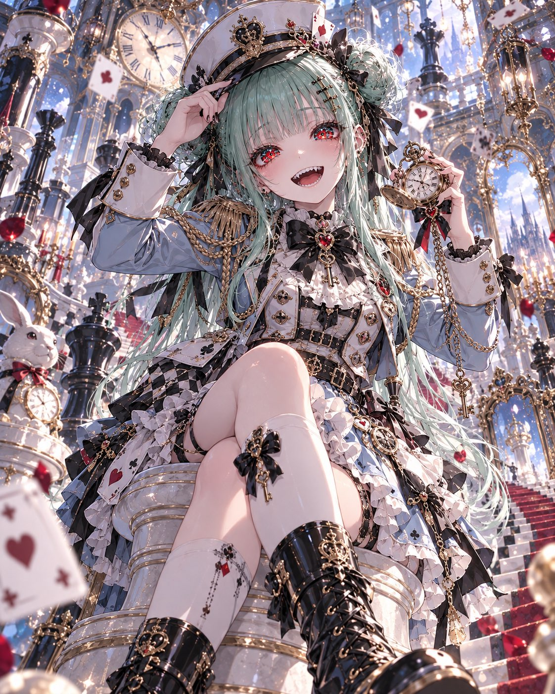
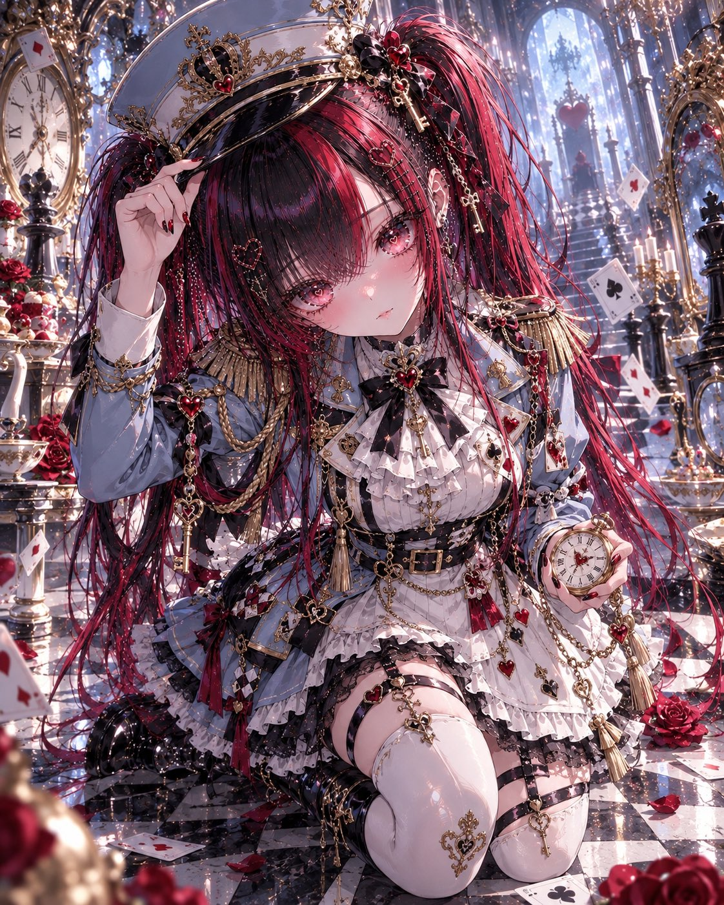
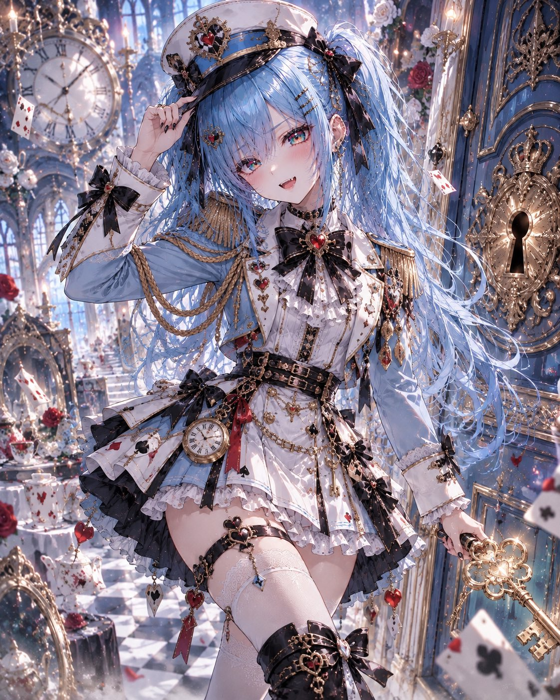
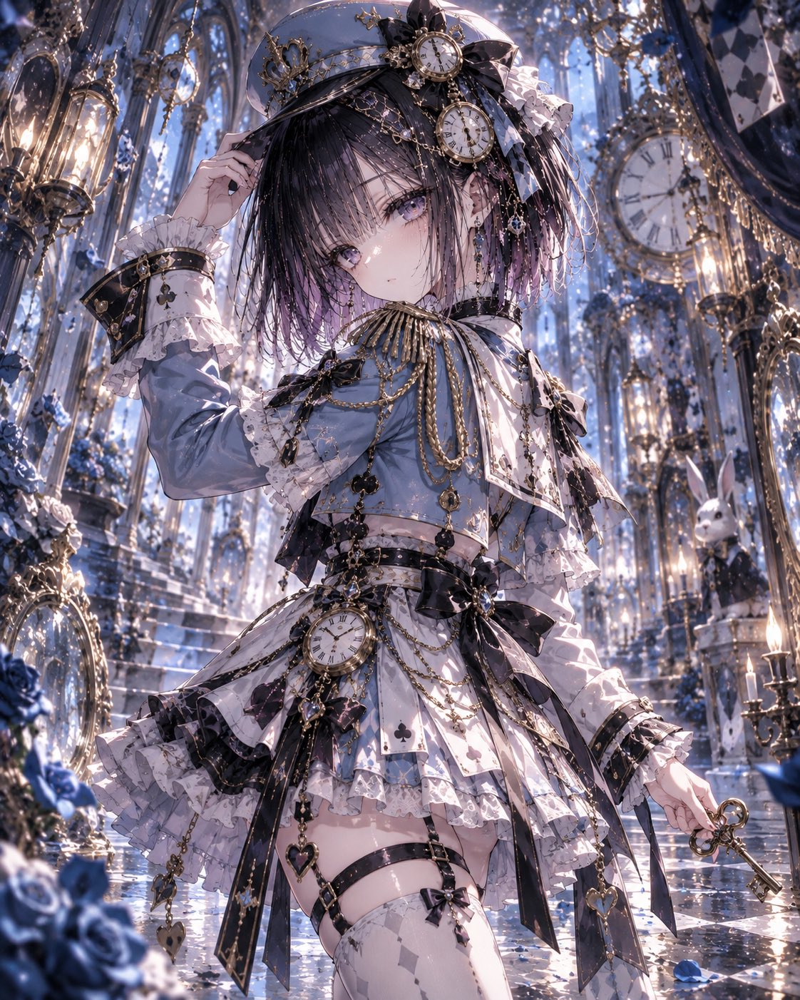

# 爱丽丝×皇家军服：粉蓝军官帽与围裙式军装（衣装 prompt）

- 原帖链接：https://x.com/ENJU1123PIPI/status/2116296588306112811
- 作者：るんちゃん🦋（@ENJU1123PIPI）
- 时间：2026-10-31 06:30 (UTC+8 / Asia/Hong_Kong)
- 互动摘要：点赞 118 · 转发 38 · 回复 8 · 引用 11 · 书签 8 · 浏览 41566（采集快照：2026-11-02 09:08 UTC+8）
- 模型/工具：未注明（日系 AI 插画 / 衣装プロンプト；作者写可贴角色参考）
- 标签：二次元
- 媒体路径：
  - `media/images/2116296588306112811_1.jpg`（）
  - `media/images/2116296588306112811_2.jpg`（）
  - `media/images/2116296588306112811_3.jpg`（）
  - `media/images/2116296588306112811_4.jpg`（）
- 入库日期：2026-11-02
- 备注：prompt 位于作者自回复（note_tweet）。

## prompt 原文

```text
Use the attached character as the only character.

Preserve the character’s recognizable identity: face, hairstyle, hair color, eye color, body proportions, accessories, gender presentation, vibe, and personality. Do not make major changes that make the character unrecognizable. Replace the original outfit completely.

Create an Alice in Wonderland × royal military couture design.
Balance: Alice 70% / military 30%.
Mood: cute, elegant, regal, playful, slightly surreal.
Main colors: powder blue, ivory white, black, antique gold, with small crimson accents.

The outfit must read clearly as Alice-inspired first, with a refined royal military overlay.

Include these key Alice elements:

powder-blue base
white apron-inspired integrated panel
black ribbon or bow
antique key motif
pocket-watch motif
subtle playing-card symbols
slight asymmetry
elegant fantasy atmosphere

Add these military elements:

stylish officer cap
structured short jacket
epaulettes
gold or dark-metal buttons
military piping
decorative waist belt
shoulder cord
polished boots
optional gloves

No real-world insignia. No readable text.

For feminine characters:
use a cute Alice-inspired royal military silhouette with a fitted short officer jacket, short pleated or layered skirt, white apron-like panel, decorative belts, black ribbon, and polished boots.
Optional tasteful exposure: collarbones, shoulders, small waist area, upper thighs. Keep intimate areas fully covered.

For masculine characters:
use a clearly masculine Alice-inspired royal military silhouette with structured shoulders, tailored officer jacket, fitted trousers, white formal/apron-like paneling, black ribbon accents, and polished military boots.
No skirt, corset, bustier, thigh-highs, cleavage emphasis, feminine waist shaping, or feminine dress silhouette.

Officer cap design:
powder-blue or black crown, white band, gold piping, small black ribbon accent, abstract heart/key/clock emblem, tiny chain detail. The cap should frame the face without hiding the hairstyle.

Add accessories selectively:
antique key, pocket watch, small satchel, black ribbon brooch, gold chain, heart-shaped medal, or a small ceremonial baton. No firearms.

Pose:
cute, confident three-quarter full-body composition.
Preferred pose: one hand lightly touching the brim of the cap, the other holding an antique key or pocket watch near the waist. One leg slightly forward.
Expression: cute, curious, slightly smug, playful, mysterious, direct eye contact.
Correct anatomy. Exactly two arms and two legs. Natural hands. No extra fingers.

Background:
a refined royal Wonderland military-academy setting with blue-and-white palace architecture, oversized doors, checkerboard floor, antique clocks, mirrors, floating cards, giant chess pieces, elegant staircases, and soft mist.
No extra clear characters. No readable text.

Lighting:
cinematic fantasy lighting with soft blue ambient light, warm gold highlights, cool white rim light, subtle reflections on buttons and boots, and a faint magical glow around the key or watch.

Quality:
highest quality premium anime illustration, clean strong outer linework, fine facial linework, glass-like multi-layered irises, rich textures, strong dimensional shading, clear Alice-military silhouette, sharp focus.

No readable text. No logo. No watermark. No extra characters.

If you want, I can also make this even shorter in a copy-paste compact version.
```

---

个人学习归档，非商业。prompt 与媒体版权归原作者 @ENJU1123PIPI，引用请回到原帖。
