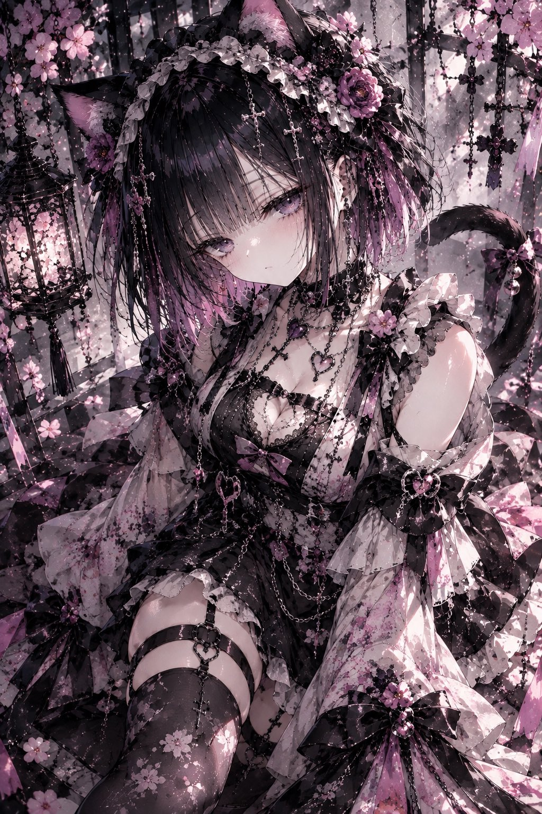
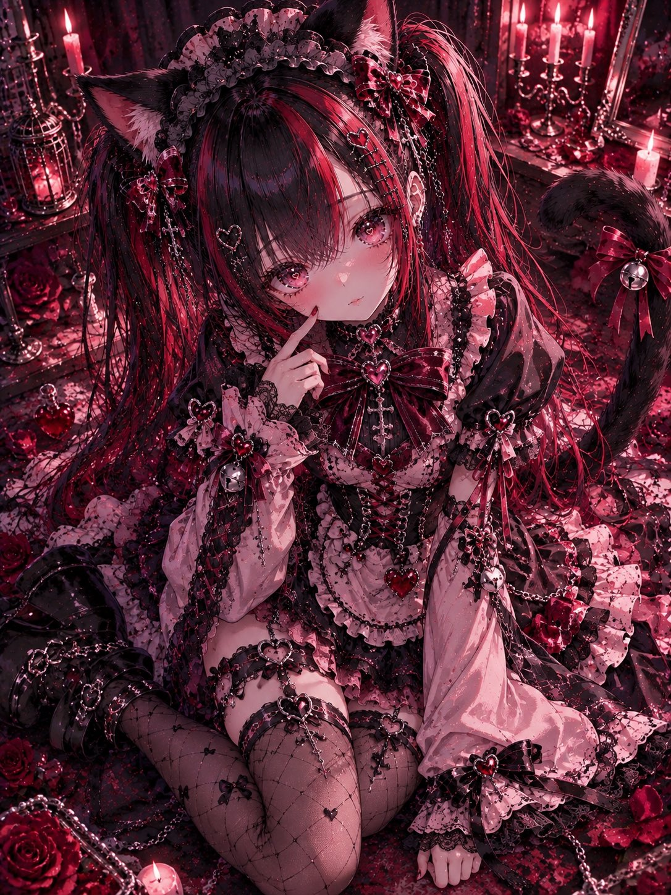

# 猫耳万圣节地雷系哥特女仆装（衣装 prompt）

- 原帖链接：https://x.com/ENJU1123PIPI/status/2116485351762174013
- 作者：るんちゃん🦋（@ENJU1123PIPI）
- 时间：2026-10-31 19:00 (UTC+8 / Asia/Hong_Kong)
- 互动摘要：点赞 77 · 转发 27 · 回复 4 · 引用 6 · 书签 10 · 浏览 2684（采集快照：2026-11-02 09:08 UTC+8）
- 模型/工具：未注明（日系 AI 插画 / 衣装プロンプト；作者写可贴角色参考）
- 标签：二次元
- 媒体路径：
  - `media/images/2116485351762174013_1.jpg`（）
  - `media/images/2116485351762174013_2.jpg`（）
  - `media/images/2116485351762174013_3.jpg`（）
  - `media/images/2116485351762174013_4.jpg`（）
- 入库日期：2026-11-02
- 备注：prompt 位于作者自回复（note_tweet）。

## prompt 原文

```text
Preserve the original character's face, hairstyle, eye color, and body proportions. Add soft black cat ears with pink inner fur and one long, slender black cat tail decorated with a tiny ribbon and silver bell. Design an extravagant original jirai-kei gothic maid outfit combining black, dusty pink, and deep violet. A fitted high-neck velvet bodice, elaborate lace collar, oversized ribbon at the chest, puffed shoulders, extra-long detachable frilled sleeves, layered asymmetric ruffle skirt, heart-shaped apron, corset lacing, intricate cross ornaments, silver chains, heart-shaped locks, delicate bows, lace garters, patterned stockings, and chunky platform Mary Jane shoes. Black lace maid headdress with cat-inspired ornaments, luxurious layered fabrics, glossy accents, playful mischievous expression, cute yet darkly elegant, modest coverage with a refined feminine silhouette. Intricate premium anime costume design, expressive linework, rich cel shading, highly detailed accessories. No text.
```

---

个人学习归档，非商业。prompt 与媒体版权归原作者 @ENJU1123PIPI，引用请回到原帖。
