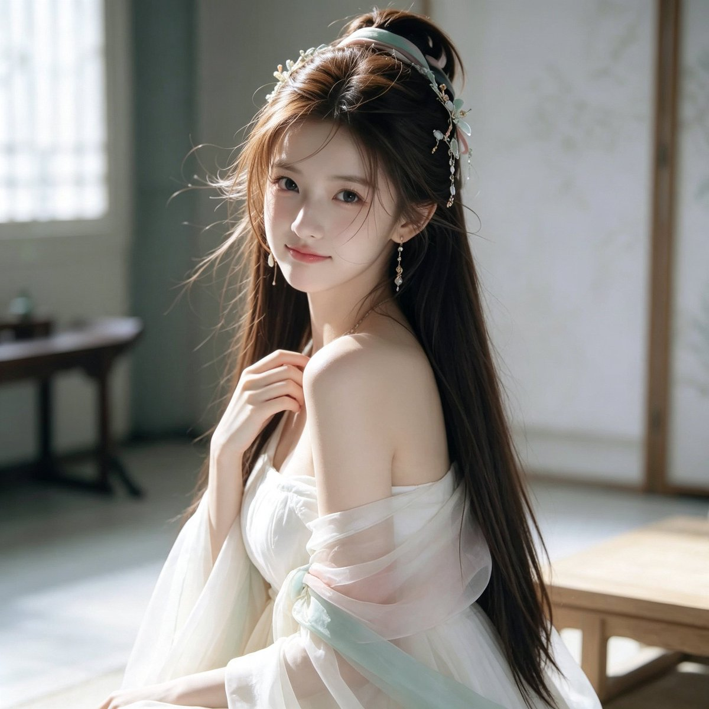

# 古风仙女汉服回眸人像（Seedance 提示词 37/100）

- 原帖链接：https://x.com/CryY666666/status/2116581101452009882
- 作者：沧瑶（@CryY666666）
- 时间：2026-11-01 01:20 (UTC+8 / Asia/Shanghai)
- 互动摘要：点赞 38 · 转发 4 · 回复 9 · 引用 0 · 书签 18 · 浏览 2107（采集快照：2026-11-02 20:10 UTC+8）
- 模型/工具：Seedance（作者标注）
- 标签：真人
- 媒体路径：
  - `media/images/2116581101452009882_1.jpg`（）
- 入库日期：2026-11-02
- 备注：prompt 位于原帖正文（note_tweet），含负面提示词。

## prompt 原文

```text
Seedance prompt 37/100
Seedance 提示词分享 37/100

1:1正方形构图，单幅独立画面，超写实东方古风女性人像摄影，韩系清冷仙女气质，古典东方美学与高级真实人像摄影融合。奶油白与浅青绿色调，柔和自然光，空灵、温柔、优雅。

【人物面容】

一位23至25岁、明确成年的绝美东亚女性，精致小巧的鹅蛋脸，柔和流畅的下颌线，小巧圆润的下巴，清透冷白瓷肌，淡淡蜜桃粉色腮红。

明亮清澈的深灰棕色杏仁眼，自然双眼皮，细致卧蚕，纤长卷翘的睫毛，柔和微扬的眼线。

纤细挺直的鼻梁，小巧精致的鼻尖，柔软饱满的玫瑰粉色水润嘴唇。

嘴角轻微上扬，露出温柔含蓄的浅笑，双眼自然直视镜头，五官精致但保留真实皮肤微纹理。

【发型与发饰】

浓密柔顺的深栗棕色及腰长发，头顶自然蓬松，采用古典半扎发造型。

部分头发在头顶盘成松散精致的小发髻，其余长发自然垂落至腰部以下，发尾带有轻微柔和波浪。

额前几缕轻薄的八字碎刘海自然垂落，部分细长发丝轻轻掠过脸颊。

头发佩戴浅青绿色玉质发簪、白色小花发饰、细金色花枝和珍珠流苏，精致小巧，不过度华丽。

双耳佩戴细长的银金色珍珠流苏耳环。

【服装设计】

身穿奶油白色、象牙白色的轻盈古风仙女汉服。

柔软丝绸抹胸内衫，搭配自然垂落的半透明白色欧根纱披帛，宽松露肩设计，展现柔和自然的肩颈与锁骨线条。

双臂缠绕轻薄的白色透明纱袖，袖口宽大飘逸，点缀浅青绿色轻纱飘带。

衣裙采用多层细腻丝绸和柔软薄纱，具有真实布料重量、自然褶皱与透光质感，内层保持不透明。

整体服装以月白色、浅象牙白和淡青绿色为主，清雅、精致、轻盈。

【人物姿势】

人物优雅地侧坐在古典室内木质长榻旁，身体侧向镜头约60度。

上半身自然挺直，头部轻轻向后回转，形成温柔的侧身回眸姿态。

一侧肩膀自然露出，一只手轻轻抬至锁骨前方，手指柔和弯曲，另一只手自然放置于膝前。

浓密长发沿背部自然垂落，部分长发披散在肩膀前方。

神情安静温柔，眼睛直视镜头，姿态自然松弛。

【背景环境】

典雅简洁的中式古典室内，江南庭院书房风格。

画面左侧是高大的木质格栅窗户，透过半透明白色窗纱洒入明亮午后阳光。

背景为浅米灰色墙壁、淡雅的中式屏风和古典木质结构。

画面右侧可见低矮的浅原木色茶几或长凳。

背景干净雅致，具有真实的古典生活空间感。

【镜头与光影】

等效50至85mm人像镜头，平视拍摄，人物侧身半身构图，脸部位于画面中央偏左。

柔和午后自然光从画面左上方窗户斜向照射，照亮人物脸颊、鼻梁、发丝、肩膀与白色轻纱。

发丝边缘形成细腻暖金色轮廓光，人物面部保持清透冷白色，阴影自然柔和。

背景略微虚化，保留古典建筑与木质家具细节。

真实摄影肤质、独立细小发丝、精致丝绸纹理、自然光学柔焦、轻微电影感调色。

【负面提示词】

动漫，插画，塑料CG脸，过度磨皮，夸张网红脸，异常大眼，过尖下巴，五官错位，假发，头发黏连，发饰畸形，多余手指，畸形手掌，肩膀错位，身体比例失真，衣服穿模，轻纱结构错误，过度透明服装，强HDR，过度锐化，夸张仙侠特效，背景杂乱，明显AI生成痕迹，文字，水印，LOGO，拼图。
```

---

个人学习归档，非商业。prompt 与媒体版权归原作者 @CryY666666，引用请回到原帖。
