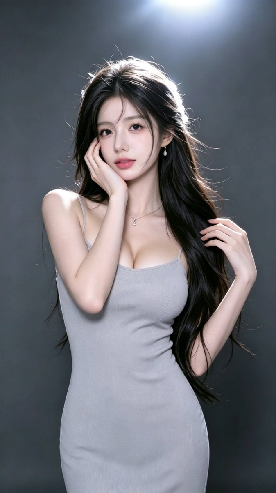

# 银灰吊带针织裙摄影棚人像（GPT Image 提示词 38/100）

- 原帖链接：https://x.com/CryY666666/status/2116603002513666240
- 作者：沧瑶（@CryY666666）
- 时间：2026-11-01 02:47 (UTC+8 / Asia/Shanghai)
- 互动摘要：点赞 28 · 转发 3 · 回复 6 · 引用 0 · 书签 9 · 浏览 1739（采集快照：2026-11-02 20:10 UTC+8）
- 模型/工具：GPT Image（作者标注）
- 标签：真人
- 媒体路径：
  - `media/images/2116603002513666240_1.jpg`（）
- 入库日期：2026-11-02
- 备注：prompt 位于原帖正文（note_tweet），含负面提示词。

## prompt 原文

```text
Gpt image prompt 38/100

Gpt image 提示词分享 38/100

9:16竖版，单幅独立画面，超写实韩系成年女性高级时尚人像摄影，清冷温柔御姐气质，浅银灰色修身吊带连衣裙，深灰黑色极简摄影棚，顶部冷白聚光灯，电影级细腻光影，真实相机质感。

【人物面容】

一位23至25岁的美丽成年东亚女性，精致小巧的鹅蛋脸，柔和流畅的下颌线，小巧圆润的下巴，清透冷白瓷肌，淡淡玫瑰粉色腮红。

明亮清澈的深灰棕色杏仁眼，自然双眼皮，细致卧蚕，纤长卷翘睫毛，微微上扬的细眼线。

纤细挺直的鼻梁，小巧鼻尖，柔软饱满的玫瑰豆沙粉色水润嘴唇，双唇自然微张。

眼神平静温柔，带有清冷疏离感，直视镜头，保留自然皮肤微纹理。

【发型——核心】

极其浓密蓬松的乌黑色及腰长发，带有自然深黑茶色光泽。

头顶自然蓬松，采用松散半扎发造型，额前有轻薄不规则八字碎刘海。

大量乌黑长发自然披散于双肩与胸前，画面右侧长发尤其浓密，发尾带有柔和松散的大弧度波浪。

少量细长碎发自然垂落在额头与脸颊，部分发丝被微风轻轻吹起。

顶部聚光灯照亮头发外缘，形成清晰明亮的银白色轮廓光，保留真实独立发丝。

【服装与首饰】

身穿浅银灰色、淡冰灰蓝色修身细肩带针织连衣裙。

柔软细密的弹力针织面料，细肩带设计，低圆弧领口，简洁贴身剪裁，裙身自然延伸至大腿下方。

面料具有真实细腻的针织纹理与轻微褶皱，颜色为低饱和度浅银灰色。

佩戴精致的银色水滴形耳环与极细银色锁骨链，中央悬挂一颗小巧透明水晶吊坠。

【人物姿势】

人物站立在摄影棚中央，身体正面略微侧向镜头，腰部自然挺直，肩膀放松。

头部轻轻向画面左侧倾斜，下巴微收，双眼直视镜头。

画面左侧的一只手抬起，手掌轻轻贴住脸颊，手指自然沿太阳穴与下颌线舒展。

另一只手自然抬至肩膀旁，轻轻握住一束乌黑长发。

长发顺着身体自然垂落至腰部，姿态优雅、安静、温柔。

【背景与光影】

深炭灰色极简摄影棚，背景干净，没有复杂家具与装饰。

画面顶部中央有一盏明亮的冷白色聚光灯，向下照射人物。

头顶和长发边缘形成明显的银白色逆光轮廓，细小飞散发丝清晰可见。

柔和正面补光照亮人物脸部、肩膀与锁骨，肤色呈现明亮清透的冷白色。

背景保持深灰黑色，人物明亮，形成自然的明暗对比。

【镜头与画质】

9:16竖版，等效50mm人像镜头，眼睛高度平视，人物居中，头部至大腿附近的中景构图。

高清真实摄影，清晰自然五官，真实皮肤纹理，细腻发丝，柔和高光，低饱和冷灰色调，轻微自然柔焦。

避免商业化过度精修、塑料皮肤与明显AI渲染质感。

【负面提示词】

动漫，插画，3D渲染，CG假脸，塑料皮肤，过度磨皮，夸张网红脸，异常大眼，尖下巴，五官错位，假发，头发黏连，僵硬卷发，畸形手指，多余手指，肩膀错位，身体比例异常，衣服穿模，错误光影，严重过曝，强HDR，过度锐化，明显AI感，文字，水印，LOGO，拼图。
```

---

个人学习归档，非商业。prompt 与媒体版权归原作者 @CryY666666，引用请回到原帖。
