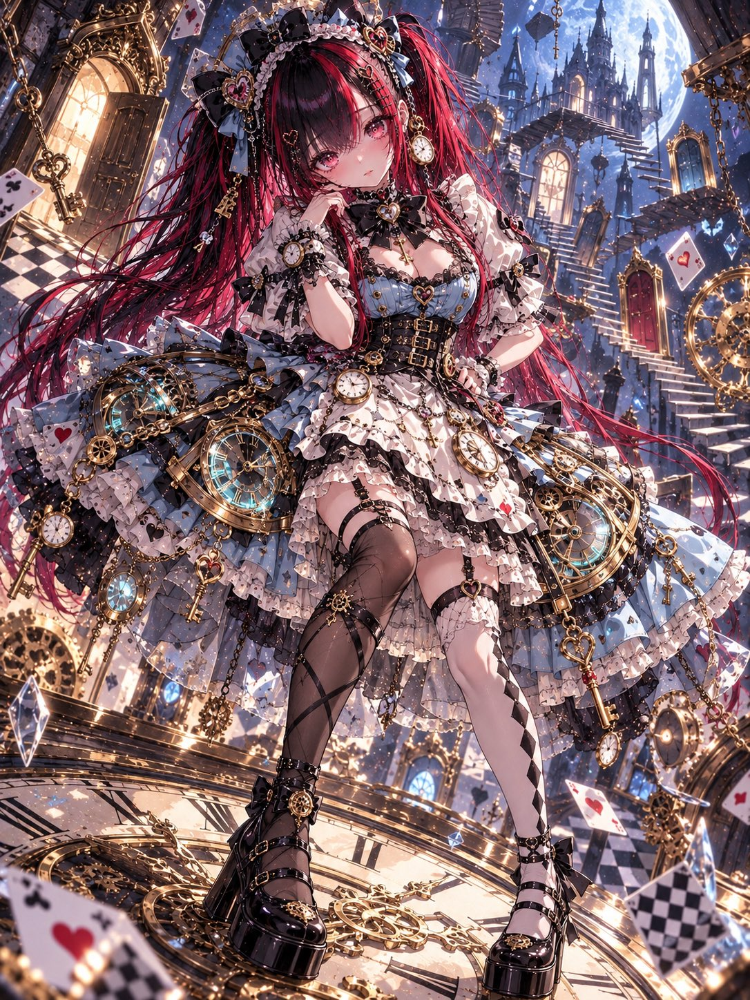
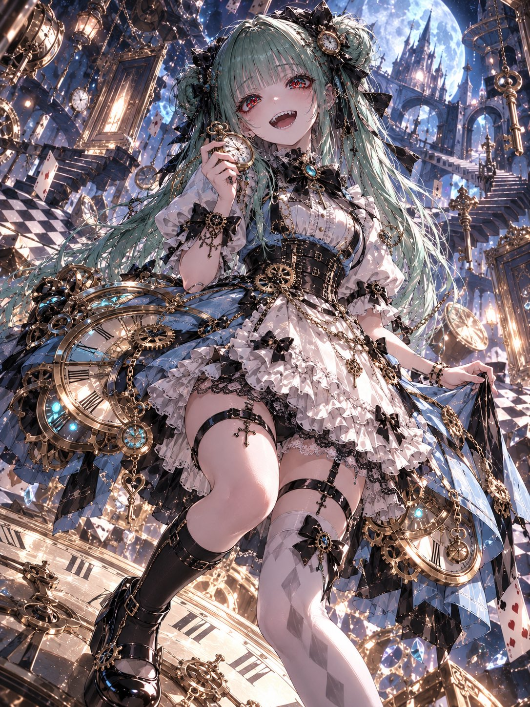
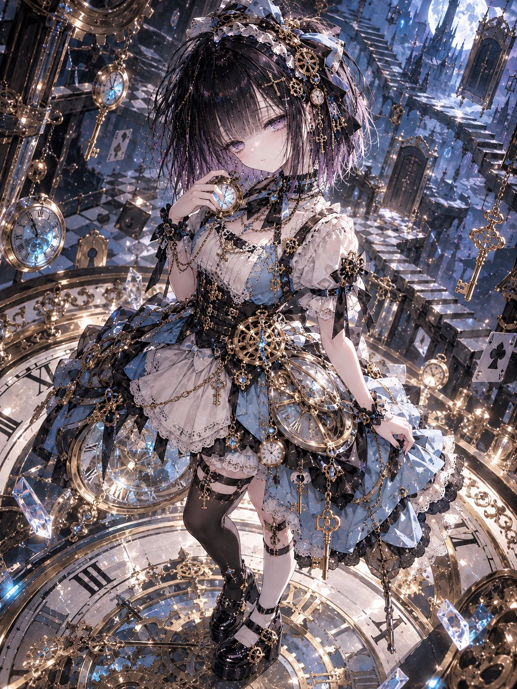
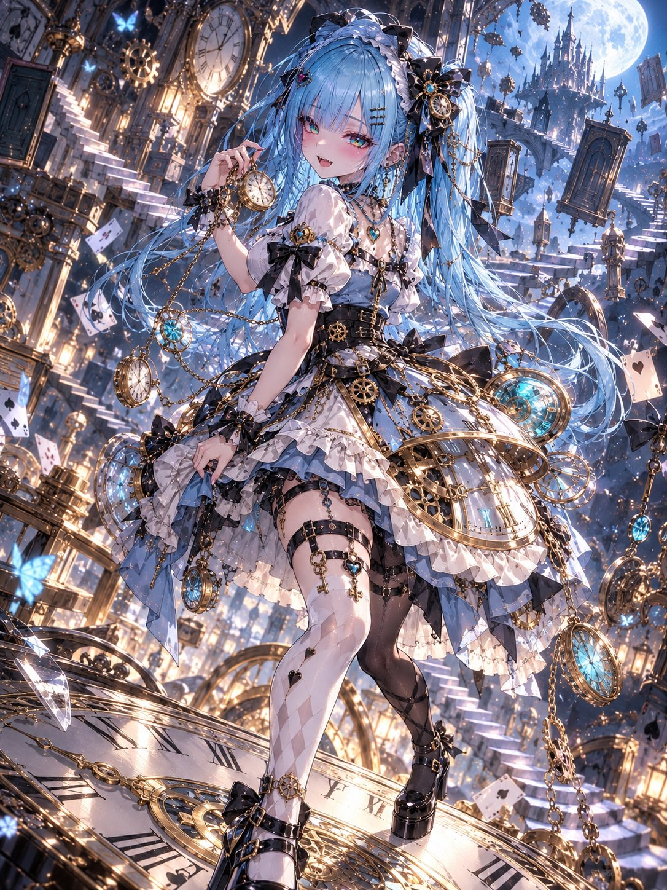

# Clockwork Alice：机械齿轮爱丽丝礼服（衣装 prompt）

- 原帖链接：https://x.com/ENJU1123PIPI/status/2116658977320898835
- 作者：るんちゃん🦋（@ENJU1123PIPI）
- 时间：2026-11-01 06:30 (UTC+8 / Asia/Hong_Kong)
- 互动摘要：点赞 103 · 转发 33 · 回复 3 · 引用 15 · 书签 14 · 浏览 4247（采集快照：2026-11-02 09:08 UTC+8）
- 模型/工具：未注明（日系 AI 插画 / 衣装プロンプト；作者写可贴角色参考）
- 标签：二次元
- 媒体路径：
  - `media/images/2116658977320898835_1.jpg`（）
  - `media/images/2116658977320898835_2.jpg`（）
  - `media/images/2116658977320898835_3.jpg`（）
  - `media/images/2116658977320898835_4.jpg`（）
- 入库日期：2026-11-02
- 备注：prompt 位于作者自回复（note_tweet）。

## prompt 原文

```text
01 — CLOCKWORK ALICE COUTURE

Alice in Wonderland × Clockwork Machinery × Dark Fantasy Fashion.

Use the attached character as the sole reference. Preserve their face, hairstyle, hair color, eyes, body proportions, accessories, and personality. Completely redesign the outfit.

COSTUME DESIGN

Create an elaborate mechanical Alice-inspired outfit, balancing Alice 60% × Clockwork 40%.

Colors: powder blue, black, ivory, antique gold, and glowing cyan accents.

A fitted blue dress with a black corset waist, white puff sleeves, black ribbons, lace, and a layered short skirt with an ivory apron panel.

Integrate functional-looking golden gears, transparent clock-face panels, rotating mechanical rings, brass hinges, miniature pocket watches, and delicate chains directly into the clothing.

Add a large Alice-style hair bow, asymmetric stockings, black platform Mary Jane shoes, and secure inner shorts.

For masculine characters, adapt the design into a tailored mechanical Wonderland officer outfit.

POSE & COMPOSITION

Dynamic three-quarter full-body composition with dramatic perspective.

The character stands on an enormous tilted clock face, holding an antique pocket watch near the chest while the other hand rests naturally near the waist or skirt.

The mechanical skirt spreads outward, revealing intricate golden machinery.

Expression: curious, mischievous, dreamy, or slightly smug, matching the original personality.

BACKGROUND

A surreal mechanical Wonderland filled with floating clocks, giant gears, antique keys, suspended staircases, mysterious doors, and warped checkerboard floors.

Cool blue moonlight contrasts with warm golden machinery. Floating glass fragments and magical particles create cinematic depth.

ART STYLE

Masterpiece anime illustration, expressive linework, strong dimensional cel shading, glass-like irises, detailed hair highlights, luxurious lace and fabric textures, polished brass reflections, intricate mechanical construction, dramatic lighting, rich contrast, and exceptional costume detail.

Cute yet sophisticated, with the dress itself functioning as an elaborate clockwork masterpiece.

Single character only. No text, logos, watermarks, extra characters, distorted anatomy, malformed hands, or exaggerated reaching poses.
```

---

个人学习归档，非商业。prompt 与媒体版权归原作者 @ENJU1123PIPI，引用请回到原帖。
