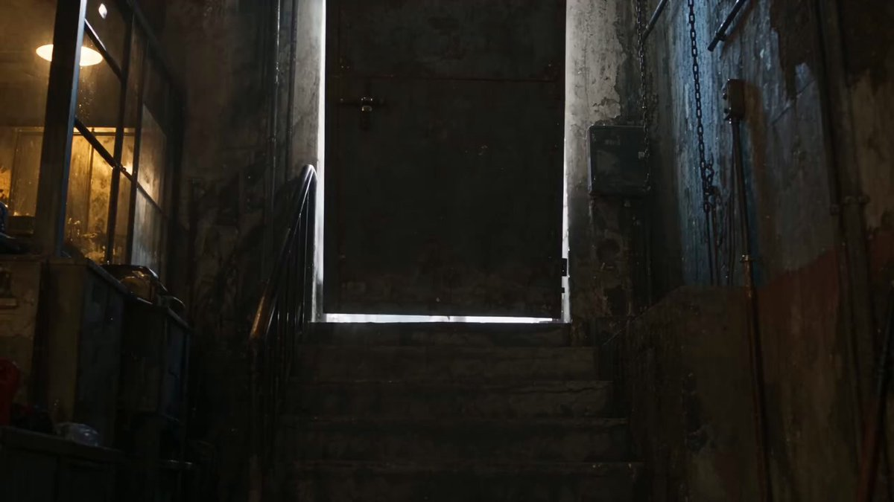
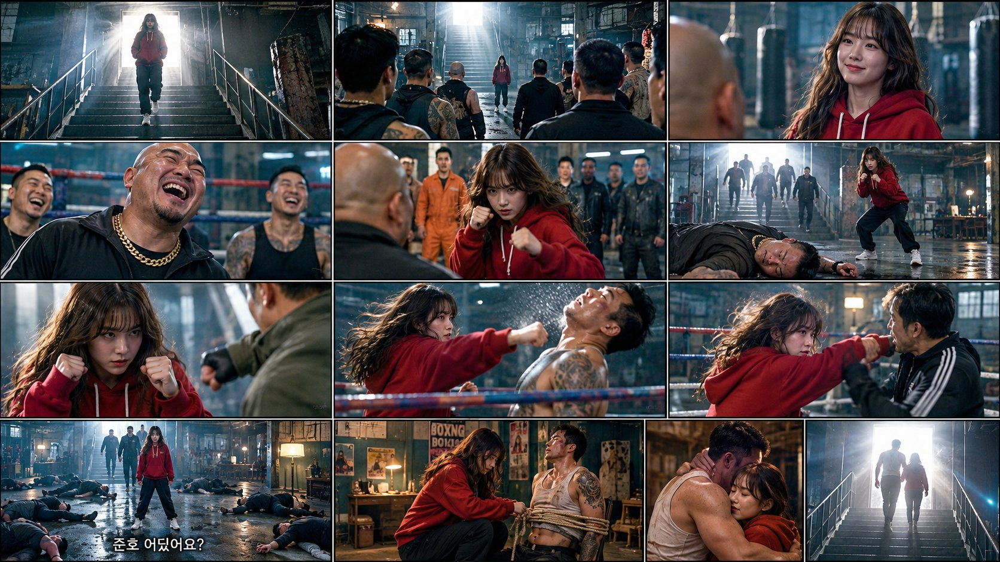

# 废弃拳馆红卫衣女主分镜（Seedance 2.5 故事板 prompt）

- 原帖链接：https://x.com/ItsMaryamAi/status/2116739355205308486
- 作者：Maryam（@ItsMaryamAi）
- 时间：2026-11-01 11:49 (UTC+8 / Asia/Shanghai)
- 互动摘要：点赞 63 · 转发 13 · 回复 13 · 引用 1 · 书签 30 · 浏览 2829（采集快照：2026-11-02 20:10 UTC+8）
- 模型/工具：Seedance 2.5
- 标签：真人
- 媒体路径：
  - `media/video-stills/2116739355205308486_1.jpg`（视频截图，视频文件不入库，仅保留原帖链接）（）
  - `media/images/2116739864406392959_1.jpg`（）
- 入库日期：2026-11-02
- 备注：视频帖；prompt 位于作者自回复 https://x.com/ItsMaryamAi/status/2116739864406392959 ，回复附带的分镜图一并入库。

## prompt 原文

```text
Video prompt Cinematic storyboard frame, 16:9 widescreen, live-action film still, gritty abandoned boxing gym, volumetric dust and light beams from a bright doorway, teal-and-amber color grade, shallow depth of field. Heroine: young Korean woman, long wavy dark-brown hair with bangs, oversized red hoodie with white drawstrings, black pants, white sneakers.
Panels:
Wide, low angle: She walks down the staircase from a blinding white doorway toward camera, haze in the air, silhouette edged with light.
Over-the-shoulder, wide: Back view of a group of muscular tattooed thugs facing the stairs; the small red-hoodie girl stands at the bottom, hands in pockets.
Medium close-up: She smiles calmly, hands in her hoodie pocket, a blurred bald head in the foreground, punching bags behind her.
Close-up: A bald heavyset man with a thick gold chain laughs mockingly, two henchmen laughing beside him, ring ropes blurred behind.
Medium, dynamic: She charges at the bald man in a boxing guard stance, onlookers in an orange jumpsuit and black jackets behind them.
Wide: The bald man lies knocked out on the wet floor, she crouches in a fighting stance, more thugs rushing down the stairs, backlit.
Side close-up: Her fists up beside her face, fierce eyes, a man in an olive jacket throws a punch at her, light shafts behind.
Medium, at the ring: She lands a punch on a shirtless tattooed fighter with taped hands, his head snapping back, ring ropes in the foreground.
Medium: She trades blows with a man in a black white-striped tracksuit beside the ring, hair flying.
Wide, symmetrical: Defeated men scattered on the floor, she stands unharmed in the center. Korean subtitle at the bottom: "준호 어딨어요?"
Medium two-shot: Back room with a desk lamp and boxing posters; a muscular man in a dirty white tank top is tied to a chair, she kneels beside him untying the rope.
Close-up, warm light: He hugs her tightly, her eyes closed in relief, soft focus, warm lamp glow.
Extreme wide: From the dark gym, the couple walks up the staircase into the blinding white doorway, silhouettes, lens flare.
```

---

个人学习归档，非商业。prompt 与媒体版权归原作者 @ItsMaryamAi，引用请回到原帖。
