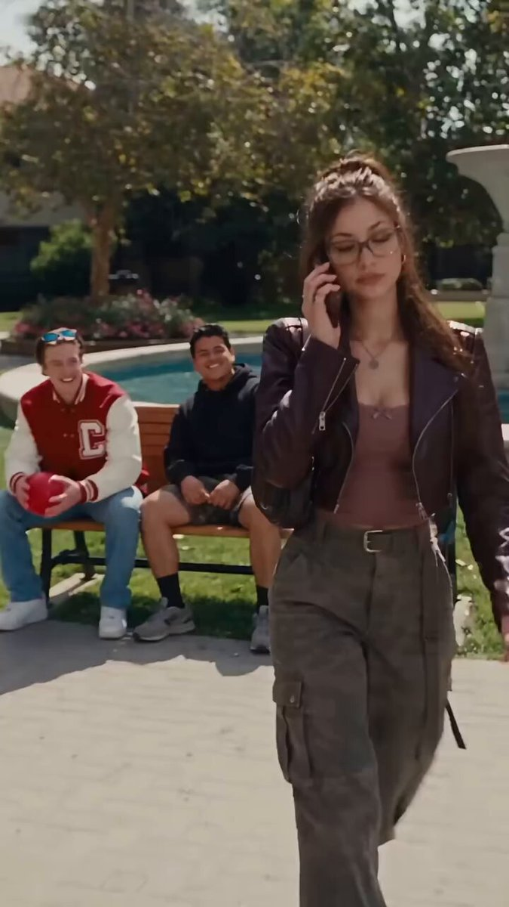

# 校园泳池边走向两位男生（Seedance 2.5 图生视频）

- 原帖链接：https://x.com/SeeratFatima112/status/2116792378103345437
- 作者：Seerat Fatima（@SeeratFatima112）
- 时间：2026-11-01 15:20 (UTC+8 / Asia/Shanghai)
- 互动摘要：点赞 652 · 转发 44 · 回复 57 · 引用 3 · 书签 128 · 浏览 167740（采集快照：2026-11-02 20:10 UTC+8）
- 模型/工具：Seedance 2.5
- 标签：真人
- 媒体路径：
  - `media/video-stills/2116792378103345437_1.jpg`（视频截图，视频文件不入库，仅保留原帖链接）（）
- 入库日期：2026-11-02
- 备注：视频帖；prompt 位于作者自回复 https://x.com/SeeratFatima112/status/2116792384420012297 。API 返回文本止于“Vertical 9:16 vide”，疑似原文即截断，按原样保留。

## prompt 原文

```text
🎬 AI Video Generation Prompt

Use the uploaded image as the first frame and visual reference. Create a highly realistic, cinematic university campus scene.

A young woman with long, straight brown hair, wearing a dark brown leather jacket and black pants, walks confidently toward two young men sitting on a wooden bench beside a beautiful swimming pool. One man wearing a red varsity jacket smiles and waves at her with excitement, while the other man wearing a black hoodie smiles and laughs naturally.

The woman approaches them with natural body movements. The two men react warmly and happily as she comes closer.

Camera Movement: Smooth cinematic follow shot from behind the woman, slowly moving forward toward the two men. Subtle handheld camera movement for a realistic movie-like feeling.

Visual Style: Ultra-realistic, cinematic Hollywood movie look, natural facial expressions, realistic body movements, beautiful sunny daylight, soft shadows, detailed environment, natural colors, 4K quality.

Important Instructions:

Maintain consistent faces and clothing.

Keep the same background and environment.

Natural human movements and expressions.

No face distortion or body deformation.

No extra people appearing.

No text, subtitles, or watermark.

Vertical 9:16 vide
```

---

个人学习归档，非商业。prompt 与媒体版权归原作者 @SeeratFatima112，引用请回到原帖。
