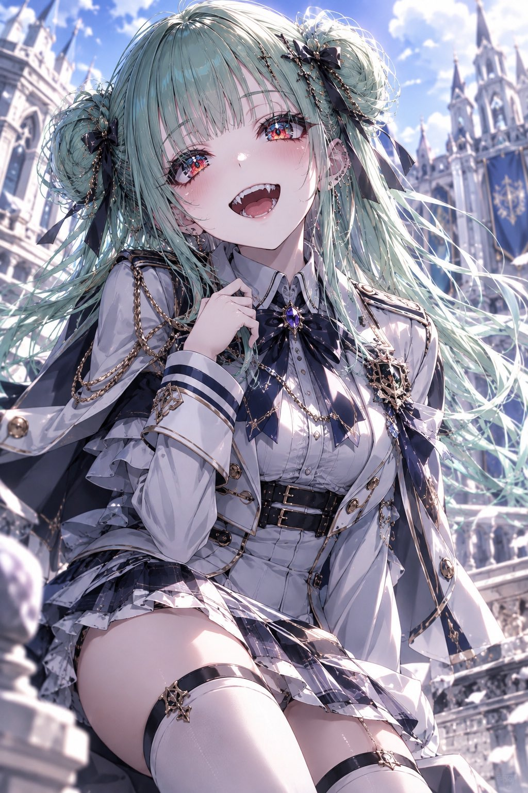
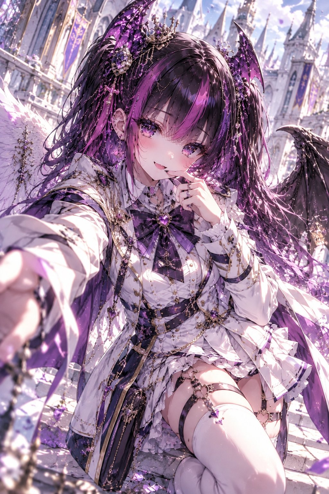
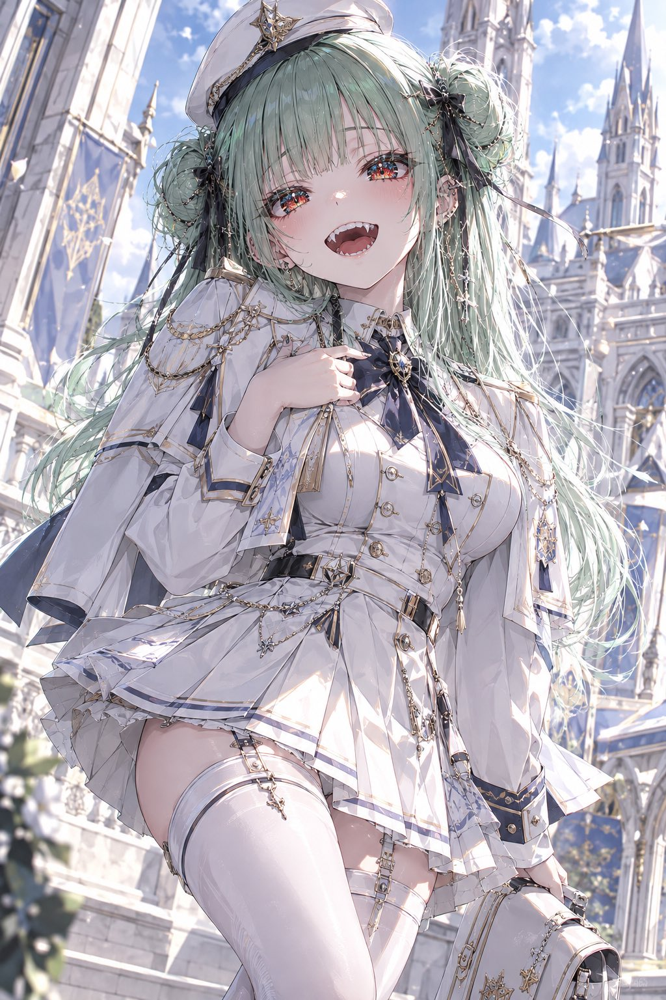
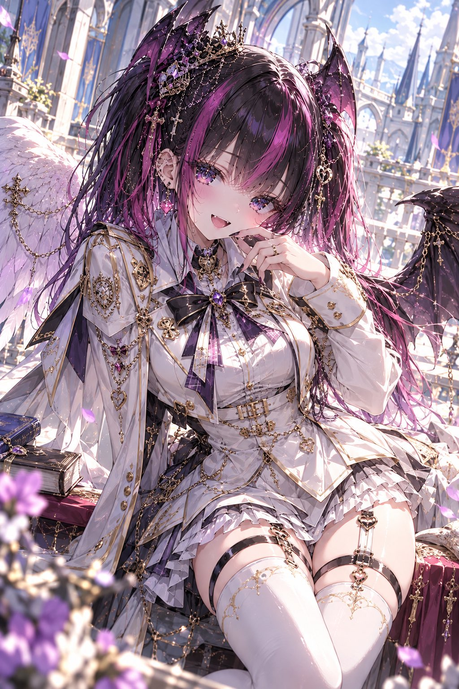

# 白色礼式军服学院装（衣装 prompt）

- 原帖链接：https://x.com/ENJU1123PIPI/status/2116832634454098359
- 作者：るんちゃん🦋（@ENJU1123PIPI）
- 时间：2026-11-01 18:00 (UTC+8 / Asia/Hong_Kong)
- 互动摘要：点赞 81 · 转发 26 · 回复 3 · 引用 8 · 书签 8 · 浏览 2163（采集快照：2026-11-02 09:08 UTC+8）
- 模型/工具：未注明（日系 AI 插画 / 衣装プロンプト；作者写可贴角色参考）
- 标签：二次元
- 媒体路径：
  - `media/images/2116832634454098359_1.jpg`（）
  - `media/images/2116832634454098359_2.jpg`（）
  - `media/images/2116832634454098359_3.jpg`（）
  - `media/images/2116832634454098359_4.jpg`（）
- 入库日期：2026-11-02
- 备注：prompt 位于作者自回复（note_tweet）。

## prompt 原文

```text
Use the attached character as the sole reference.

Preserve the original character’s face, hairstyle, hair color, eye color, body proportions, accessories, gender presentation, personality, and recognizable art style.

Completely replace the original outfit.

WHITE ROYAL MILITARY ACADEMY UNIFORM

Create an original fantasy academy uniform combining 60% school uniform × 40% royal military officer style.

Main color: pure white.
Accents: ivory, silver, soft gray, subtle navy, and antique gold.

Elegant, prestigious, youthful, refined, and fashionable.

Outfit design:

Tailored white academy jacket with a structured school collar
Silver piping, elegant buttons, and subtle gold embroidery
Decorative epaulettes and ceremonial shoulder details
School ribbon or necktie with a jeweled academy brooch
Fitted waist, decorative belt, and delicate chains
Small crest ornaments without readable lettering
Optional short capelet or white officer cap

Feminine design:
Short pleated skirt with fitted safety shorts, elegant white thigh-high stockings or knee-high socks, polished academy boots or loafers.

Masculine design:
Tailored white blazer, fitted trousers, structured officer collar, ceremonial belt, and polished academy boots.

Preserve the character’s original gender presentation.

Keep the outfit clearly recognizable as a school uniform, enhanced with elegant military details. No heavy armor or real-world military insignia.

COMPOSITION & EXPRESSION

Dynamic three-quarter or full-body composition with cinematic perspective.

Choose a natural, character-appropriate pose:

Standing confidently on academy stairs
Walking through a grand courtyard
Adjusting a collar, ribbon, or academy cap
Holding a book or elegant school satchel
Looking back over the shoulder with a flowing capelet

Preserve the character’s signature expression and personality.

BACKGROUND

Prestigious fantasy royal academy featuring white stone architecture, grand staircases, Gothic arches, tall windows, elegant banners, and a bright sky.

Soft daylight, warm golden reflections, subtle rim lighting, atmospheric depth, and cinematic shadows.

ART QUALITY

Masterpiece anime illustration, highly detailed character design, expressive linework, glass-like multilayered irises, intricate iris reflections, rich fabric textures, polished metallic ornaments, dimensional cel shading, beautiful hair highlights, cinematic composition, sharp focus.

Maintain strong visual separation between the white uniform and the background.

Avoid: identity changes, incorrect anatomy, extra limbs or fingers, broken hands, excessive exposure, bulky armor, extra characters, readable text, logos, watermarks, collages, or split panels.

One character. One standalone illustration.
```

---

个人学习归档，非商业。prompt 与媒体版权归原作者 @ENJU1123PIPI，引用请回到原帖。
