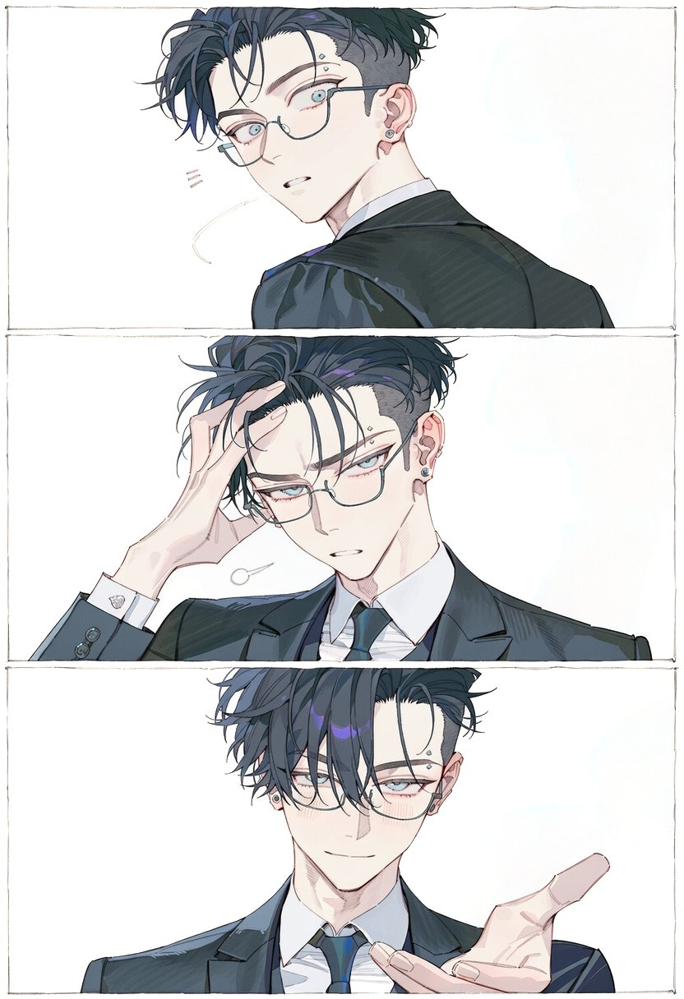
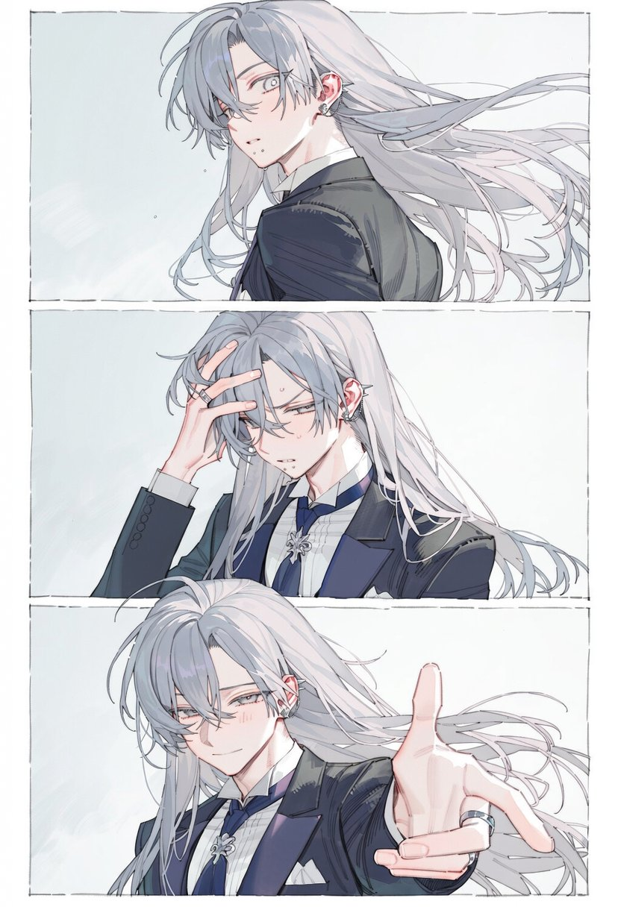
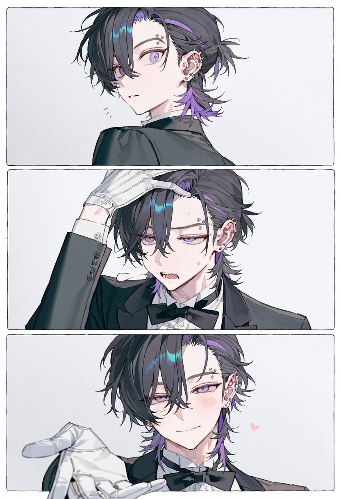
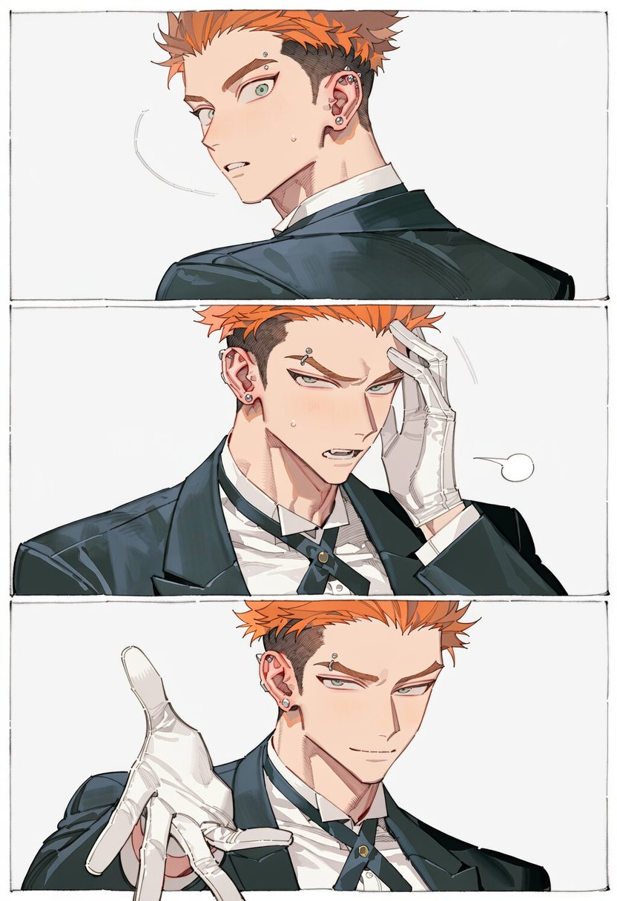
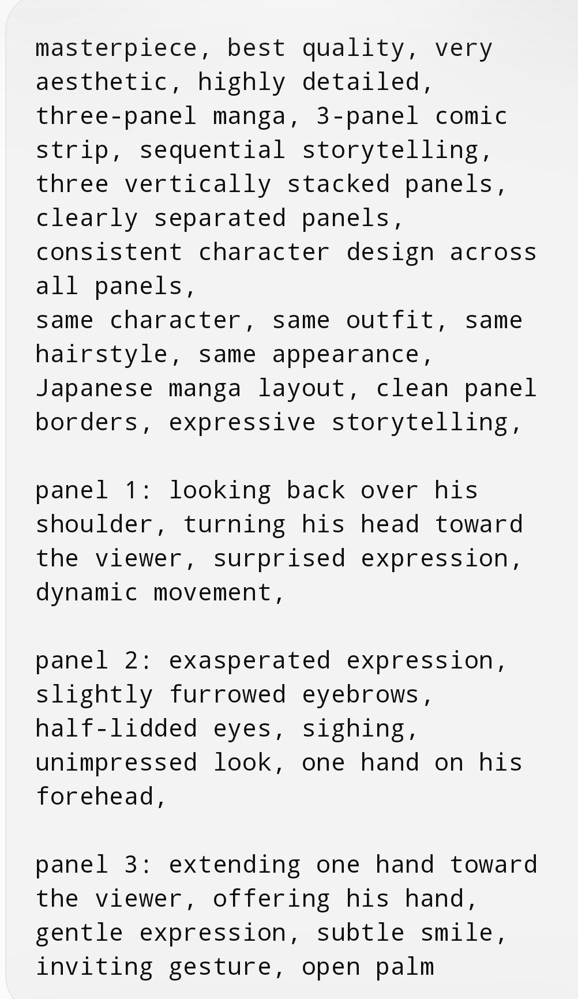

# 三格漫画「又摔倒了？来，手」：眼镜西装男回头-扶额-伸手

- 原帖链接：https://x.com/shiyuhu_tadano/status/2117125322261062014
- 作者：只野しふゆ（@shiyuhu_tadano）
- 时间：2026-11-02 13:23 (UTC+8 / Asia/Shanghai)
- 互动摘要：点赞 169 · 转发 19 · 回复 2 · 引用 9 · 书签 133 · 浏览 6062（采集快照：2026-11-02 20:10 UTC+8）
- 模型/工具：NovelAI / TSUBAKI3 / ChatGPT（作者注明）
- 标签：二次元
- 媒体路径：
  - `media/images/2117125322261062014_1.jpg`（）
  - `media/images/2117125322261062014_2.jpg`（）
  - `media/images/2117125322261062014_3.jpg`（）
  - `media/images/2117125322261062014_4.jpg`（）
  - `media/images/2117125329479430451_1.jpg`（）
- 入库日期：2026-11-02
- 备注：prompt 原以图片形式发在作者自回复 https://x.com/shiyuhu_tadano/status/2117125329479430451 ，此处为逐字转写（换行按图片排版），原图一并入库（文件名以回复 id 开头）。

## prompt 原文

```text
masterpiece, best quality, very aesthetic, highly detailed,
three-panel manga, 3-panel comic strip, sequential storytelling,
three vertically stacked panels, clearly separated panels,
consistent character design across all panels,
same character, same outfit, same hairstyle, same appearance,
Japanese manga layout, clean panel borders, expressive storytelling,

panel 1: looking back over his shoulder, turning his head toward the viewer, surprised expression, dynamic movement,

panel 2: exasperated expression, slightly furrowed eyebrows, half-lidded eyes, sighing, unimpressed look, one hand on his forehead,

panel 3: extending one hand toward the viewer, offering his hand, gentle expression, subtle smile, inviting gesture, open palm
```

---

个人学习归档，非商业。prompt 与媒体版权归原作者 @shiyuhu_tadano，引用请回到原帖。
