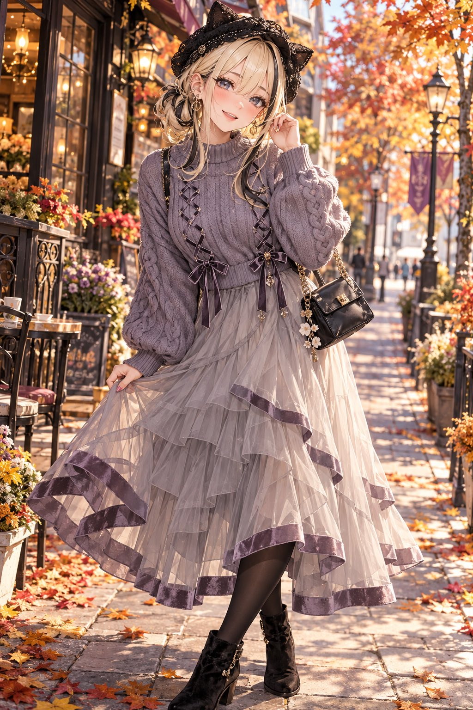
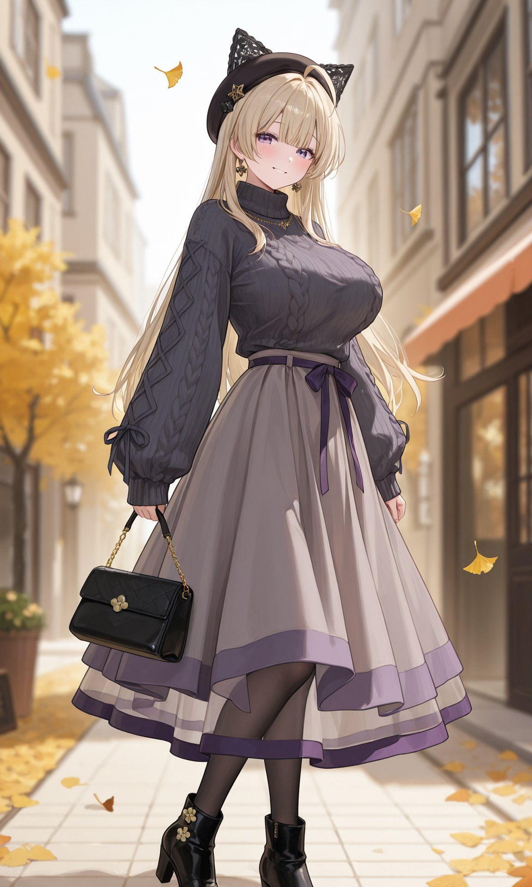
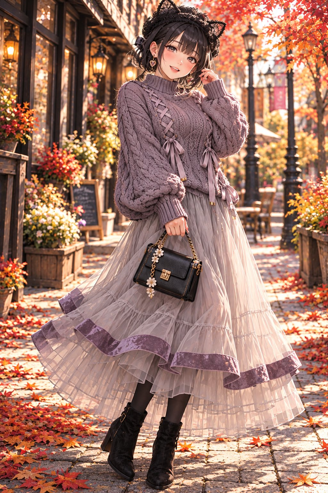
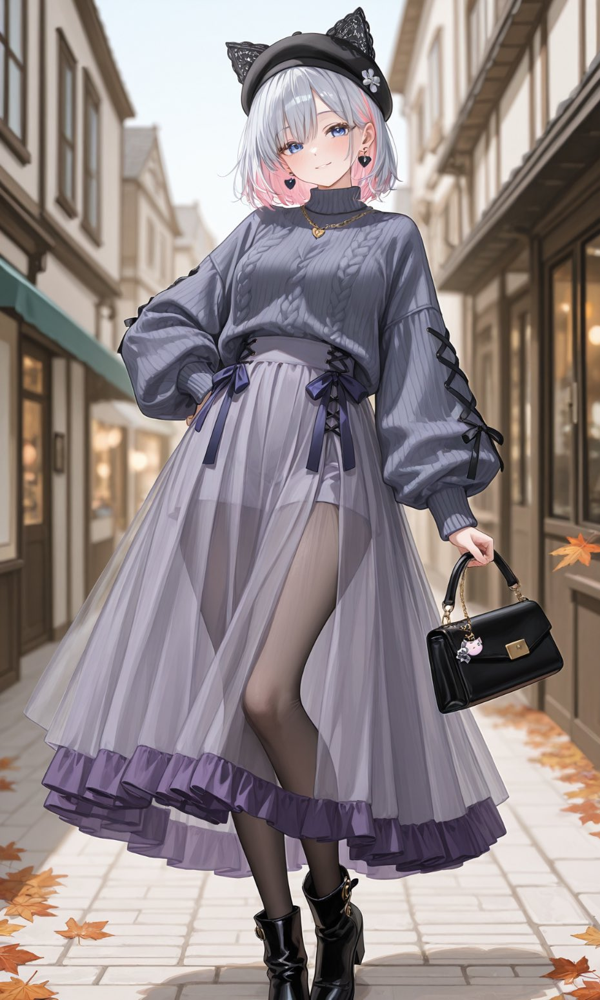

# 黑蕾丝猫耳贝雷帽 + 灰紫麻花针织 + 纱裙（衣装 prompt）

- 原帖链接：https://x.com/naanfa257023/status/2116376360595882211
- 作者：Nia⭐︎AIart（@naanfa257023）
- 时间：2026-10-31 11:46 (UTC+8 / Asia/Taipei)
- 互动摘要：点赞 43 · 转发 9 · 回复 2 · 引用 3 · 书签 5 · 浏览 1880（采集快照：2026-11-03 09:04 UTC+8）
- 模型/工具：未注明
- 标签：二次元
- 媒体路径：
  - `media/images/2116376360595882211_1.jpg`（）
  - `media/images/2116376360595882211_2.jpg`（）
  - `media/images/2116376360595882211_3.jpg`（）
  - `media/images/2116376360595882211_4.jpg`（）
- 入库日期：2026-11-03
- 备注：prompt 位于第 1 张图的 ALT 文字与作者自回复，两处内容一致；以下摘自自回复 https://x.com/naanfa257023/status/2116376365931106366 。仅为衣装部分，角色描述需自行补充。

## prompt 原文

```text
プロンプト⇩

black lace cat-ear beret, oversized dusty gray-purple cable-knit sweater with front crisscross lace-up ribbons and hanging ribbon bows at waist, fully covered chest, completely closed sweater front,
no exposed skin around the neckline or chest,
no corset design, no open chest,balloon sleeves with ribbed cuffs, long flowing multi-layered sheer tulle skirt in pale ash-gray with wide muted purple velvet hem trim, black opaque tights, black suede heeled ankle boots, small black structured handbag with gold chain and floral charms
```

---

个人学习归档，非商业。prompt 与媒体版权归原作者 @naanfa257023，引用请回到原帖。
