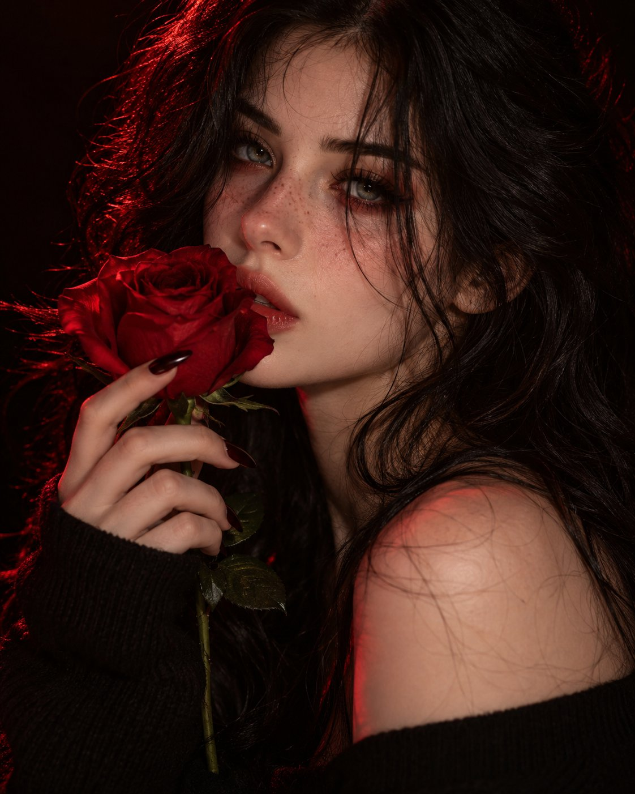

# 暗调红玫瑰贴唇写实人像

- 原帖链接：https://x.com/Monaqbuv/status/2116575930709660156
- 作者：Mona（@Monaqbuv）
- 时间：2026-11-01 01:00 (UTC+8 / Asia/Taipei)
- 互动摘要：点赞 47 · 转发 2 · 回复 11 · 引用 1 · 书签 7 · 浏览 539（采集快照：2026-11-03 20:10 UTC+8）
- 模型/工具：未注明
- 标签：真人
- 媒体路径：
  - `media/images/2116575930709660156_1.jpg`（）
- 入库日期：2026-11-03
- 备注：prompt 即原帖正文（note_tweet），含标题行与画幅比例。

## prompt 原文

```text
AI Image Prompt — Dark Romantic Red Rose Portrait

Create an ultra-realistic close-up portrait of a beautiful adult woman with long, messy jet-black hair, delicate freckles across her nose and cheeks, captivating gray-green eyes, and soft natural makeup. She gently holds a deep crimson-red rose against her lips, with long dark-painted nails and a black off-shoulder sweater. Dramatic red lighting illuminates her face against a pitch-black background, creating a mysterious, romantic, dark feminine aesthetic. Realistic skin texture, soft cinematic shadows, shallow depth of field, DSLR photography, high detail, 8K quality.

Aspect Ratio: 4:5
```

---

个人学习归档，非商业。prompt 与媒体版权归原作者 @Monaqbuv，引用请回到原帖。
