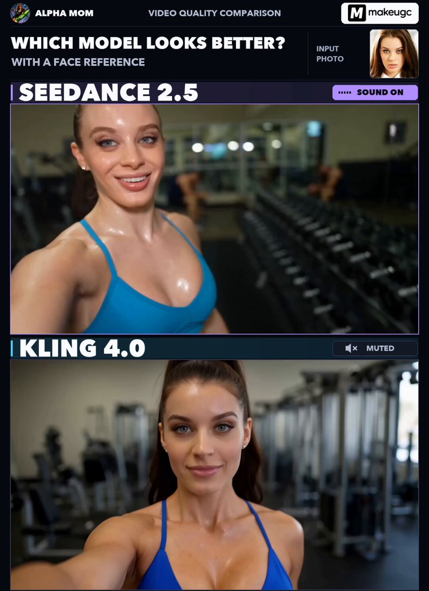

# DV 手持感健身房 vlog 分镜（Seedance 2.5 vs Kling 4.0 同 prompt 对比）

- 原帖链接：https://x.com/YourAlphaMom/status/2116635769729323171
- 作者：Alpha Mom（@YourAlphaMom）
- 时间：2026-11-01 04:57 (UTC+8 / Asia/Taipei)
- 互动摘要：点赞 71 · 转发 4 · 回复 10 · 引用 0 · 书签 95 · 浏览 8638（采集快照：2026-11-03 20:10 UTC+8）
- 模型/工具：Seedance 2.5 vs Kling 4.0（makeugc 平台，图像角色参考）
- 标签：真人
- 媒体路径：
  - `media/video-stills/2116635769729323171_1.jpg`（视频截图，视频文件不入库，仅保留原帖链接）（）
- 入库日期：2026-11-03
- 备注：视频帖；prompt 位于原帖正文（note_tweet）「PROMPT 👇」之后。前面的对比评论与 #AIVideo 标签未收入 prompt 区。prompt 中角色设定为 20 岁成年人。

## prompt 原文

```text
**CAMERA:**
DV 16mm tape camcorder handheld feel. MILA from  image1 films the opening and closing selfies herself; her gym friend films the dumbbell exercises handheld. Hand shake, misaligned framing, delayed focus pulls, clumsy zooms, occasional face cut-off framing, imperfect shots. Camcorder and camera operator never appear on screen.

**LOOK:**
Soft, slightly blurry tape quality, faint tape noise, bloomed highlights under gym lighting, flickering auto-exposure, muted contrast, realistic skin tones.

**STYLE:**
Playful, self-deprecating gym-vlog tone — genuine effort mixed with humor. Quick, casual cuts between excerpts from an ongoing workout. Exercise shots begin and end mid-set, with continuous rhythmic repetitions at normal speed. She talks while moving, without stopping to pose. Time passes between clips; equipment setup and camera handoffs happen off-screen.

**Character**

MILA — a beautiful American Instagram-style brunette model and performer, 20. Long dark-brown hair in a high ponytail, natural skin texture with a light sweat sheen, glossy lips, expressive eyes, soft glam makeup and delicate sparkly stud earrings. Slim athletic figure with a very large, full bust, very full rounded buttocks, a narrow waist, flat stomach, lean arms and slender legs.

She wears a cobalt-blue supportive sports bra with thin straps and a deep scoop neckline showing cleavage, paired with matching ultra-short fitted athletic shorts. Bare shoulders, arms and midriff. White ankle socks, sneakers off. She speaks with an American accent.

**Setting**

A gym dumbbell area in the evening — weight racks, benches, soft overhead lighting. Two other gym-goers exercise casually in the background, away from MILA. An angled mirror naturally reflects her back, blue shorts and legs in wider shots. She uses the same matching pair of small black hex dumbbells throughout.

**Storyboard (15s, 6 shots)**

1. *(0–2.5s, moving arm’s-length selfie)* Already walking past the weight rack, MILA smiles toward the lens and briefly glances at the equipment. Her face and blue sports bra are visible; the framing bobs with her footsteps. MILA: “Arm day. This should be quick.”

2. *(2.5–5s, handheld medium shot)* Cut into an ongoing set of standing alternating dumbbell curls. One arm rises as the other lowers; she keeps the rhythm while speaking. The camera drifts slightly with the operator’s movement. MILA: “These felt lighter yesterday.”

3. *(5–7.5s, handheld wider three-quarter shot)* Another excerpt: MILA is already doing lateral raises, repeatedly lifting and lowering both dumbbells without holding a pose. Her rear view is visible in the mirror. MILA (breathless): “I picked the light ones!”

4. *(7.5–9.5s, handheld close-up insert)* Her hand and forearm grip a dumbbell through the continuing repetitions. The camera briefly loses focus as the weight moves, then catches it again. No dialogue — breathing and distant gym sounds.

5. *(9.5–12s, handheld medium-wide shot)* MILA walks briskly past the camera toward the rack, carrying both dumbbells beside her thighs. The operator turns to follow her as she laughs. MILA: “Yep — my arms just quit.”

6. *(12–15s, arm’s-length selfie after the set)* A clear jump cut: the dumbbells have been returned, and MILA is already holding the camera herself. Walking out of the weights area, she shakes out her free hand and grins. MILA: “Same time tomorrow? No promises.”
```

---

个人学习归档，非商业。prompt 与媒体版权归原作者 @YourAlphaMom，引用请回到原帖。
