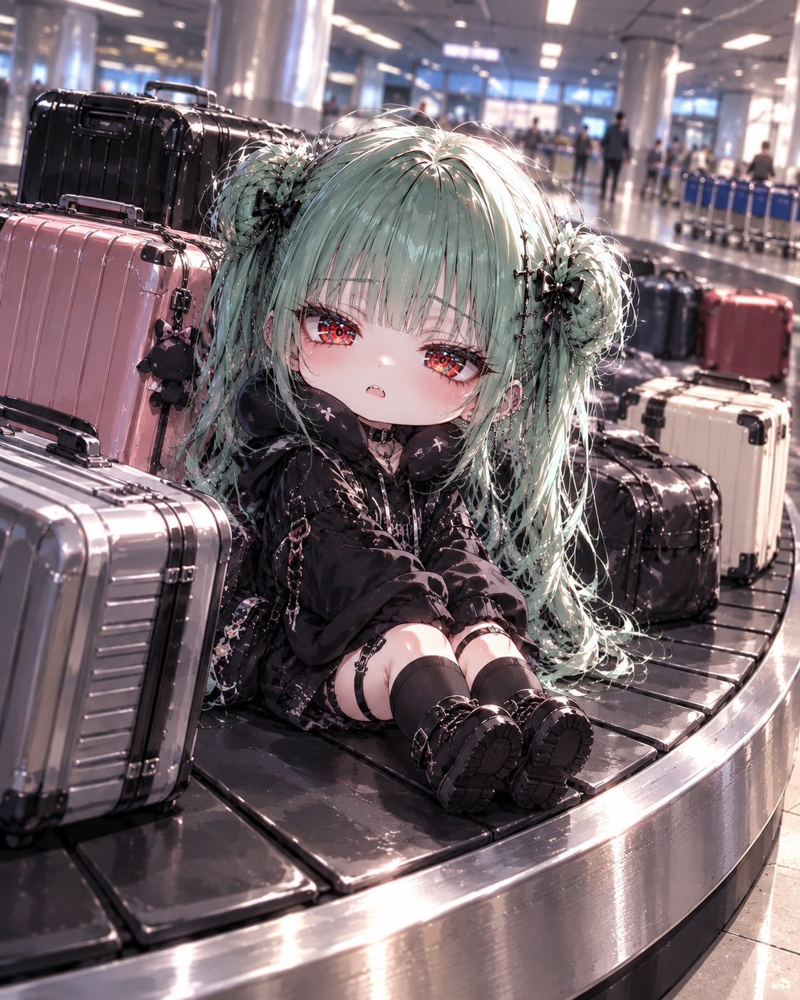
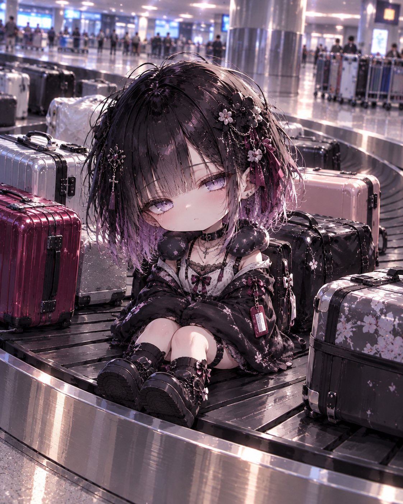

# 行李转盘上的 Q 版角色（#るんプロンプト 第238弾）

- 原帖链接：https://x.com/ENJU1123PIPI/status/2116674075816772023
- 作者：るんちゃん🦋（@ENJU1123PIPI）
- 时间：2026-11-01 07:30 (UTC+8 / Asia/Taipei)
- 互动摘要：点赞 121 · 转发 28 · 回复 9 · 引用 20 · 书签 16 · 浏览 7080（采集快照：2026-11-03 20:10 UTC+8）
- 模型/工具：未注明（角色参考图驱动的通用生图 prompt）
- 标签：二次元
- 媒体路径：
  - `media/images/2116674075816772023_1.jpg`（）
  - `media/images/2116674075816772023_2.jpg`（）
  - `media/images/2116674075816772023_3.jpg`（）
  - `media/images/2116674075816772023_4.jpg`（）
- 入库日期：2026-11-03
- 备注：prompt 位于作者自回复 https://x.com/ENJU1123PIPI/status/2116674077028925495 （note_tweet）。需上传自己的角色图作参考。

## prompt 原文

```text
Use the attached character as the only character. Preserve their recognizable face, hairstyle, hair color, eyes, accessories, and personality.

BAGGAGE CAROUSEL COMEDY

Create a hilarious, high-quality anime illustration of the character transformed into an adorable 3-head-tall chibi, sitting calmly on a moving airport baggage carousel among 4–6 ordinary suitcases, as if they were checked luggage.

Pose: Oversized head, tiny body, short legs, feet together, sitting upright with hands hidden in oversized sleeves or resting on the lap. Simple, anatomically correct proportions.

Expression: Randomly choose a deadpan stare, sleepy half-lidded eyes, puffed cheeks, innocent smile, mildly annoyed face, or suspicious sideways glance. The character behaves as if this ridiculous situation is completely normal.

Outfit: Random original travel fashion matching the character’s personality, such as an oversized hoodie, casual streetwear, sporty outfit, or comfortable airport clothing. Optional cute neck pillow and luggage tag.

Scene: Curved moving baggage carousel, assorted suitcases, polished airport floor, luggage carts, and softly blurred terminal background. Add subtle conveyor motion blur and playful visual comedy.

Composition: Dynamic three-quarter camera angle, clear view of the carousel, character surrounded by luggage. Prioritize an instantly funny situation, expressive face, and strong visual storytelling.

Premium comedic anime artwork, detailed glossy eyes, crisp linework, cinematic lighting, vibrant colors, adorable chibi proportions.

Exactly ONE character. No readable text, no logos, no extra limbs, no broken hands or feet.
```

---

个人学习归档，非商业。prompt 与媒体版权归原作者 @ENJU1123PIPI，引用请回到原帖。
