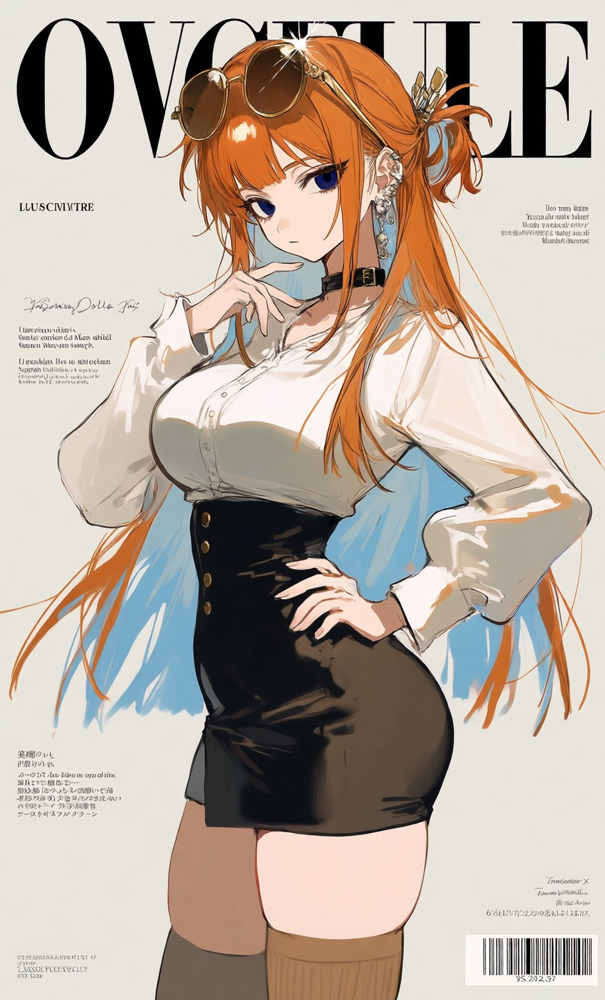
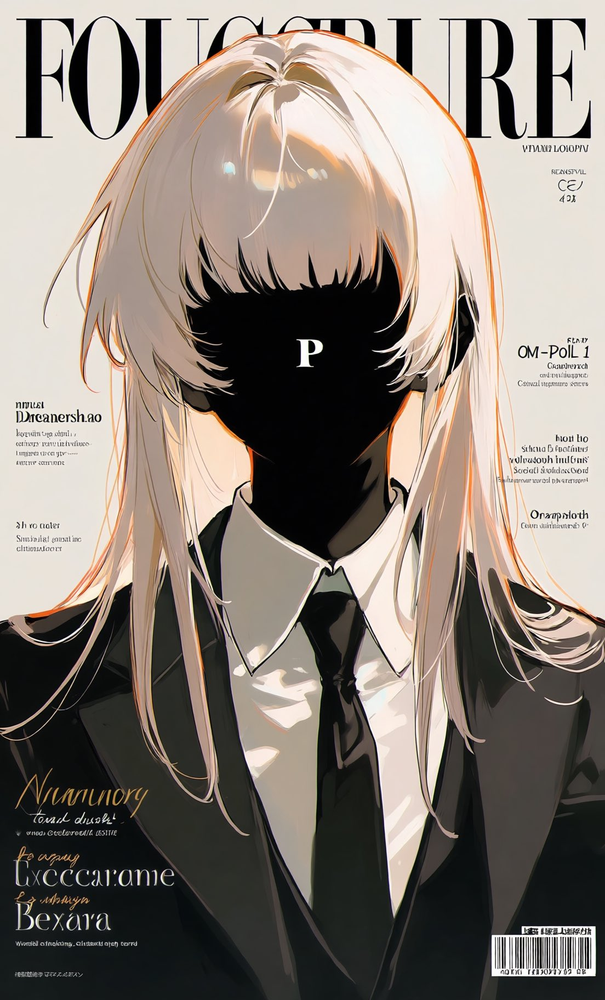
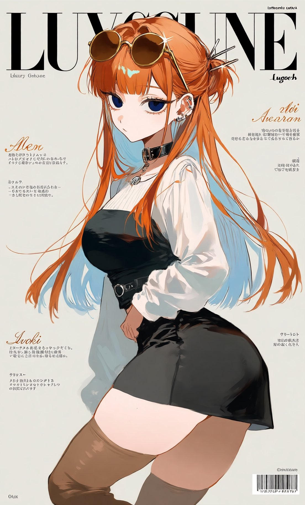

# 「一键杂志封面风」通用质量/排版 tag 串

- 原帖链接：https://x.com/YukimitiMuti2/status/2116872221868302673
- 作者：ゆきみちもちもち全部制限中@トワ教幹部@律風教@♥ダウナー教♡【232日間語尾…♡9/20迄猫】（@YukimitiMuti2）
- 时间：2026-11-01 20:37 (UTC+8 / Asia/Taipei)
- 互动摘要：点赞 47 · 转发 7 · 回复 1 · 引用 17 · 书签 23 · 浏览 4061（采集快照：2026-11-03 20:10 UTC+8）
- 模型/工具：未注明（tag 式 prompt，适用 NovelAI / SD 类）
- 标签：二次元
- 媒体路径：
  - `media/images/2116872221868302673_1.jpg`（）
  - `media/images/2116872221868302673_2.jpg`（）
  - `media/images/2116872230949007793_1.jpg`（）
- 入库日期：2026-11-03
- 备注：prompt 位于作者自回复 https://x.com/YukimitiMuti2/status/2116872230949007793 的图片 ALT 中，按 ALT 原文收录；该回复的图片一并入库（文件名以回复 id 开头）。

## prompt 原文

```text
masterpiece, best quality, editorial fashion magazine cover, luxury fashion magazine design, sophisticated graphic design, professional magazine layout, high-end fashion editorial photography, stylish character portrait, elegant typography, carefully arranged text elements, bold masthead at the top, oversized title lettering, small editorial headlines around the subject, minimal text blocks, clean grid layout, asymmetrical composition, generous negative space, refined kerning, modern sans-serif typography, contrasting serif typography, fine print, subtle issue number, barcode at the bottom corner, premium print design, glossy magazine cover, sophisticated color palette, harmonious color coordination, professional art direction, balanced visual hierarchy, crisp details, contemporary fashion publication aesthetic
```

---

个人学习归档，非商业。prompt 与媒体版权归原作者 @YukimitiMuti2，引用请回到原帖。
