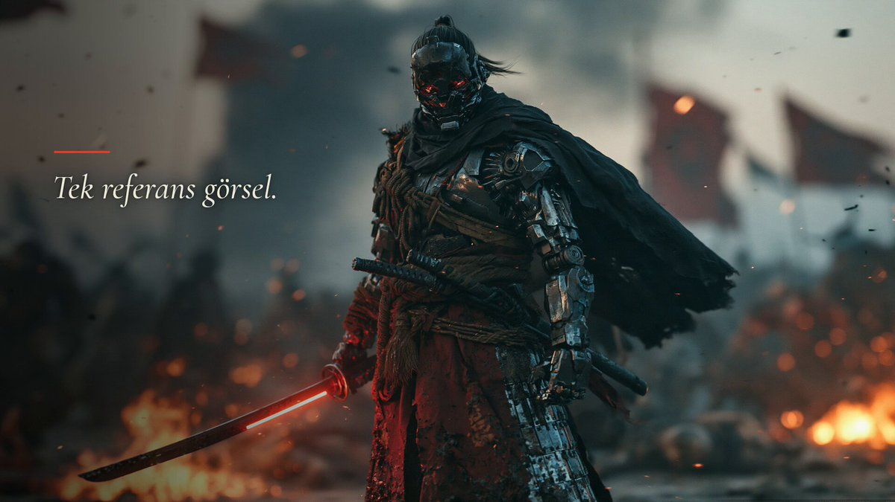

# Midjourney 起始帧 + 同一 prompt 跑 6 个视频模型：武士斩外星生物

- 原帖链接：https://x.com/ozansihay/status/2116879021002625229
- 作者：Ozan Sihay（@ozansihay）
- 时间：2026-11-01 21:04 (UTC+8 / Asia/Taipei)
- 互动摘要：点赞 67 · 转发 3 · 回复 25 · 引用 0 · 书签 17 · 浏览 7580（采集快照：2026-11-03 09:04 UTC+8）
- 模型/工具：起始帧：Midjourney v8.2；视频：H3 Max、FLUX 3 Max、Gemini Omni Flash v1.1、Seedance 2.5、Kling v4、Wan 3.0（原帖顺序对照）
- 标签：其它
- 媒体路径：
  - `media/video-stills/2116879021002625229_1.jpg`（）
  - 视频仅保留原帖链接，仓库不存视频文件。
- 入库日期：2026-11-03
- 备注：prompt 位于作者自回复 https://x.com/ozansihay/status/2116879599246131428 ，作者标注为土耳其语原始 prompt。截图为视频封面。

## prompt 原文

```text
Orijinal prompt (Türkçe):

Samuray kameraya doğru koşmaya başlar. Kamera onun önünde geriye doğru ilerleyerek takip eder ve o hızlanır. Dünya dışı yaratıklar her yönden üzerine saldırır. Samuray akıcı, sinematik kılıç darbeleriyle hepsini biçer. Sahnenin temposu hiç düşmez, farklı sinematik kamera açılarına geçiş yapılır.
```

---

个人学习归档，非商业。prompt 与媒体版权归原作者 @ozansihay，引用请回到原帖。
