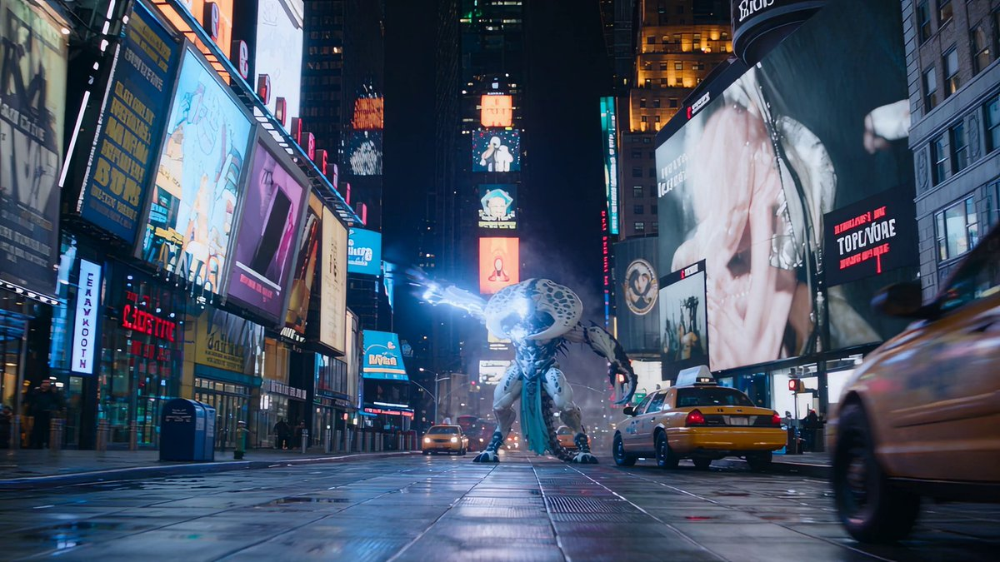
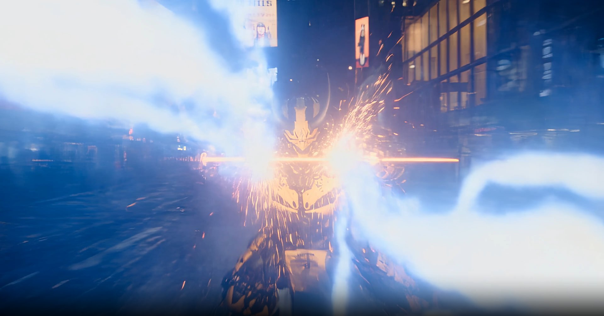

# 校车变形机甲武士时代广场斩怪（Seedance 2.5，30 秒逐秒分镜）

- 原帖链接：https://x.com/tokyo_Valentine/status/2116902934760108283
- 作者：とすくん（@tokyo_Valentine）
- 时间：2026-11-01 22:39 (UTC+8 / Asia/Taipei)
- 互动摘要：点赞 118 · 转发 23 · 回复 4 · 引用 2 · 书签 49 · 浏览 3475（采集快照：2026-11-03 20:10 UTC+8）
- 模型/工具：Seedance 2.5
- 标签：其它
- 媒体路径：
  - `media/video-stills/2116902934760108283_1.jpg`（视频截图，视频文件不入库，仅保留原帖链接）（）
  - `media/images/2116902939319316602_1.jpg`（）
- 入库日期：2026-11-03
- 备注：视频帖；prompt 位于作者自回复 https://x.com/tokyo_Valentine/status/2116902939319316602 （note_tweet），该回复附带的参考图一并入库（文件名以回复 id 开头）。

## prompt 原文

```text
Seedance 2.5 Prompt
SEEDANCE 2.5 — 30-SECOND CINEMATIC BATTLE

FORMAT AND LOOK
30 seconds, 16:9. Photorealistic cinematic science-fiction action in Times Square, New York, at night. Spectacular, powerful combat with extreme acceleration, readable impacts, and extensive building destruction. Blue-white electricity contrasts with yellow armor and golden energy. Preserve visible armor detail in the darkness and control highlight exposure.

Action-movie camerawork continues every single second. Give every one-second beat the camera action specified below. Connect movements coherently; continuous shots may bridge beats. Maintain screen direction and clear spatial relationships throughout.

REFERENCE IDENTITIES AND SCALE
Image 1: the warrior AFTER transformation. Approximately 20 meters total standing height, reaching the fifth-to-sixth-floor window bands of the surrounding buildings. Preserve the reference's yellow-and-black mechanical samurai armor, horned helmet, face, cables, layered plates, and overall silhouette. One Japanese katana and its scabbard. The warrior uses swordsmanship and golden energy waves.

Image 2: the monster. Approximately 25 meters total standing height, reaching the seventh-floor window band. A comparable heavyweight opponent, visibly one size larger than the warrior: the warrior defeats a larger, stronger-looking enemy. Preserve the reference's ivory-white spotted shell, enormous curved head structures, dark mechanical framework, long claws, and trailing appendages. Its attacks are blue-white electricity emitted from its body and rapidly extending mechanical claws. Its interior is machinery, and its destruction produces mechanical scrap only.

Image 3: the unoccupied yellow school bus, approximately 12 meters LONG before transformation. Preserve its recognizable body, hood, grille, windows, black stripes, and wheels. No driver or passengers.

Use all three references for DESIGN ONLY; the dimensions above override apparent reference-image scale. Treat the stated floor bands as visual staging guides. Keep building windows, taxis, traffic lights, and people at ordinary scale. The monster remains approximately 1.25 times the warrior's standing height, never several times taller.

The bus and warrior are ONE transforming entity. During transformation, nested parts successively unfold, telescope, expand, and extend, assembling a warrior much larger than the original bus. Show this growth progressively from the 12-meter vehicle into the 20-meter warrior. The final armor and silhouette must match Image 1. Integrate every bus section; leave no separate bus or miniature warrior behind. Once transformed, both combatants keep their fixed sizes through the end.

For scale, include ordinary humans, yellow taxis, traffic lights, and multiple building-window rows together with the giants in shared compositions. In the dedicated civilian shot, people are close to the camera and both giants are farther behind them: humans remain readable and are physically much shorter than the warrior's knees. Maintain correct perspective.

ONE-SECOND ACTION AND CAMERA TIMELINE
00–01s:
Begin at the exact instant the monster releases branching blue-white electricity from its whole body. A bolt visibly hits a giant LED billboard and blows its panels outward. Street-level wide-angle push-in links the monster, bolt, and explosion in one composition. No introductory pause.

01–02s:
The discharge jumps into adjacent billboards and building facades. LED panels burst in sequence and glass rains down. A fast upward crane follows the electrical path, keeping the monster's 25-meter scale readable against window rows.

02–03s:
The monster's mechanical claws extend rapidly and spear an abandoned yellow taxi through its body. A low lateral tracking shot shows the claw make contact and lift the crushed vehicle; the taxi stays tiny beside the monster.

03–04s:
The monster whips its arm and throws the impaled taxi free into a nearby facade. A whip-pan follows the taxi into a shower of masonry and glass. An approaching bus horn starts beneath the impact.

04–05s:
The reference school bus charges into the avenue at high speed, horn sounding. A low front-quarter tracking camera races beside its bumper. Reflections of blue electrical strikes sweep across the windshield; the seats and driver's position are empty.

05–06s:
Lightning strikes the road beside the bus. It swerves and enters a hard sideways drift, dodging the discharge while spraying tire smoke and road debris. An exterior lateral tracking shot keeps the full 12-meter bus readable.

06–07s:
Without stopping the drift, body panels unlock and split along mechanical seams. The chassis articulates and nested framework begins expanding. Track the transformation from the same side, retaining its momentum and visible mechanical connections.

07–08s:
Telescoping leg assemblies extend dramatically; wheels retract into layered armor and long bus sections unfold into the hips and limbs. The expanding body rises above the traffic lights. The tracking camera tilts upward as the warrior grows.

08–09s:
The torso and shoulders expand, yellow plates lock around black machinery, and the reference horned helmet rises into position. The katana and scabbard settle into their final mounting. A rising three-quarter camera reveals the assembly approaching its full 20-meter height, every part still visibly connected.

09–10s:
The fully formed Image 1 warrior lands from the transforming drift at exactly its fixed 20-meter scale. Its feet carve trenches through asphalt. It draws the katana in the same landing motion. A low forward tracking shot catches the completed silhouette, blade, and shock of the landing.

10–11s:
One full second of fleeing civilians at human eye level. Track backward in front of people running and screaming. Behind them, clearly show BOTH the 20-meter warrior and 25-meter monster, with a taxi, traffic lights, and building-window rows in the same frame. Keep the people large enough in the foreground to read their urgency.

11–12s:
The monster launches a rapid sequence of extending-claw strikes. The warrior deflects them with three sharp katana parries while advancing. A lateral tracking camera shows each contact, recoil, and shower of sparks. Claw tips gouge the facade behind the warrior.

12–13s:
The monster fires a blue-white electrical blast; the warrior counters with a golden energy wave from its free palm. An over-the-shoulder push-in shows the waves collide between them and burst outward, breaking nearby windows. Neither fighter changes size.

13–14s:
The warrior redirects its momentum onto a building wall and runs upward. Every footfall visibly crushes the facade, blasting concrete and glass away from the point of contact. Track upward alongside its feet and body, showing the building bear its weight.

14–15s:
It takes another powerful wall-running step, demolishing a new section of facade, then launches into the air. The monster jumps to intercept. An upward crane follows the leap through the expanding cloud of shattered windows and concrete.

15–16s:
First aerial crossing: katana meets an extended claw in a clearly visible midair collision. The impact blasts apart a large LED sign beside them. A fast lateral camera follows their opposing trajectories without losing either silhouette.

16–17s:
The warrior kicks off the opposite facade, crushing it, and crosses the airborne monster again. The monster twists into a second claw attack, which the warrior redirects with its blade. A controlled tracking arc captures the second contact and the cascade of building fragments.

17–18s:
The warrior lands in a broad street-level skid, katana held in one hand, free palm aimed at the descending monster. Golden energy compresses at its palm. A low tracking push follows the skid into the firing position, with no prolonged charging pose.

18–19s:
The warrior releases a powerful golden energy wave directly into the monster's torso. A clear side-wide view shows the emission, direct hit, and sudden backward acceleration as one connected action. The monster is thrown toward a high-rise.

19–20s:
The monster crashes bodily through several lower floors of the high-rise. Track its flight into the impact, then widen to reveal broken columns, bursting windows, and the damaged tower above it. The collision initiates the collapse.

20–21s:
The damaged high-rise buckles and collapses progressively from the impact zone. A rapid crane backward reveals upper sections dropping, facade slabs cascading, and dust rolling into the avenue. Keep the monster's location at the base identifiable; collapse continues into following shots.

21–22s:
The monster forces itself upright out of the rubble while the building continues falling behind it. Electricity intensifies across its white shell and extended claws. A low push-in emphasizes its larger frame and renewed threat.

22–23s:
It unleashes maximum-output electricity straight toward the warrior, with secondary arcs tearing through surrounding signs and facades. An over-the-monster-shoulder tracking push establishes the electrical torrent and the warrior bracing at its far end.

23–24s:
Golden energy coats the katana. The warrior drives forward and cuts into the advancing electrical torrent, dividing it around the blade. A low frontal retreating camera holds the warrior's recognizable face and sword inside the split stream.

24–25s:
The warrior accelerates through the opened channel. Split blue-white lightning tears into buildings on either side while the golden blade remains sharply visible. A fast side-tracking shot shows the decreasing distance to the monster and the contrasting sizes of both bodies.

25–26s:
In one decisive pass, the warrior delivers ONE enormous golden diagonal katana slash through the monster's mechanical body. Use a clear three-quarter side view that shows actual blade contact and follow-through. Keep both figures visible; no full-screen flash conceals the strike.

26–27s:
The slash triggers a chain of fractures through the entire monster. Its white shell breaks into many pieces, curved head structures fracture, and black mechanical components burst outward with sparks and blue electrical arcs. A short lateral camera move keeps the physical fragmentation plainly visible.

27–28s:
The remaining monster disintegrates completely into a broad explosive spray of mechanical scrap. Pull wide to show hundreds of white shell fragments, black gears, cables, and extinguishing electrical arcs raining over the destroyed street. No intact monster remains. The warrior lands beyond it with the golden blade extended.

28–29s:
Amid falling fragments, the warrior calmly brings the katana back toward its scabbard. A moving medium three-quarter shot contrasts its controlled motion with clattering scrap, settling dust, and burning wreckage. The blade's golden light fades enough to reveal its solid edge.

29–30s:
The warrior completes the sheathing motion with a distinct metallic click. A low camera pulls back to reveal its full 20-meter silhouette against devastated Times Square: collapsed high-rise sections, ruined facades, shattered LED billboards, wrecked taxis, and drifting debris. Finish on the composed warrior, with the monster completely destroyed.

SOUND DESIGN
Spatial city ambience, screams and running footsteps during the civilian shot, electrical crackling and thunderous discharges, sequential billboard explosions, glass rainfall, the bus horn, engine acceleration, tire squeal, interlocking transformation mechanisms, heavy landing impacts, sharp katana-and-claw contacts, wall-crushing footfalls, energy-wave impacts, a deep progressive building-collapse rumble, and the final shower of clattering scrap. Let the last scabbard click remain distinct. No spoken dialogue or narration.

CONTINUITY AND EXCLUSIONS
Preserve the night setting, reference designs, weapon ownership, and fixed post-transformation scale. No human-sized versions of the combatants, no duplicate bus, no duplicate warrior, no cockpit or pilot, no unrelated extra weapons, and no fire-breathing attack.

No blood, gore, flesh, or organs: the defeated monster becomes white shell fragments and black mechanical scrap.

No subtitles, captions, title cards, or added watermarks. Reference vehicle markings and environmental signage may remain as physical scene elements.

Avoid slow-motion-dominated fighting, unreadable motion blur, unexplained teleportation, premature cuts away from destruction, and flashes that hide the transformation or final fragmentation.
```

---

个人学习归档，非商业。prompt 与媒体版权归原作者 @tokyo_Valentine，引用请回到原帖。
