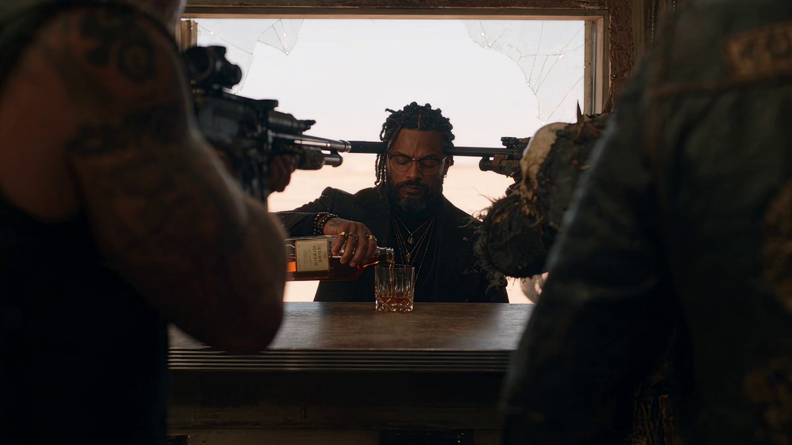
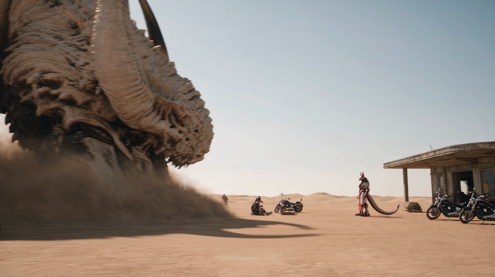

# 沙漠加油站店主变身击败机械沙虫（Seedance 2.5，30 秒逐秒分镜）

- 原帖链接：https://x.com/tokyo_Valentine/status/2117089826390618536
- 作者：とすくん（@tokyo_Valentine）
- 时间：2026-11-02 11:02 (UTC+8 / Asia/Taipei)
- 互动摘要：点赞 95 · 转发 23 · 回复 10 · 引用 4 · 书签 30 · 浏览 7125（采集快照：2026-11-03 20:10 UTC+8）
- 模型/工具：Seedance 2.5
- 标签：其它
- 媒体路径：
  - `media/video-stills/2117089826390618536_1.jpg`（视频截图，视频文件不入库，仅保留原帖链接）（）
  - `media/images/2117089830656168010_1.jpg`（）
- 入库日期：2026-11-03
- 备注：视频帖；prompt 位于作者自回复 https://x.com/tokyo_Valentine/status/2117089830656168010 （note_tweet），该回复附带的参考图一并入库（文件名以回复 id 开头）。

## prompt 原文

```text
Seedance 2.5 Prompt
Create a 30-second photorealistic cinematic action short, 16:9, at an old isolated desert gas station. Dusty sunlight, worn timber, weathered concrete and realistic physical weight. A tense gang confrontation escalates into a spectacular mechanical-monster explosion, ending with the shopkeeper's deadpan composure. NO BGM.

MANDATORY CAMERA RULE
Action-movie camerawork continues every second throughout the entire video.
Use the one-second action and camera beats below. Maintain purposeful tracking, low-angle moves, push-ins, whip-pans and motivated cuts throughout. Adjacent beats may form continuous moving shots; a cut every second is not mandatory. Keep geography clear, preserve scale, and show each decisive action. No prolonged slow motion.

REFERENCE ASSIGNMENT
Image 1: the shopkeeper's transformed body, exactly 3.2 m tall. Preserve the white, red and black biomechanical armor, fox-mask head, tall pointed head projections, clawed hands, red hanging apron and long segmented spiked tail.

Image 2: the SAME shopkeeper in human form, approximately 1.85 m tall. Preserve his face, tied-back braids, salt-and-pepper beard, glasses, black patterned suit, gold accessories and RIGHT-HAND tattoo. Use the black outfit only.

Image 3: the 2 m outlaw is the LEADER of a biker gang of approximately TEN people total: this leader plus NINE other adult bikers. Preserve the leader's reference face, hair, beard, skull shoulder armor, torn dark coat and long scoped sniper rifle. Give the nine companions distinct faces, hairstyles, builds and variations of the same weathered wasteland biker clothing, with firearms. They are not nine copies of the leader.

Image 4: the sandworm, 25 m tall when fully reared above the sand. Preserve its silhouette, single central eye, huge fanged mouth, curved horns and layered ivory bone-like outer armor. Its body is MECHANICAL beneath that shell: segmented metal chassis, cables, actuators and a fictional glowing energy core. Damage reveals machinery, sparks and metal fragments, never flesh or organs. It has no limbs.

Images 1 and 2 are two forms of ONE shopkeeper. Transform the same continuous body; never leave a human duplicate behind. Only the shopkeeper transforms and fires the red beam.
The biker gang remains approximately ten people across the sequence. Show the group clearly in wide shots, with distinct individuals occupying real positions.
Use reference sheets for appearance only; omit their panels, labels, measurement guides and backgrounds.

GEOGRAPHY AND CONTINUITY
The shop has a long counter, wide aisles and a broad open entrance. All ten bikers initially occupy the shop and entrance, surrounding the counter and blocking the exit. The shopkeeper stands alone behind the counter.
The gang's motorcycles are parked outside. The worm emerges at the sandy edge beyond the forecourt and swallows the LEADER'S motorcycle. The gang then fires together from the forecourt toward the same worm.
After the beam hits, the worm collapses away from the shop into open sand. Its mechanical body is the source of the explosions and fire column. Preserve the shop and counter.
Leave the same glasses and poured whisky on the counter until the ending. The leader's same rifle is fired, crushed and returned, and remains ruined.
The gang escapes on foot. The leader's swallowed motorcycle never reappears.
There is NO money exchange, no payment, no cash on the counter and no return to the counter by the leader.

ONE-SECOND ACTION AND CAMERA PLAN

00-01s:
Start inside the shop, already at maximum tension. A low tracking move passes armed bikers' shoulders and reveals the leader pressing his scoped rifle muzzle against the human shopkeeper's forehead across the counter. The shopkeeper calmly pours whisky.

01-02s:
Slide laterally into a wide composition revealing approximately ten threatening bikers around the counter, aisles and entrance. Several aim their weapons at the lone shopkeeper; others block his exit. Maintain the whisky pour visibly in the foreground.

02-03s:
Push through the threatening rifle line to the shopkeeper's glasses. His pupils flash red for an instant behind the lenses. He finishes pouring without trembling or changing expression.

03-04s:
Track along the shelves as a sudden underground tremor shakes the shop. Bottles rattle, fall and smash. The bikers lose their threatening composure and turn toward the disturbance; the shopkeeper stays calm.

04-05s:
Whip-pan to cracks spreading across the window, then push toward the exterior view as a massive moving ridge of sand rises beyond the parked motorcycles. Bikers at the entrance recoil and move outside.

05-06s:
Ground-level exterior tracking rises with the enormous sandworm erupting through the sand. Its horned crown spreads as its head clears the ground. Reveal the full 25 m height against the tiny station while the gang pours through the broad entrance.

06-07s:
Fast downward tracking follows the worm's jaws scooping up the leader's motorcycle and swallowing it whole. Show the rear wheel disappear. All ten bikers reach the forecourt and raise their weapons toward the worm.

07-08s:
A moving wide shot clearly shows the ENTIRE ten-person gang opening fire together. Multiple simultaneous muzzle flashes form a broad line across the foreground. The leader fires rapid individual shots from his recognizable scoped rifle; all companions fire toward the same target.

08-09s:
Track across the worm's ivory outer armor as the combined barrage ricochets off in a storm of sparks and metallic impacts. Include the firing gang in the lower foreground to connect the volley to the impacts. The outer shell remains unpenetrated.

09-10s:
Snap push toward the ONE central eye locking onto the gang. The worm lowers its vast armored head and releases a deafening mechanical roar. Pull back enough to show the gunmen faltering together as the huge mouth advances.

10-11s:
Rapid sideways tracking through the panicking group. The bikers stop firing and scatter visibly in several directions, stumbling, ducking and scrambling around motorcycles and posts. The leader trips backward beside the entrance. Show multiple fleeing people at once, not a single runner.

11-12s:
Cut inside with a controlled moving close-up. The shopkeeper silently removes his glasses and sets them beside the untouched whisky. Through the open entrance, several bikers are still running in panic.

12-13s:
Low rear tracking follows the human shopkeeper walking outside against the direction of the fleeing gang. Frightened bikers rush past him while he maintains a calm, measured stride.

13-14s:
Tight moving close-up on the RIGHT-HAND tattoo igniting red. Energy spreads up his arm, his body begins expanding, and his black suit splits along its seams.

14-15s:
Rising three-quarter orbit follows the SAME body growing as white, red and black armor unfolds over the torso and limbs. Torn suit fragments are absorbed into the transformation.

15-16s:
Continue the rising move as the fox-mask head completes, the red apron unfurls and the long spiked tail extends. Finish on ONE fully transformed 3.2 m shopkeeper, with no remaining human duplicate.

16-17s:
Low wide dolly establishes the 3.2 m shopkeeper facing the much larger 25 m worm. Several bikers retreat toward the edges of the forecourt; the leader remains on the ground by the entrance. Keep all scales and positions readable.

17-18s:
Fast side tracking follows the worm lunging down toward the transformed shopkeeper with its enormous jaws open. Its heavy mechanical segments drive through the sand and throw a rolling sand wave ahead.

18-19s:
Low front-quarter push-in on the shopkeeper, standing firmly without retreating. He extends his RIGHT arm toward the incoming eye and opens his palm. A short, concentrated red charge forms there.

19-20s:
A single straight red beam erupts from his RIGHT palm. Track laterally in a wide composition that shows the palm, the complete beam path and the worm's eye aligned together. Make the beam's origin in the shopkeeper's hand unmistakable.

20-21s:
Push toward the SINGLE eye as the same beam penetrates its lens and the armored head. The shell splits, revealing glowing machinery and broken metal components. A red energy surge runs into the segmented internal chassis. No blood or biological tissue.

21-22s:
Pull out rapidly as the worm buckles and crashes away from the station into open sand. Successive INTERNAL EXPLOSIONS rip along its mechanical segments, visibly bursting armor plates outward and exposing cables, metal ribs and showers of sparks.

22-23s:
A dramatic wide crane-back shot shows the wrecked mechanical body erupting in a massive explosion. A towering VERTICAL COLUMN OF ORANGE FIRE rises far above the wreckage, surrounded by black smoke, incandescent metal fragments and expanding sand. Clearly show the worm's body breaking apart beneath the fire column.

23-24s:
Low forward tracking follows the transformed shopkeeper turning calmly toward the leader while secondary explosions continue behind him. The towering fire remains visible above the wreckage. In the wider background, gang members scramble away from the blast in panic. The leader recoils against the entrance.

24-25s:
Push into a close-up as the shopkeeper takes the leader's SAME rifle from his loosened grip and crushes it with one clawed hand into a bent, useless mass. Make the physical bending and crushing clearly visible.

25-26s:
Moving two-shot: the shopkeeper politely places the ruined rifle directly into the terrified leader's open hands. The leader stares at the crushed weapon, then looks up at the impassive fox mask. No dialogue and no payment.

26-27s:
Fast lateral tracking follows the leader scrambling upright and fleeing on foot with the crushed rifle, joining the other panicked bikers. Show the group retreating across the forecourt and into the desert. Nobody approaches the counter or produces money.

27-28s:
Track with the shopkeeper returning through the entrance. The SAME body shrinks to its original human size; armor and tail retract into the red tattoo, and the intact original black suit reforms. Complete the return to Image 2 before he reaches the counter.

28-29s:
Smooth close tracking follows him retrieving the SAME glasses from beside the whisky and putting them on. Restore his original face, complete human hands, exact black outfit and unchanged calm expression.

29-30s:
Final controlled push-in as he lifts the SAME previously poured whisky and takes a quiet sip. Through the cracked window behind him, the worm's burning mechanical wreckage and tall flames remain visible. End on his expressionless face. No banknotes or payment props.

SOUND
No BGM, music, score, musical drones, dialogue or narration.
Opening: tense close breathing from the bikers, creaking leather, weapon handling, dry wind and a clearly audible steady whisky pour.
Escalation: underground rumble, rattling bottles, breaking glass, sand eruption, motorcycle metal being crushed, a simultaneous multi-weapon volley, hard ricochets, a deep mechanical roar and chaotic running footsteps.
Transformation and attack: tearing fabric, mechanical armor locking, tail segments, a brief electrical charge and ONE explosive beam report.
Finale: cascading mechanical detonations, tearing metal, heavy fragments striking sand, an enormous explosion, roaring vertical flames and the sand shockwave.
Ending: the rifle's sharp metal crunch, retreating footsteps, glasses being lifted and a quiet glass sound. The distant fire remains audible outside but is muffled inside the shop.

EXCLUSIONS
No subtitles, captions, speech bubbles, added logos or on-screen titles. Preserve existing costume markings as wardrobe details.
No cloned biker faces, crowd appearing from nowhere, unexplained disappearance of the gang, swapped identities, swapped abilities, extra eyes or extra limbs.
No money, banknotes, wallets, tipping, compensation or payment scenes.
No blood, gore, exposed organs or graphic human injuries. The worm's destroyed interior is entirely mechanical.
No beam fired from the worm's eye, repeated beam attacks, beam struggle or obscured decisive impact.
No quiet intact worm simply lying down as the final defeat: show mechanical fragmentation, successive explosions and a towering fire column.
No explosion originating from the shop or fuel pumps. No destruction of the counter, glasses or whisky.
```

---

个人学习归档，非商业。prompt 与媒体版权归原作者 @tokyo_Valentine，引用请回到原帖。
