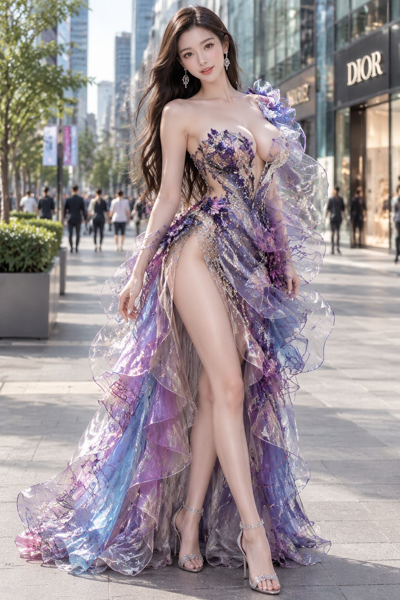

# 未来感高定礼服 × 城市街景全身人像（GPT Image）

- 原帖链接：https://x.com/MrGafish/status/2117149893399916637
- 作者：鱼哥（@MrGafish）
- 时间：2026-11-02 15:00 (UTC+8 / Asia/Taipei)
- 互动摘要：点赞 271 · 转发 6 · 回复 38 · 引用 2 · 书签 147 · 浏览 15803（采集快照：2026-11-03 09:04 UTC+8）
- 模型/工具：GPT Image（作者注明）
- 标签：真人
- 媒体路径：
  - `media/images/2117149893399916637_1.jpg`（）
- 入库日期：2026-11-03
- 备注：作者邀请他人用同一 prompt 在 GPT Image 上对比出图；prompt 位于原帖正文。下方为原帖正文原样摘录（去掉末尾 t.co 媒体短链）。

## prompt 原文

```text
有没有朋友帮个忙
也用 GPT Image 这个提示词生成图片
我想试试你们是什么效果

Prompt:

人物主体： 一位成年东亚女性，年轻貌美，长发飘逸，五官精致，妆容精致。自然站立，身体微微侧转，面向镜头，姿态优雅迷人。
服装设计： 穿着一件极具未来感的高级定制礼服，随机搭配鲜艳高级配色、金属缎面、透明薄纱、立体欧根纱、水晶、珍珠、宝石刺绣、不对称肩部、立体花朵、层叠裙摆及华丽披肩。不对称肩部及多层飘逸裙摆。裙身采用优雅的不规则高开衩设计，展现修长腿部线条。整体华丽、优雅、前卫。
背景场景： 日常现代城市街景，玻璃幕墙商业建筑、时尚店铺、城市人行道、街边绿植及远处行人。自然融入真实城市环境，呈现高级时装与日常街景的视觉反差。
构图与摄影： 竖版全身构图，人物居中，从头部到鞋子完整入镜，礼服裙摆完整呈现。自然日光，柔和光影，背景适度虚化，人物清晰突出。
摄影风格： 超写实真人摄影，电影级布光，真实细腻的皮肤质感，精致服装纹理，鲜艳饱满的色彩，8K高清质感，时尚杂志大片效果。
```

---

个人学习归档，非商业。prompt 与媒体版权归原作者 @MrGafish，引用请回到原帖。
