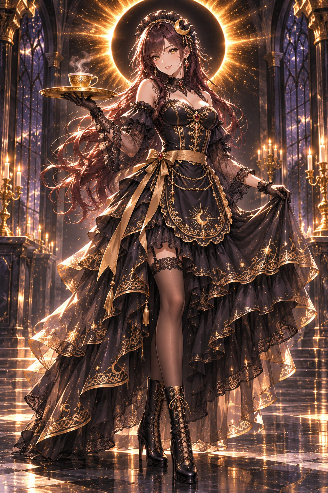
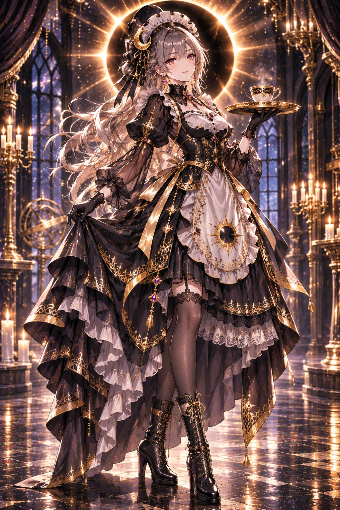
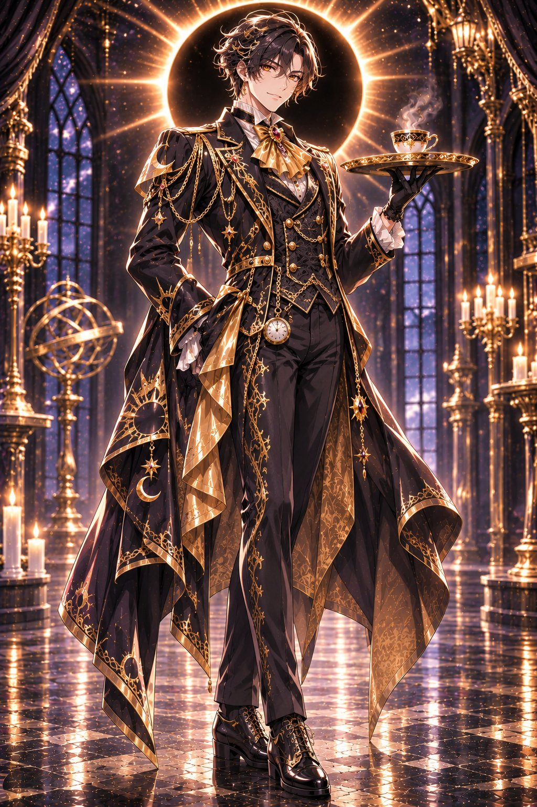

# 日蝕メイド / 日蝕バトラー：黑金日蚀光轮哥特女仆与执事

- 原帖链接：https://x.com/AIXyu1v/status/2117210138868347221
- 作者：ゆき　AIイラストXで収益化（@AIXyu1v）
- 时间：2026-11-02 19:00 (UTC+8 / Asia/Taipei)
- 互动摘要：点赞 48 · 转发 8 · 回复 4 · 引用 8 · 书签 11 · 浏览 1551（采集快照：2026-11-03 09:04 UTC+8）
- 模型/工具：未注明
- 标签：二次元
- 媒体路径：
  - `media/images/2117210138868347221_1.jpg`（）
  - `media/images/2117210138868347221_2.jpg`（）
  - `media/images/2117210138868347221_3.jpg`（）
- 入库日期：2026-11-03
- 备注：prompt 位于作者对原帖的两条自回复（女仆版、执事版）。原帖正文仅为介绍。

## prompt 原文

### 女仆版（作者自回复 https://x.com/AIXyu1v/status/2117210140919418996 ，2026-11-02 19:00 (UTC+8 / Asia/Taipei)）

```text
日蝕メイド｜Eclipse Maidプロンプト
Eclipse Maid, masterpiece anime fantasy illustration, exactly one beautiful adult woman.

Long flowing dark auburn hair, golden eyes, mysterious and elegant expression.

Luxurious jet-black gothic maid dress with intricate antique-gold eclipse and celestial embroidery, fitted bodice, layered frilled skirt, delicate black lace, sheer black chiffon sleeves, elegant black-and-gold apron, golden waist ribbons.

Black lace maid headdress decorated with a golden crescent moon, ruby-black gemstone brooch, elegant lace gloves, black heeled boots.

A magnificent glowing golden solar eclipse halo floating symmetrically behind her head, radiant corona and delicate golden particles.

Graceful full-body standing pose, holding an ornate black-and-gold tea tray with a delicate golden teacup.

Mysterious gothic palace with tall arched windows, dark marble floors, golden candles, starry shadows and dramatic eclipse light.

Vertical full-body composition, cinematic black-and-gold lighting, exquisite fabric details, elegant natural anatomy, exactly one woman, no extra limbs, no text, no watermark.
```

### 执事版（作者自回复 https://x.com/AIXyu1v/status/2117210142454513889 ，2026-11-02 19:00 (UTC+8 / Asia/Taipei)）

```text
日蝕バトラー｜Eclipse Butler　プロンプト
Eclipse Butler, masterpiece anime fantasy illustration, exactly one handsome adult man.

Short wavy midnight-black hair with subtle golden highlights, luminous amber eyes, mysterious and elegant expression.

Luxurious jet-black tailored tailcoat with intricate antique-gold solar eclipse, crescent moon and celestial embroidery, fitted black waistcoat, ivory dress shirt, golden cravat with an onyx brooch, elegant black trousers and polished leather boots.

Gold-trimmed cuffs, black gloves, delicate golden chains, celestial pocket watch and refined gothic accessories.

A magnificent glowing golden solar eclipse halo floating symmetrically behind his head, radiant corona and delicate golden particles.

Graceful full-body standing pose, holding an ornate black-and-gold silver serving tray with a delicate golden teacup.

Mysterious gothic palace with tall arched windows, dark marble floors, golden candles, starry shadows and dramatic eclipse light.

Vertical full-body composition, cinematic black-and-gold lighting, exquisite embroidery, elegant masculine proportions, natural anatomy, exactly one man, no extra limbs, no text, no watermark.
```

---

个人学习归档，非商业。prompt 与媒体版权归原作者 @AIXyu1v，引用请回到原帖。
