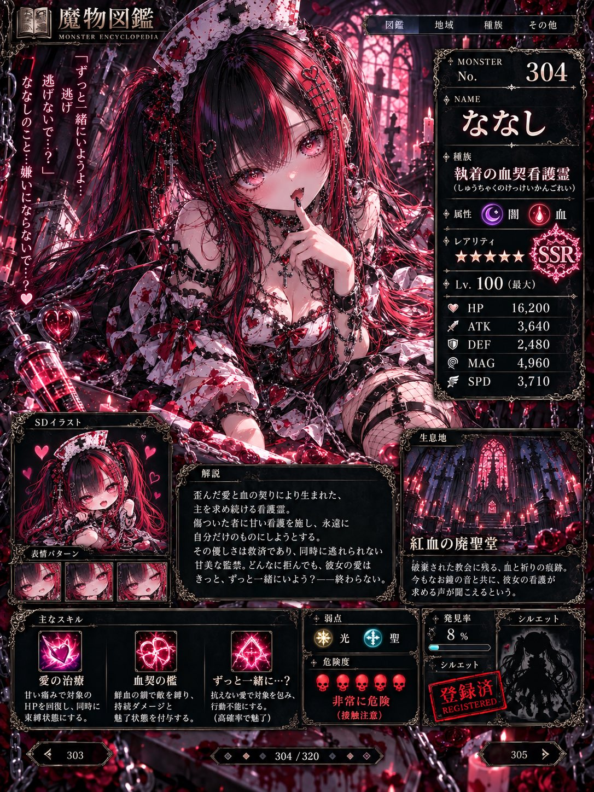
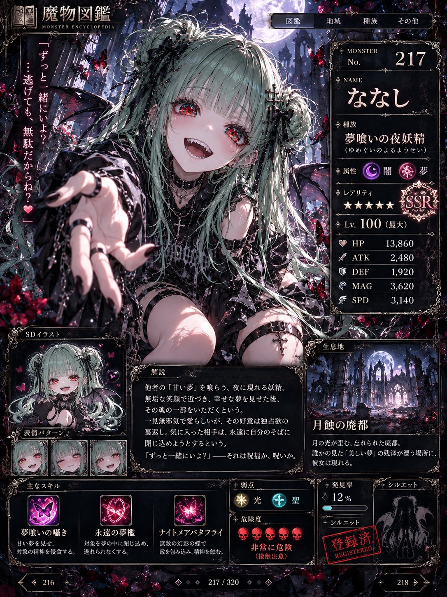
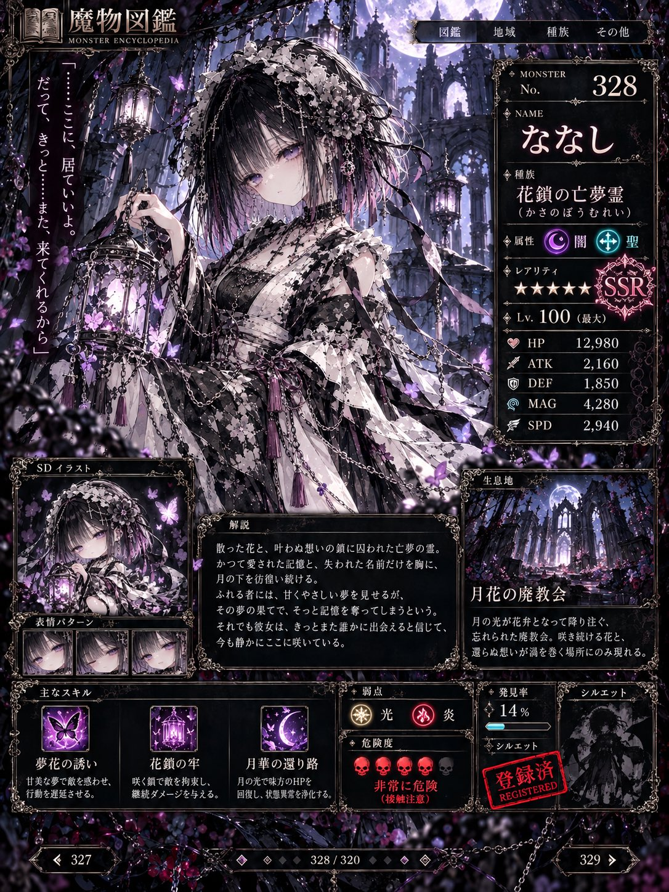
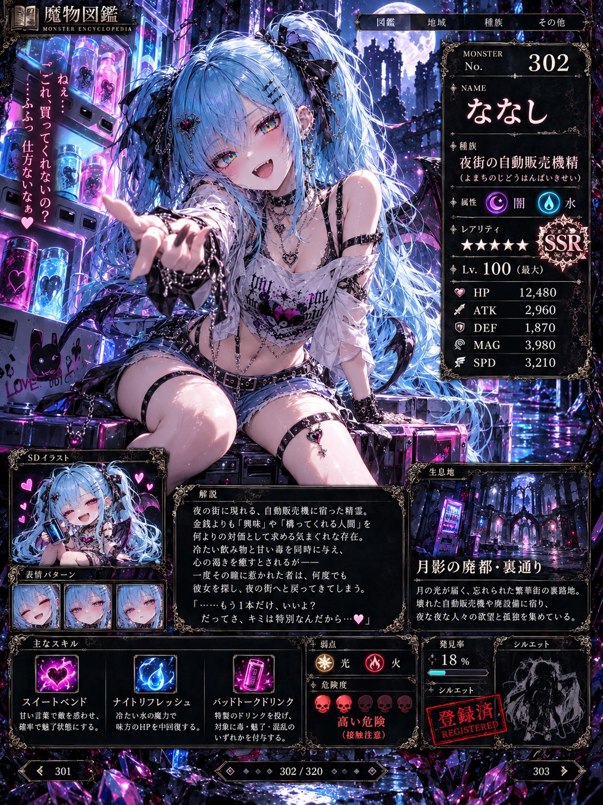

# 日式 RPG 魔物图鉴页：把自家角色做成稀有怪物（#るんプロンプト 第241弾）

- 原帖链接：https://x.com/ENJU1123PIPI/status/2117225212634648950
- 作者：るんちゃん🦋（@ENJU1123PIPI）
- 时间：2026-11-02 20:00 (UTC+8 / Asia/Taipei)
- 互动摘要：点赞 94 · 转发 17 · 回复 6 · 引用 20 · 书签 27 · 浏览 5421（采集快照：2026-11-03 20:10 UTC+8）
- 模型/工具：未注明（角色参考图驱动的通用生图 prompt）
- 标签：二次元
- 媒体路径：
  - `media/images/2117225212634648950_1.jpg`（）
  - `media/images/2117225212634648950_2.jpg`（）
  - `media/images/2117225212634648950_3.jpg`（）
  - `media/images/2117225212634648950_4.jpg`（）
- 入库日期：2026-11-03
- 备注：prompt 位于作者自回复 https://x.com/ENJU1123PIPI/status/2117225214224351566 （note_tweet）。原帖说明把「ななし」替换为自己的角色名。

## prompt 原文

```text
Use the attached image as the absolute character identity reference.

Create a spectacular JAPANESE FANTASY RPG MONSTER ENCYCLOPEDIA SCREEN featuring the character as a rare collectible monster.

CHARACTER NAME: ななし
Display this exact name prominently.

Preserve the character's face, hairstyle, hair and eye colors, proportions, accessories, and personality. Keep them cute and recognizable.

MONSTER DESIGN:
Randomly create an original species such as a demon, spirit, dragonkin, cursed doll, phantom beast, celestial familiar, cyber creature, fairy, or secret boss.

Assign 1–2 attributes from Fire, Ice, Lightning, Darkness, Light, Water, Nature, Crystal, Cosmic, Poison, Dream, Chaos, or Unknown.

Randomize the pose, expression, magical effects, and suitable monster accessories. Add subtle horns, wings, tails, or markings only when appropriate.

ENCYCLOPEDIA UI:
Design an authentic Japanese RPG bestiary interface featuring:

• MONSTER No. (random three-digit number)
• NAME (exact supplied name)
• SPECIES (original Japanese title)
• ATTRIBUTE (elemental icons)
• RARITY (N / R / SR / SSR / UR / LEGEND / ???)
• LEVEL (1–999)
• HP / ATK / DEF / MAG / SPD
• HABITAT (fantasy location)
• WEAKNESS (occasionally humorous)
• SPECIAL SKILL (original Japanese ability)
• DANGER LEVEL (D–SSS / ???)
• Short, funny or mysterious Japanese monster description

Add skill icons, rarity effects, monster silhouette, discovery percentage, and page navigation.

RANDOM UI STYLE:
Choose one:
A. Classic 16-bit pixel RPG
B. Retro handheld monster database
C. Modern ornate fantasy RPG
D. Dark gothic monster archive
E. Futuristic holographic database
F. Golden legendary discovery screen
G. Glitched secret boss interface

Match the artwork, typography, effects, and habitat to the selected style.

VISUAL QUALITY:
Premium Japanese anime illustration or authentic pixel art, intricate multicolored irises, expressive eyes, strong outlines, detailed shading, cinematic lighting, magical effects, elegant UI borders, and readable Japanese text.

The character must dominate the composition while the interface remains clear and believable.

Vertical 3:4 composition.
One character, one complete encyclopedia screen.
No collage, duplicate characters, broken anatomy, existing franchise logos, or generic poster layouts.

Make it look like an authentic rare monster entry from a high-quality Japanese fantasy RPG, with imaginative worldbuilding and unexpected humor.
```

---

个人学习归档，非商业。prompt 与媒体版权归原作者 @ENJU1123PIPI，引用请回到原帖。
