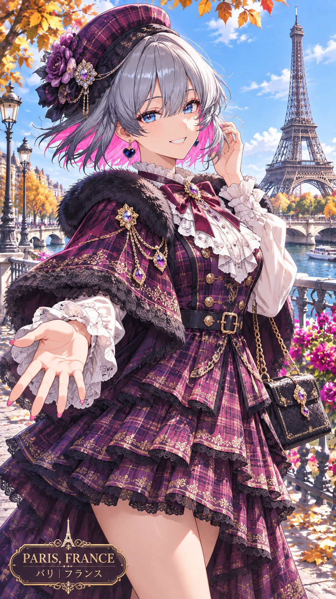

# 世界都市ランダム衣装（角色参考图 → 随机可爱衣装 + 世界名所背景）

- 原帖链接：https://x.com/naanfa257023/status/2117242630157357171
- 作者：Nia⭐︎AIart（@naanfa257023）
- 时间：2026-11-02 21:09 (UTC+8 / Asia/Taipei)
- 互动摘要：点赞 23 · 转发 7 · 回复 1 · 引用 2 · 书签 4 · 浏览 1424（采集快照：2026-11-04 09:20 UTC+8）
- 模型/工具：ChatGPT / Grok 等（帖文写「チャットGPT、Grokなど」，需附一张角色参考图）
- 标签：二次元
- 媒体路径：
  - `media/images/2117242630157357171_1.jpg`（）
- 入库日期：2026-11-04
- 备注：prompt 太长，作者分成两条自回复发布：第 1 段 https://x.com/naanfa257023/status/2117242635765309683 ，第 2 段 https://x.com/naanfa257023/status/2117242643386347604 。以下按顺序拼接原文。用法：先贴一张角色插画，再粘贴 prompt。

## prompt 原文

```text
【基本構図】

縦長9:16。
キャラクターを画面いっぱいに配置した、華やかで美しい一枚絵。
全身または膝上までを自然に収め、キャラクターの魅力と衣装のディテールを十分に見せる。
キャラクターを主役として明確に描き、背景との美しい奥行きを表現する。
単一画面の一枚絵。コマ割り、複数パネル、コラージュは禁止。

【キャラクター】

リファレンス画像のキャラクターを忠実に再現する。
顔立ち、髪型、髪色、瞳の色、体格、年齢相応の雰囲気、個性、魅力を維持する。
同一人物として認識できることを最優先する。
キャラクターの基本設定にない髪型変更、アクセサリーの勝手な追加、顔立ちの改変は禁止。
キャラクター本来のかわいらしさ、美しさ、個性を最大限に引き出す。

【衣装：AIによる完全ランダム創作】

衣装はキャラクターの外見、性格、髪色、瞳の色、雰囲気、魅力からインスピレーションを得て、AIが毎回新しいオリジナル衣装を創作する。

かわいい系ファッションを中心に、以下のジャンルから自由に選択・組み合わせる。

・ガーリー、フェミニン、姫系ファッション
・フリル、リボン、レースを使用した上品な衣装
・ロリータ、ゴシックロリータ、クラシカルロリータ
・韓国風ファッション、韓国ガーリー
・ヨーロッパ風ヴィンテージファッション
・おしゃれなワンピース、セットアップ
・ニット、カーディガン、ブラウス、スカート
・季節感のあるかわいいコーディネート
・花、動物、宝石、星、月などをモチーフにした独創的な衣装
・民族衣装や伝統衣装をかわいく現代風にアレンジしたファッション
・AI独自の創造的なオリジナルデザイン

毎回異なる衣装ジャンル、配色、素材、柄、シルエット、装飾を選択する。
キャラクターの魅力に合った色彩とデザインをAIが自動的に判断する。
衣装はかわいらしく、上品で、ファッション性が高く、完成度の高いものにする。

【衣装ディテール】

布地の質感、繊細なレース、フリル、刺繍、ボタン、リボン、アクセサリー、立体的な装飾、袖や裾のデザインまで丁寧に描き込む。
衣装の構造と着用状態を正確に表現する。
胸元は自然に覆い、露出を抑えた上品なデザインにする。
衣装のディテールが背景に埋もれないよう、色彩とコントラストを調整する。

【背景：世界の都市からランダム選択】

背景は世界中の都市・観光地・美しい景観からAIが毎回ランダムに選択する。

選択対象は以下に限定せず、世界中から自由に発想する。

・日本の美しい街並み、神社、寺院、庭園、温泉街
・フランス、パリ、コルマールなどのヨーロッパの街並み
・イタリア、ヴェネツィア、フィレンツェなどの歴史都市
・イギリス、ロンドン、コッツウォルズなどの美しい景観
・オーストリア、スイスなどの山岳都市や湖畔
・韓国、ソウル、釜山などの都市景観
・台湾、香港、シンガポールなどの華やかな街並み
・中国の古都、伝統建築、幻想的な庭園
・タイ、ベトナムなどの異国情緒あふれる街並み
・アメリカ、ニューヨーク、サンフランシスコなどの都市景観
・カナダ、北欧、オセアニアなどの自然と都市
・世界の美しい海岸、花畑、湖、山岳地帯、歴史的建築

都市名、建築様式、景観、季節、時間帯をAIが毎回ランダムに選択する。
実在する都市の場合は、その土地の特徴的な景観、建築、街並みを可能な限り正確に描写する。
毎回異なる国・都市・風景を積極的に選び、同じ背景の繰り返しを避ける。

【背景と衣装の融合】

選ばれた背景の文化、気候、季節、色彩、雰囲気を参考にしながら、キャラクターの衣装を自然に調和させる。
ただし、背景の文化に衣装を完全に固定せず、現代ファッション、かわいい系、独創的なデザインを自由に融合する。
背景と衣装の色が同化しないよう、視認性と美しい色彩バランスを重視する。

【季節・時間帯・天候】

季節、時間帯、天候もAIがランダムに選択する。

春の花々、夏の青空、秋の紅葉、冬の雪景色。
朝の柔らかな光、昼の鮮やかな日差し、夕暮れの黄金色、夜の幻想的なイルミネーション。
晴天、薄曇り、雨上がり、雪、幻想的な霧など。

選ばれた環境に応じて、光、影、空気感、背景の色彩を自然に変化させる。

【ポーズ・表情】

ポーズと表情は毎回ランダムに変更する。
かわいらしい笑顔、微笑み、恥じらい、楽しそうな表情、少し大人びた表情など、キャラクターに最も似合うものをAIが選択する。

立ち姿、振り返り、歩いている瞬間、軽く手を振る、スカートや袖を自然に持つ、髪を風になびかせる、かわいらしい仕草など。
ポーズと表情の組み合わせを毎回変化させる。
自然な身体構造、正確な手指、人体の整合性を厳守する。
衣装の美しいシルエットとキャラクターの魅力が際立つポーズにする。

【仕上げ】

キャラクター、衣装、背景、光、色彩が一体化した完成度の高い芸術作品。
繊細な布地の質感、美しい髪の光沢、透明感のある瞳、自然な肌の陰影、背景の建築や風景のディテールを丁寧に描き込む。
キャラクターを最も美しく見せる構図とライティング。
背景は適度な奥行きと描写を持たせつつ、キャラクターの視認性を優先する。
SNSで思わず目を引く、かわいらしく華やかで、独創的かつ美しいイラストに仕上げる。

余計な人物を追加しない。
不要な文字、ロゴ、透かしを入れない。
キャラクターの顔、髪、体格、個性を改変しない。
衣装と背景は毎回新しく創作する。
同じ衣装、同じ構図、同じ背景の繰り返しを極力避ける。

【背景の場所の明確化・観光地の認識性】

背景は単に美しい街並みを描くだけでなく、実在する国・都市・観光名所がイラストを見ただけで分かるように描写することを最優先する。

毎回、世界中の実在する都市・観光地・歴史的建築・名所からランダムに1か所を選択する。

選択した場所について、以下の特徴を積極的に画面内へ取り入れる。

・その場所を象徴する有名な建築物、ランドマーク
・独特な建築様式、街並み、景観
・地域特有の橋、塔、城、寺院、広場、街灯など
・その土地ならではの自然景観や地形
・現地の文化や歴史を感じさせる背景要素

観光地の象徴的なランドマークを、キャラクターの背後または画面奥に明確に配置する。
建築物の形状、色彩、特徴的なシルエットを正確に再現し、背景だけでも訪問先を認識できるほどの描写を目指す。

背景のランドマークを人物や装飾で隠さない。
キャラクターを主役にしながらも、訪問先の景観が十分に見える構図を採用する。
背景を単なる抽象的な美しい景色にしないこと。

【訪問先の情報表示】

イラストの下部、上部の余白、または背景の自然な位置に、訪問先を示す小さな旅行雑誌風の情報表示を追加してもよい。

表示例：
VENICE, ITALY
ヴェネツィア｜イタリア

PARIS, FRANCE
パリ｜フランス

PRAGUE, CZECHIA
プラハ｜チェコ

KYOTO, JAPAN
京都｜日本

表示は上品で洗練されたタイポグラフィを使用し、イラストの美しさを損なわない。
文字は正確に表示し、誤字、文字化け、不自然な文字列を禁止する。
不要なロゴ、広告、装飾文字は追加しない。

最重要：毎回選択した実在の場所と、その場所を象徴するランドマークの組み合わせが一致すること。架空の観光地や別の都市の建築物を混在させない。

【ランダム生成の最重要ルール】
毎回の生成開始時に、衣装ジャンル、衣装カラー、衣装デザイン、背景の国、都市、景観、季節、時間帯、天候、ポーズ、表情をそれぞれ独立してランダムに再選択する。過去の生成結果を引き継がず、新しい組み合わせを積極的に創造する。キャラクターの個性を起点に、毎回まったく異なるファッションと世界観を生み出すこと。
```

---

个人学习归档，非商业。prompt 与媒体版权归原作者 @naanfa257023，引用请回到原帖。
