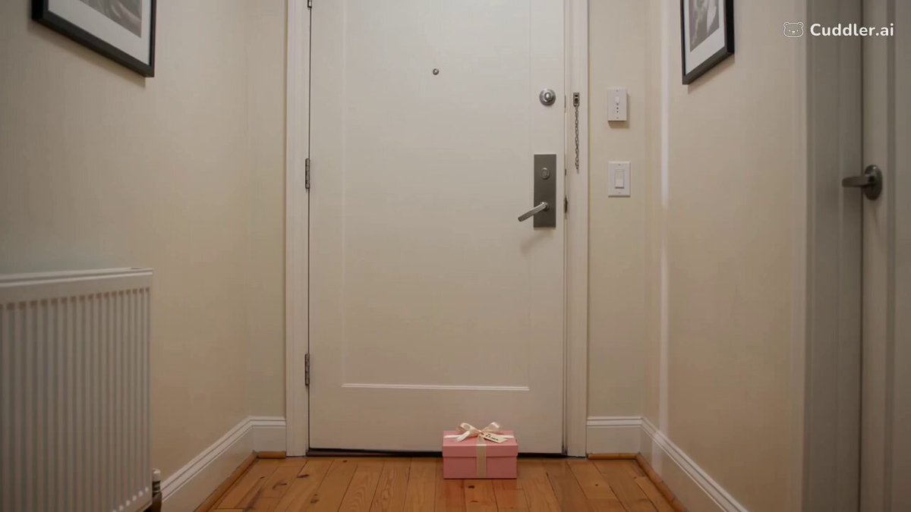

# The Little Delivery：30 秒竖屏温情短片

- 原帖链接：https://x.com/AynahhX/status/2117443820287644037
- 作者：Aynah（@AynahhX）
- 时间：2026-11-03 10:28 (UTC+8 / Asia/Taipei)
- 互动摘要：点赞 50 · 转发 1 · 回复 38 · 引用 0 · 书签 2 · 浏览 812（采集快照：2026-11-04 09:20 UTC+8）
- 模型/工具：Seedance 2.5（CuddlerAI 平台）
- 标签：真人
- 媒体路径：
  - `media/video-stills/2117443820287644037_1.jpg`（）
  - 视频本体仅保留原帖链接，未存入仓库。
- 入库日期：2026-11-04
- 备注：视频条目：仓库只保留原帖链接与封面截图，不存视频文件。prompt 位于作者自回复 https://x.com/AynahhX/status/2117443869843341634 。

## prompt 原文

```text
Create a 30-second ultra-realistic cinematic short movie titled "The Little Delivery".

FORMAT:
Vertical 9:16, 4K quality, realistic human movements, cinematic storytelling, natural soft lighting.

MAIN CHARACTER:
A beautiful young adult woman with long dark brown wavy hair, hazel eyes and natural skin texture. Wearing a stylish beige trench coat, white top, blue jeans and white sneakers. Maintain exactly the same face, hairstyle and outfit in every scene.

SCENE 1 (0–6 seconds):
A beautiful modern apartment hallway. The woman opens her apartment door and discovers a small elegant pink gift box placed outside. She looks surprised and picks it up.

Dialogue:
"Wait... I didn't order anything!"

SCENE 2 (6–12 seconds):
Close-up of the gift box. A small handwritten tag reads "For Emma". The woman looks around the hallway, wondering who it belongs to.

Dialogue:
"Emma? Who's Emma?"

SCENE 3 (12–18 seconds):
She walks through a beautiful modern neighborhood carrying the gift box. She asks a friendly elderly shopkeeper about Emma. Natural street activity, cinematic tracking shots.

Dialogue:
"Excuse me, do you know someone named Emma?"

SCENE 4 (18–24 seconds):
A little girl standing outside a colorful flower shop suddenly notices the gift box. Her face lights up with excitement. The woman kneels slightly and hands her the box.

Dialogue:
"Is this yours?"

SCENE 5 (24–30 seconds):
The little girl opens the box and reveals a beautiful tiny teddy bear. She smiles happily and gives the woman a small thank-you card. Close-up of the card reading "You're someone's little surprise too!"

The woman smiles warmly.

FINAL DIALOGUE:
"Well... that made my day."

AUDIO:
Light cheerful cinematic instrumental music, soft piano and acoustic guitar, natural street ambience, realistic footsteps and subtle sound effects.

VISUAL STYLE:
Premium Hollywood family movie cinematography, natural daylight, warm neutral colors, realistic expressions, smooth camera movements, detailed environments, beautiful depth of field.

IMPORTANT:
Keep character consistency in all scenes. Natural acting, realistic dialogue lip-sync, no exaggerated expressions, no fantasy effects, no logos, no brand names and no watermarks.
```

---

个人学习归档，非商业。prompt 与媒体版权归原作者 @AynahhX，引用请回到原帖。
