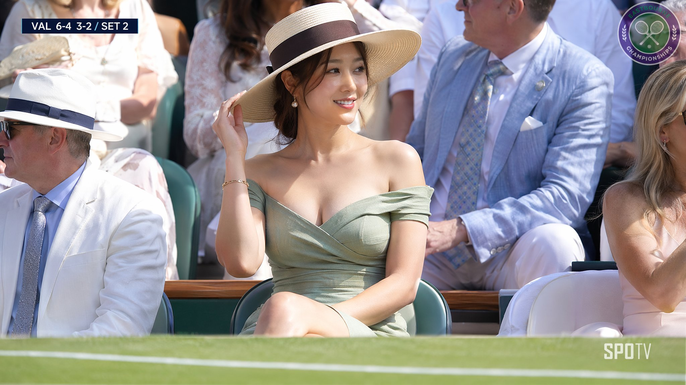
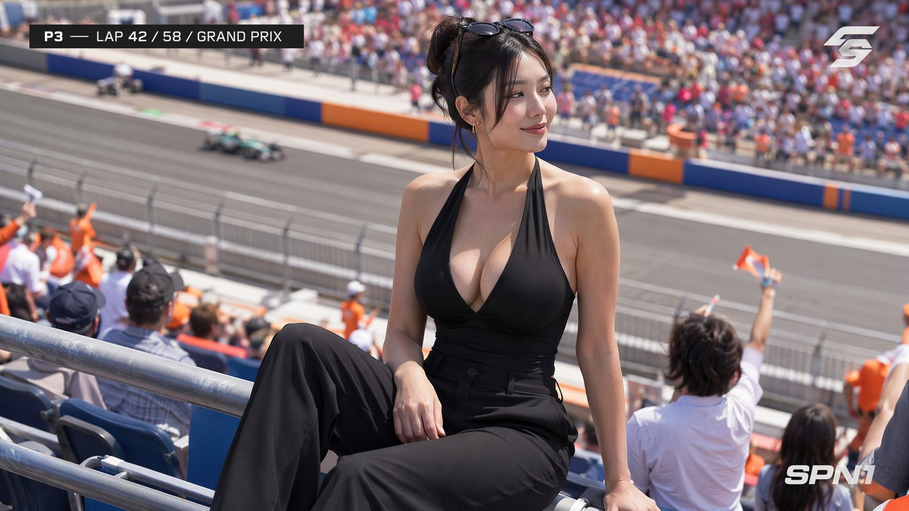
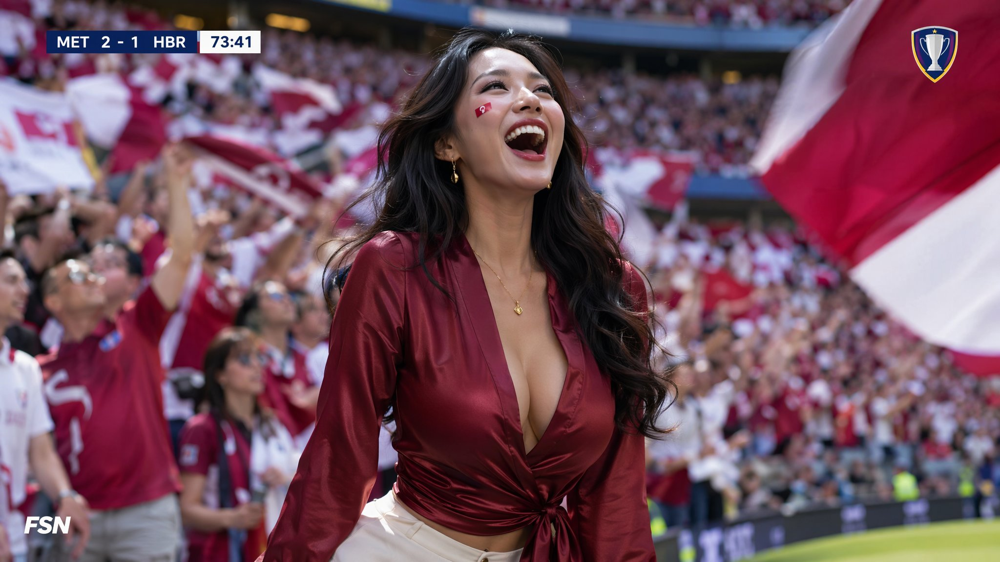

# 高级感 AI 人像 8 维提示词框架（GPT Image，中文长帖）

- 原帖链接：https://x.com/AYi_AInotes/status/2117508777062584363
- 作者：AYi（@AYi_AInotes）
- 时间：2026-11-03 14:46 (UTC+8 / Asia/Taipei)
- 互动摘要：点赞 677 · 转发 82 · 回复 105 · 引用 41 · 书签 833 · 浏览 119002（采集快照：2026-11-04 20:10 UTC+8）
- 模型/工具：GPT Image（作者经 Flatkey 平台调用；文中称用 Fable 5.5 打磨提示词）
- 标签：真人
- 媒体路径：
  - `media/images/2117508777062584363_1.jpg`（）
  - `media/images/2117508777062584363_2.jpg`（）
  - `media/images/2117508777062584363_3.jpg`（）
- 入库日期：2026-11-04
- 备注：prompt 原文即主帖正文中 8 个维度的英文关键词示例，按原帖整段摘录（含作者对其所用平台的推广段落，未删改）。作者称完整英文 prompt 在一楼，本次未取到一楼的完整英文 prompt，故只收正文版本。

## prompt 原文

```text
全体起立！！开源我的8 维高级独家AI美女人像生图焚决！！（附本人10年人像写真摄影老法师用Fable 5.5 打磨的独家顶级美女人像提示词）

兄弟们有没有想过，为什么你跑出来的 AI 人像总是一股油腻的塑料感和假人味？
因为你还在用空泛的形容词，而没有用真实的摄影物理语言去约束 AI。

分这套沉淀了 8 个维度的AI生图框架心法与批量流水线，能够彻底把 AI 视觉质感拉到顶级水准，

照着这套框架套词，出来的质感直接拉满：

1️⃣ 气质与影调定人设：拒绝空泛的漂亮标签，用具体阶层气质锚定气场，比如 25-year-old East Asian woman, old-money relaxed elegance, editorial fashion portrait。

2️⃣ 面料垂坠替代直白形容：高级感来自物理材质的重量，比如 raw silk, fitted merino knit, subtle collarbone shadow, tailored silhouette。

3️⃣ 抓拍微表情消除死鱼眼：指定瞬间的真实情绪，彻底告别僵硬摆拍，比如 candid moment, soft knowing glance, caught mid-reaction, unaware of the camera。

4️⃣ 电影级光学镜头语言：让画面拥有真实相机的光学景深，比如 85mm portrait lens, f/1.8 shallow depth of field, subtle film grain, natural optical compression。

5️⃣ 方向性光影雕刻皮肤呼吸感：用侧光和轮廓光保留真实毛孔肌理，比如 soft diffuse directional light, gentle rim light, authentic skin texture with visible pores and natural highlights。

6️⃣ 柔和散焦托出主体：环境必须克制且有景深层次，比如 soft morning cafe ambiance, muted warm background bokeh, natural depth。

7️⃣ 克制松弛卡死审美下限：拒绝夸张五官与过度浓妆，追求自然耐看，比如 classy, effortless beauty, understated luxury, natural proportions。

8️⃣ 工业级负面词筑起防火墙：强行拦截各类变形和 CGI 质感，卡死 no plastic skin, no doll face, no extra limbs, no 3D render look, no over-smoothed texture。

有了好提示词，怎么以极低成本批量测试并跑通工作流，才是持续起号的关键。

天天到处开不同工具会员不仅月费极高，频繁切后台更会打碎所有创作节奏。

我自己最近主力在跑的多模态底座是 Flatkey（1 ），对于天天折腾多模态创作和批量做图的人来说，确实是目前极省心也极划算的解法：

→ 官方模型，更低开销：每天价格比官方直连低至少 20%，最实用的是失败请求按 0 美元计费，多轮调试提示词完全没有心理负担。

→ 全模态一站式搞定：聚合了 100 多个官方模型，生图调 GPT Image，做视频用 Seedance，写文案切 Claude 和 GPT，一个 Key 搞定所有环节。

→ 自动化流水线丝滑：通过 Flatkey CLI 工具，可以直接让 Claude Code 或 Codex 自动批量调用模型批量产图和生成视频，把内容流水线彻底跑通。

→ 开发者零门槛平替：完全兼容 OpenAI 接口规范，现有脚本改个请求地址就能无缝迁移，带 99.5% 稳定性保障。

把生图审美参数化，再把工具链成本打下来，自媒体起号才能真正变成确定性的持续复利。

配图的几组实测大片案例与完整英文 Prompt 整理在一楼，大家现在生图最常卡在哪个环节？欢迎交流，我一定无保留分享。

这是在 Flatkey 用 GPT Image 跑出来的赛道看台美女人像，没有任何后期修图和局部重绘，纯 Prompt 直出，零塑料假面感，光影肌理完全就是顶级长焦转播机位的抓拍质感。
```

---

个人学习归档，非商业。prompt 与媒体版权归原作者 @AYi_AInotes，引用请回到原帖。
