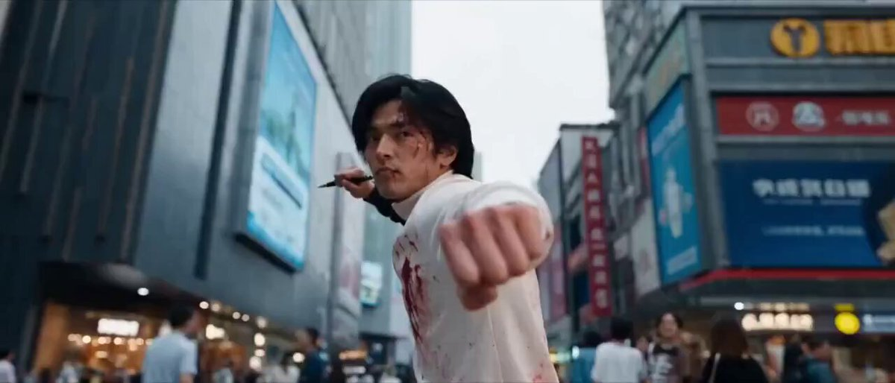

# 霓虹黄昏城市街道 FPV 穿梭一镜到底（Seedance 2.5）

- 原帖链接：https://x.com/md_raza3737/status/2117544762484162842
- 作者：Mr. jack（@md_raza3737）
- 时间：2026-11-03 17:09 (UTC+8 / Asia/Taipei)
- 互动摘要：点赞 1053 · 转发 66 · 回复 42 · 引用 4 · 书签 428 · 浏览 995995（采集快照：2026-11-04 20:10 UTC+8）
- 模型/工具：Seedance 2.5
- 标签：其它
- 媒体路径：
  - `media/video-stills/2117544762484162842_1.jpg`（）
  - 视频不入库，只保留原帖链接；上面的 `media/video-stills/` 为视频封面截图。
- 入库日期：2026-11-04
- 备注：prompt 在作者自回复，去掉开头的「Prompt ⤵️」行。

## prompt 原文

```text
A fast-paced, ultra-realistic cinematic FPV drone shot flying swiftly through a crowded, bustling modern urban city street at dusk. The camera moves forward at high speed with smooth, dynamic motion, weaving effortlessly between pedestrians, narrowly passing moving public buses, colorful cars, motorcycles, bicycles, and street performers. The drone dives low toward the wet asphalt, glides past busy storefronts, then rises smoothly above the crowd before banking sharply around a street corner.
Vibrant neon signs, glowing billboards, illuminated shop windows, colorful traffic lights, and reflections on the slightly wet road create a visually stunning cinematic atmosphere. Pedestrians walk naturally, vendors serve customers, street musicians perform, and vehicles move through the busy intersection. The camera passes extremely close to the surrounding objects, creating an intense sense of speed, depth, and immersion while maintaining realistic distances and avoiding collisions.
The drone performs rapid directional changes, smooth banking turns, low-altitude swooping movements, and breathtaking transitions through narrow gaps between buildings and traffic. Natural motion blur, realistic reflections, detailed architecture, atmospheric haze, subtle lens flares, dramatic dusk lighting, rich colors, and shallow depth of field enhance the visual experience.
The shot begins with a fast forward flight at street level, accelerates through the busiest section of the street, makes a smooth sweeping turn around a city bus, and finishes with a dramatic upward climb revealing the glowing skyline and endless city lights in the background. One continuous, uninterrupted FPV drone take, seamless camera movement, photorealistic details, professional action-movie cinematography, immersive perspective, HDR, ultra-sharp textures, 4K resolution, 60 FPS, cinematic color grading, realistic physics, no cuts, no flickering, no distorted objects, no artificial-looking pedestrians, no text, no watermark.
```

---

个人学习归档，非商业。prompt 与媒体版权归原作者 @md_raza3737，引用请回到原帖。
