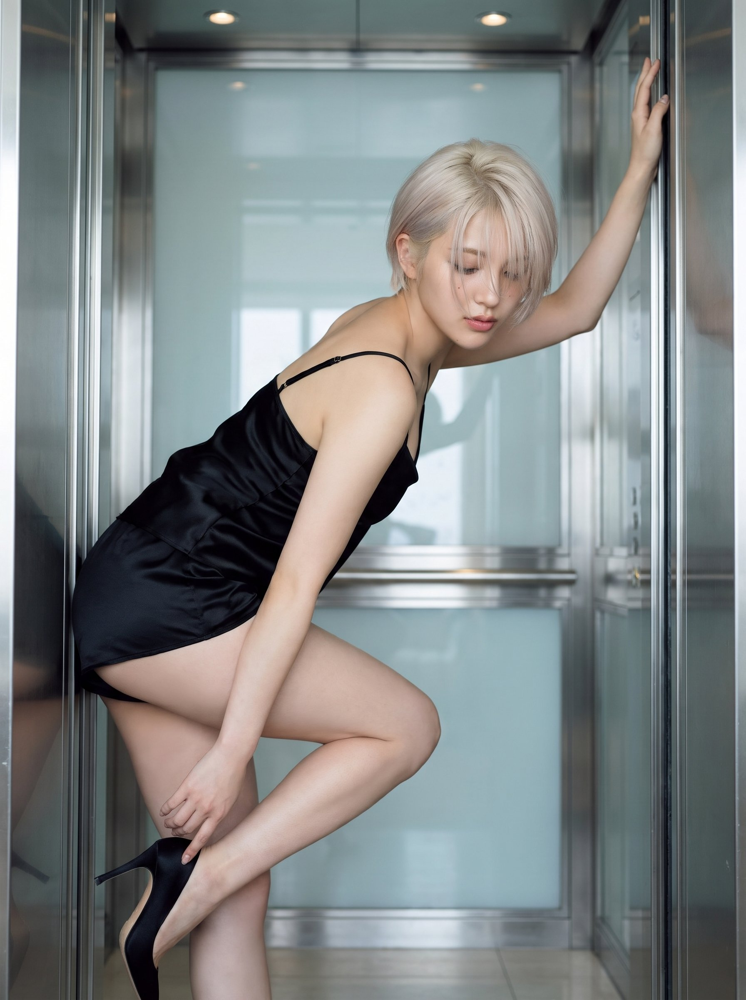

# The Shape of Waiting：电梯里的黑色缎面时装大片

- 原帖链接：https://x.com/SakiH_AI/status/2117607130685698253
- 作者：Saki H. 咲希（@SakiH_AI）
- 时间：2026-11-03 21:17 (UTC+8 / Asia/Taipei)
- 互动摘要：点赞 36 · 转发 3 · 回复 2 · 引用 0 · 书签 17 · 浏览 1020（采集快照：2026-11-04 09:20 UTC+8）
- 模型/工具：Gemini Nano Banana Pro
- 标签：真人
- 媒体路径：
  - `media/images/2117607130685698253_1.jpg`（）
  - `media/images/2117607130685698253_2.jpg`（）
- 入库日期：2026-11-04
- 备注：prompt 位于原帖正文（「Prompt 👇」之后），以下为正文原样摘录。

## prompt 原文

```text
Soft glam fashion editorial. A young woman with short platinum blonde pixie and side-swept bangs inside the elevator of an Apple-Store-like prestigious luxury hotel. She wears a black stretch silk satin camisole, and a black silk shorts, black high heels. Her eyes softly opened or obscured by strands of hair, with a cool yet flirtatious expression. Bending herself low and raising her hip to touch her heel, hand pressing waist and touching high heels and adjusting, pressing her body against the fully opened elevator door with straight arms raised and raised hips, back and hip facing the elevator door direction.
```

---

个人学习归档，非商业。prompt 与媒体版权归原作者 @SakiH_AI，引用请回到原帖。
