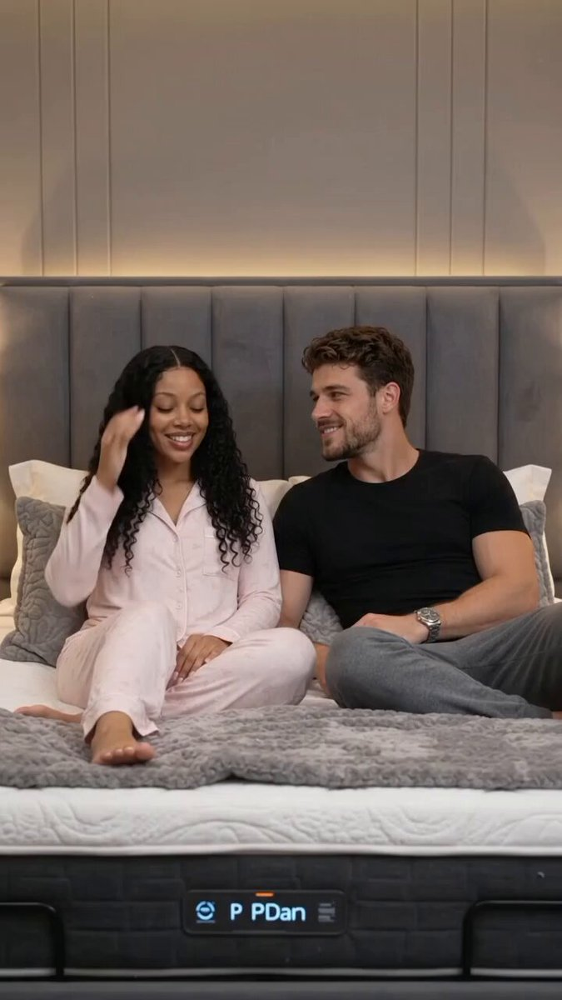

# 地震防护智能床：30 秒未来感广告短片

- 原帖链接：https://x.com/claire44/status/2117663533240340862
- 作者：Claire（@claire44）
- 时间：2026-11-04 01:01 (UTC+8 / Asia/Taipei)
- 互动摘要：点赞 28 · 转发 20 · 回复 15 · 引用 0 · 书签 9 · 浏览 634（采集快照：2026-11-04 09:20 UTC+8）
- 模型/工具：Google Flow（Omni 1.1 Flash）出视频；Nano Banana Pro 出图
- 标签：其它
- 媒体路径：
  - `media/video-stills/2117663533240340862_1.jpg`（）
  - 视频本体仅保留原帖链接，未存入仓库。
- 入库日期：2026-11-04
- 备注：视频条目：仓库只保留原帖链接与封面截图，不存视频文件。prompt 分两条自回复：https://x.com/claire44/status/2117664775215697983 与 https://x.com/claire44/status/2117664799664353336 ，以下按顺序拼接原文。

## prompt 原文

```text
THE EARTHQUAKE PROOF SMART BED

30 Second Futuristic AI Commercial

VIDEO SPECIFICATIONS

Duration: 30 seconds
Aspect ratio: 9:16 vertical
Resolution: 4K
Style: Photorealistic cinematic live action, premium futuristic product commercial.

Create one continuous 30 second commercial with realistic movement, consistent characters and a consistent product design.

CHARACTERS AND WARDROBE

Wife: Beautiful Black woman in her late 20s, warm brown skin, long black curly hair with a middle part, brown eyes and natural makeup. Wearing a pink floral long sleeve pajama set and delicate silver necklace.

Husband: Handsome white man in his late 20s, fair skin, short naturally wavy brown hair and neatly groomed beard. Wearing a fitted black short sleeve T shirt, grey lounge pants and silver wristwatch.

Preserve their faces, hairstyles, skin tones, body proportions and clothing throughout the video.

SMART BED DESIGN

A luxurious futuristic king size smart bed with a sophisticated metallic frame, illuminated blue light strips and an advanced automatic protective enclosure. The enclosure has reinforced metallic panels, mechanical hinges, hydraulic systems and transparent viewing sections.

TIMED VIDEO ACTION

00:00 to 00:03

The couple relaxes comfortably together on the futuristic smart bed in an elegant modern bedroom at night. They smile and talk naturally. The camera slowly pushes closer.

00:03 to 00:06

The room begins trembling gently. The couple notices the movement and exchanges concerned looks. The bed starts vibrating.

00:06 to 00:10

The earthquake becomes intense. The walls tremble and subtle cracks appear. The bed shakes visibly. The couple moves closer and holds each other tightly. Furniture and lamps shake but remain standing. Nothing falls yet.

00:10 to 00:13

The smart bed activates. Blue illuminated strips light up across the metallic frame. Mechanical systems underneath the mattress activate. Metallic components slide outward and hydraulic pistons extend.

00:13 to 00:17

Large reinforced metallic panels rise from both sides of the bed. Additional panels unfold from the headboard and footboard. Mechanical arms, hinges and hydraulic systems move realistically.

00:17 to 00:20

The protective panels gradually curve inward above the couple. The mechanical sections connect and lock together, forming a complete armored protective enclosure around the bed. The couple remains safely inside.

00:20 to 00:23

The earthquake reaches its strongest point. Large pieces of ceiling material and concrete debris crash onto and around the exterior of the enclosure. The armored structure absorbs the impacts and remains intact. The couple holds each other safely inside.

00:23 to 00:25

The earthquake gradually stops. Dust settles around the enclosure. Blue illuminated strips remain active. The couple looks relieved.

00:25 to 00:28

The smart bed automatically activates its release system. Mechanical locks disengage. The front metallic panels separate and slide outward along their built in tracks. Upper panels lift and fold back using visible hinges and hydraulic mechanisms. Side panels retract smoothly while remaining attached to the bed.

The enclosure must physically open through visible mechanical movement. It must not simply disappear.

00:28 to 00:30

The enclosure finishes opening, revealing the couple sitting safely on the mattress in the damaged bedroom. The wife smiles at her husband and says, "Best bed ever!" The husband laughs and gently hugs her.

End with a cinematic product reveal showing the fully opened smart bed and its mechanical panels folded neatly around the frame.

AUDIO AND SOUND DESIGN

00:00 to 00:10: Soft bedroom ambience, natural couple interaction, earthquake rumbling and structural creaking.

00:10 to 00:20: Mechanical activation, hydraulic movement, metallic panels sliding and locking.

00:20 to 00:25: Heavy environmental impacts, earthquake rumbling fading and dust settling.

00:25 to 00:30: Mechanical release sounds, panels opening, wife's dialogue and husband's laughter.

VISUAL QUALITY AND CONTINUITY

Photorealistic human characters, realistic skin textures, natural facial expressions, realistic hands and body movements, detailed metallic surfaces, believable mechanical engineering, cinematic camera movements, dramatic lighting and premium futuristic advertising quality.

Maintain the same couple, faces, hairstyles, skin tones, body proportions, clothing, bedroom and smart bed design throughout.

No character replacement, no face changes, no wardrobe changes, no duplicate characters, no disappearing characters, no cartoon appearance, no unrealistic mechanical movements, no extra people, no text, no subtitles, no logos and no watermark.
```

---

个人学习归档，非商业。prompt 与媒体版权归原作者 @claire44，引用请回到原帖。
